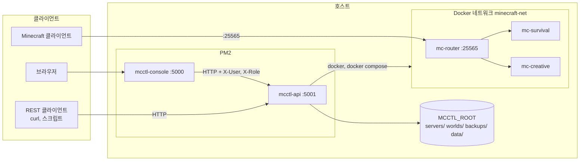
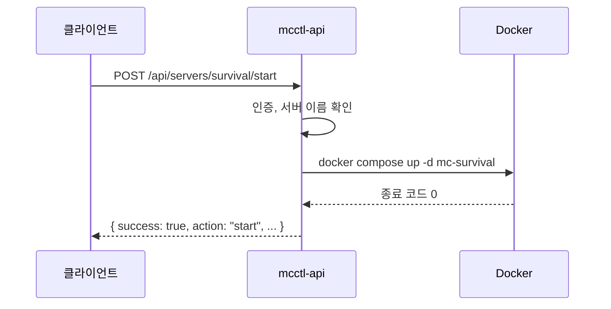
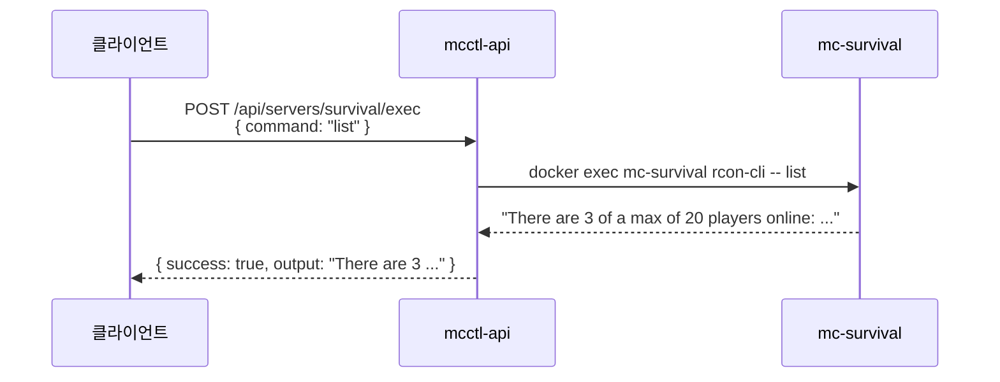
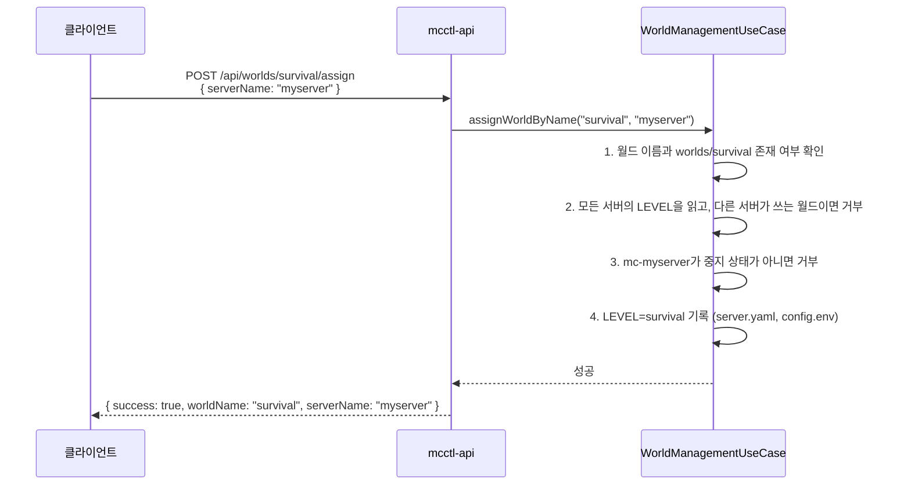
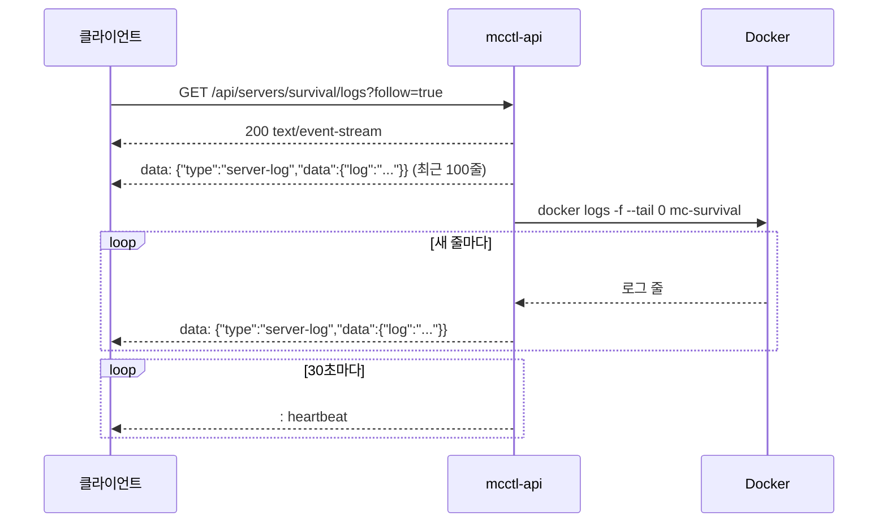

# REST API 개요

mcctl-api는 웹 콘솔이 사용하는 REST API입니다. `mcctl` CLI와 같은 코드로 서버, 월드, 플레이어, 백업, mc-router를 관리하며, 스크립트나 다른 도구에서 직접 호출할 수도 있습니다.

- **엔드포인트:** [API 엔드포인트](endpoints.ko.md)에 모든 라우트가 정리되어 있습니다.
- **기본 URL:** `http://<host>:5001`. mcctl-api는 `HOST`(기본값 `0.0.0.0`)와 `PORT`(기본값 `5001`)에서 대기합니다.

## 아키텍처 { #architecture }

mcctl-api와 웹 콘솔은 호스트에서 PM2 프로세스 `mcctl-api`와 `mcctl-console`로 실행되며, 컨테이너가 아닙니다. mcctl-api는 `MCCTL_ROOT`(기본값 `~/minecraft-servers`) 아래의 파일을 읽고 쓰며, `docker`와 `docker compose` 명령으로 컨테이너를 제어합니다. Minecraft 서버 컨테이너는 포트를 공개하지 않습니다. 플레이어는 포트 `25565`의 mc-router에 접속하고, mc-router가 호스트명에 따라 연결을 라우팅합니다.



### 요청 흐름 { #request-flows }

**서버 시작**



**RCON 명령 실행**



**월드 할당**



**서버 로그 따라가기 (SSE)**



## 인증 { #authentication }

mcctl-api는 `AUTH_EXCLUDE_PATHS`(기본값 `/health`)에 있는 경로를 제외한 모든 요청을 확인합니다. 모드는 `AUTH_MODE`로 정합니다:

| 모드 | 조건 | 요청 헤더 |
|------|------|-----------|
| `disabled` | 없음 (개발용) | - |
| `api-key` | `AUTH_API_KEY` | `X-API-Key: <key>` |
| `ip-whitelist` | 클라이언트 주소가 `AUTH_IP_WHITELIST`에 있음 | - |
| `basic` | `AUTH_USERS`에 있는 사용자 | `Authorization: Basic <user:password의 base64>` |
| `combined` | API 키와 IP 화이트리스트를 모두 확인 | `X-API-Key: <key>` |

```bash
# api-key 또는 combined 모드
curl -H "X-API-Key: mctk_your_key_here" http://localhost:5001/api/servers

# basic 모드
curl -u admin:password http://localhost:5001/api/servers
```

API 키는 `X-API-Key` 헤더에서만 읽습니다. `Authorization: Bearer` 헤더는 받지 않습니다.

### 설정 { #auth-configuration }

아래 값은 `mcctl-api` 프로세스의 환경 변수입니다. `mcctl console init`이 `<MCCTL_ROOT>/ecosystem.config.cjs`의 `mcctl-api` 앱 `env` 블록에 기록합니다.

| 변수 | 설명 |
|------|------|
| `AUTH_MODE` | 위 모드 중 하나입니다. 비어 있거나 알 수 없는 값이면 `NODE_ENV=production`일 때 `api-key`, 그 밖에는 `disabled`입니다 |
| `AUTH_API_KEY` | `X-API-Key`와 비교하는 키입니다. `api-key`, `combined`에 필요합니다 |
| `AUTH_IP_WHITELIST` | 쉼표로 구분한 주소 또는 CIDR 범위입니다(예: `127.0.0.1,192.168.1.0/24`). `ip-whitelist`, `combined`에 필요합니다 |
| `AUTH_USERS` | `{"username": "...", "passwordHash": "<bcrypt 해시>"}`의 JSON 배열입니다. `basic`에 필요합니다 |
| `AUTH_EXCLUDE_PATHS` | 인증을 건너뛰는 경로를 쉼표로 구분해 적습니다. 기본값은 `/health,/health/`입니다 |

선택한 모드에 필요한 변수가 없으면 mcctl-api가 시작하지 않습니다.

`mcctl console init`은 접근 모드를 묻고 다음과 같이 기록합니다([접근 모드](../console/installation.ko.md)):

| `mcctl console init` 모드 | 기록되는 `AUTH_MODE` |
|---------------------------|----------------------|
| `internal` (기본값) | `127.0.0.1,::1,::ffff:127.0.0.1`을 허용하는 `ip-whitelist`: 웹 콘솔처럼 호스트 자신에서 오는 요청만 허용합니다 |
| `api-key` | 생성된 키를 쓰는 `api-key`. 키는 한 번만 출력됩니다 |
| `ip-whitelist` | 입력한 주소를 쓰는 `ip-whitelist` |
| `api-key-ip` | 생성된 키와 입력한 주소를 쓰는 `combined` |
| `open` | `disabled` |

나중에 모드나 키를 바꾸려면 `mcctl console init --force`를 실행합니다. `mcctl console api` 명령어는 `api-config.json`만 바꾸며, 실행 중인 API는 이 파일을 읽지 않습니다.

인증 실패 응답:

| 상태 | 본문 |
|------|------|
| `401` | `{"error": "AuthenticationError", "message": "Missing X-API-Key header"}` (그 밖에 `Invalid API key`, `Missing or invalid Authorization header`, `Invalid credentials`) |
| `403` | `{"error": "AuthenticationError", "message": "IP address not allowed"}` |

### 사용자와 역할 헤더 { #user-headers }

웹 콘솔은 이 헤더가 필요한 요청을 mcctl-api로 전달할 때 로그인한 사용자의 이름과 역할을 `X-User`, `X-Role`로 붙입니다. 다른 클라이언트도 아래 라우트를 쓰려면 같은 헤더를 보냅니다:

| 헤더 | 사용하는 곳 |
|------|-------------|
| `X-Role` | `DELETE /api/audit-logs`, `GET /api/platform-settings`, `PUT /api/platform-settings`는 값이 `admin`이 아니면 `error: "Forbidden"`과 함께 `403`으로 응답합니다. `GET /api/auth/me`는 이 값을 `role`로 돌려줍니다 |
| `X-User` | 파일 라우트와 `PUT /api/platform-settings`의 감사 로그 주체 `api:<user>`입니다(다른 라우트는 `api:console`을 기록합니다). `GET /api/auth/me`에 필요합니다 |

웹 콘솔에서는 콘솔이 직접 일부 작업을 관리자에게만 허용합니다. mc-router 재시작이 그 예입니다.

## 오류 { #errors }

오류는 하나의 JSON 형식을 씁니다:

```json
{
  "error": "NotFound",
  "message": "Server 'unknown' not found"
}
```

| `error` | 상태 | 의미 |
|---------|------|------|
| `BadRequest` | 400 | 라우트가 입력을 거부했습니다. 예: 월드 옵션 두 개를 함께 보낸 경우 |
| `Bad Request` | 400 | 요청이 라우트의 스키마(타입, 범위, 패턴, 필수 필드)와 맞지 않습니다 |
| `AuthenticationError` | 401, 403 | [인증](#authentication)을 참고하세요 |
| `Forbidden` | 403 | 라우트에 `X-Role: admin`이 필요하거나, 경로가 허용된 디렉터리를 벗어났습니다(파일 라우트, 지도 라우트) |
| `NotFound` | 404 | 서버, 월드, 플레이어, 파일, 스케줄 또는 항목을 찾을 수 없습니다 |
| `Not Found` | 404 | 알 수 없는 라우트입니다 |
| `Conflict` | 409 | 현재 상태 때문에 거부했습니다. 서버가 이미 있거나 실행 중인 경우, 다른 서버가 월드를 쓰는 경우, 다른 작업이 잠금을 잡고 있는 경우입니다 |
| `PayloadTooLarge` | 413 | 파일 또는 업로드가 크기 제한을 넘었습니다 |
| `InternalServerError` | 500 | 작업이 실패했습니다. 원인은 `message`에 있습니다 |
| `BadGateway` | 502 | 클라이언트 전용 모드 감지가 실패했습니다(`GET /api/mods/:slug/client-only`) |
| `ServiceUnavailable` | 503 | Docker를 조회할 수 없습니다(백업 라우트) |

몇몇 라우트(레거시 라우트, 블록 통계, 서버 작업)는 다른 이름을 씁니다. 해당 섹션에서 설명합니다.

스키마 위반은 `message`에 해당 필드를 적습니다. 일부 라우트는 `statusCode`와 `code`도 함께 돌려줍니다:

```json
{
  "statusCode": 400,
  "code": "FST_ERR_VALIDATION",
  "error": "Bad Request",
  "message": "querystring/limit must be <= 200"
}
```

알 수 없는 라우트는 `{"message": "Route GET:/api/unknown not found", "error": "Not Found", "statusCode": 404}`와 함께 `404`로 응답합니다.

### 상태 코드 { #status-codes }

| 코드 | 의미 |
|------|------|
| 200 | 성공 |
| 201 | 생성됨 (서버, 월드, 월드 업로드, 설정 스냅샷, 백업 또는 스냅샷 스케줄) |
| 204 | 삭제됨, 본문 없음 (설정 스냅샷, 설정 스냅샷 스케줄) |
| 400 | 잘못된 요청 |
| 401 | 인증되지 않음 |
| 403 | 허용되지 않은 주소, 관리자 역할 필요, 허용된 디렉터리 밖의 경로 |
| 404 | 찾을 수 없음 |
| 409 | 현재 상태와 충돌 |
| 413 | 너무 큼 |
| 500 | 작업 실패 |
| 502 | 외부 모드 소스 실패 |
| 503 | Docker를 조회할 수 없음 |

## Server-Sent Events { #sse }

스트리밍 라우트는 `Content-Type: text/event-stream`을 씁니다. 메시지 형식은 두 가지입니다:

| 형식 | 전송 형태 | 라우트 |
|------|-----------|--------|
| 이름 있는 이벤트 | `event: <name>`과 `data: <JSON>` | 서버 상태, 플레이어 목록과 실시간 위치, 라우터 상태와 로그, 감사 로그, 지도 렌더링, 블록 통계 |
| 타입 메시지 | `event:` 줄 없이 `data: {"type": "<type>", "data": {...}}` | 서버 로그(`server-log`, `connection-closed`), 서버 생성(`server-create`, `server-create-log`) |

- **하트비트.** 오래 유지되는 스트림은 30초마다 주석 줄 `: heartbeat`를 보냅니다. 감사 로그 스트림은 대신 `{"timestamp": "..."}`를 담은 `event: heartbeat`를 보냅니다. 지도 렌더링과 블록 통계 스트림은 작업이 끝나면 종료되며 하트비트를 보내지 않습니다.
- **조회 간격.** 주기적으로 조회하는 스트림은 `interval`을 밀리초로 받습니다(1000~60000, 기본값 5000). 서버 상태, 플레이어 목록, 플레이어 실시간 위치, 라우터 상태가 해당합니다.
- **연결 종료.** 연결을 끊으면 그 뒤의 주기적 조회나 `docker logs` 프로세스가 멈춥니다. 서버 생성은 클라이언트가 연결을 끊어도 계속 진행되며, 블록 통계 분석은 취소됩니다.
- **브라우저.** 브라우저의 `EventSource` API는 요청 헤더를 추가할 수 없어서 `X-API-Key`를 보낼 수 없습니다. API에 헤더가 필요 없을 때(`disabled` 또는 `ip-whitelist`)만 쓰고, 그 밖에는 `curl -N`이나 스트림 리더를 쓰는 `fetch`처럼 헤더를 설정할 수 있는 클라이언트로 스트림을 읽습니다. 웹 콘솔은 로그인한 사용자에게 자체 라우트로 스트림을 전달합니다.

```bash
curl -N -H "X-API-Key: mctk_your_key_here" \
  "http://localhost:5001/api/servers/survival/logs?follow=true&lines=50"
```

## 빠른 시작 { #quick-start }

```bash
# 1. mcctl-api와 웹 콘솔을 설정합니다.
#    API 접근 모드를 고르며, api-key 계열 모드는 키를 한 번 출력합니다.
mcctl console init

# 2. mcctl-api 시작
mcctl console service start --api

# 3. 헬스 체크 (인증 불필요)
curl http://localhost:5001/health

# 4. 서버 목록. 기본 internal 모드에서는 호스트 자신에서 보낸 요청에 키가 필요 없습니다
curl http://localhost:5001/api/servers

# api-key 또는 api-key-ip 모드에서는 키를 보냅니다
curl -H "X-API-Key: <key>" http://localhost:5001/api/servers
```

키는 `ecosystem.config.cjs`의 `mcctl-api` `env` 블록에 `AUTH_API_KEY`로도 저장됩니다.

## OpenAPI와 Swagger UI { #swagger }

Swagger UI(`/docs`)와 OpenAPI 문서(`/docs/json`)는 `NODE_ENV`가 `production`이 아니거나 `SWAGGER_ENABLED=true`일 때만 제공됩니다. `mcctl console init`은 설치된 패키지에 `NODE_ENV=production`을 설정하므로, 일반 설치에서는 제공되지 않습니다. 켜려면 `<MCCTL_ROOT>/.env`에 `SWAGGER_ENABLED=true`를 추가하고 `mcctl console service restart --api`를 실행합니다. PM2가 mcctl-api를 `MCCTL_ROOT`에서 실행하므로, mcctl-api는 시작할 때 이 파일을 읽습니다.

두 경로 모두 다른 라우트와 같은 인증을 씁니다. `api-key` 모드에서는 브라우저로 `/docs`를 바로 열 수 없으므로, `curl -H "X-API-Key: <key>" http://localhost:5001/docs/json`으로 문서를 받아 OpenAPI 뷰어에서 엽니다.

## 엔드포인트 그룹 { #endpoint-groups }

| 그룹 | 라우트 |
|------|--------|
| [헬스 체크](endpoints.ko.md#health) | `GET /health` |
| [서버](endpoints.ko.md#servers) | 목록, 상세, 상태 스트림, 생성, 삭제, 시작/정지/재시작, RCON, 로그 |
| [서버 설정](endpoints.ko.md#server-configuration) | `config.env` 설정, 월드 초기화 |
| [호스트명](endpoints.ko.md#hostnames) | 서버의 커스텀 호스트명 |
| [모드](endpoints.ko.md#mods) | 서버 모드, 설치된 jar, Modrinth 검색 |
| [파일](endpoints.ko.md#files) | `servers/<name>/data` 파일 관리 |
| [플레이어와 접근 목록](endpoints.ko.md#players) | 플레이어 목록, 플레이어 상세, 실시간 위치, 화이트리스트, 밴, 관리자, 강퇴 |
| [월드](endpoints.ko.md#worlds) | 목록, 생성, 업로드, 할당, 해제, 삭제, 월드 정보, 지도, 블록 통계 |
| [라우터](endpoints.ko.md#router) | mc-router 상태, 스트림, 재시작 |
| [백업](endpoints.ko.md#backups) | GitHub 월드 백업과 백업 스케줄 |
| [설정 스냅샷](endpoints.ko.md#config-snapshots) | 서버 설정 파일 스냅샷, 비교, 스케줄 |
| [playit.gg](endpoints.ko.md#playit) | playit-agent 상태, 시작, 정지 |
| [플랫폼 설정](endpoints.ko.md#platform-settings) | 플랫폼 `.env` |
| [감사 로그](endpoints.ko.md#audit-logs) | 조회, 통계, 스트림, 정리 |
| [레거시](endpoints.ko.md#legacy) | `/api/auth/login`, `/api/auth/me`, `/servers/:id/console/exec` |

## 다음 단계

- **[API 엔드포인트](endpoints.ko.md)**: 모든 라우트
- **[설치 가이드](../console/installation.ko.md)**: mcctl-api와 웹 콘솔 설정
- **[CLI 명령어](../console/cli-commands.ko.md)**: `mcctl console` 명령어
