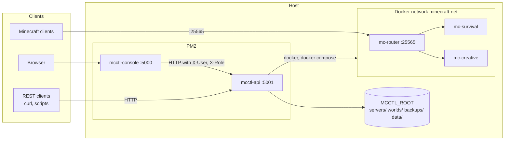
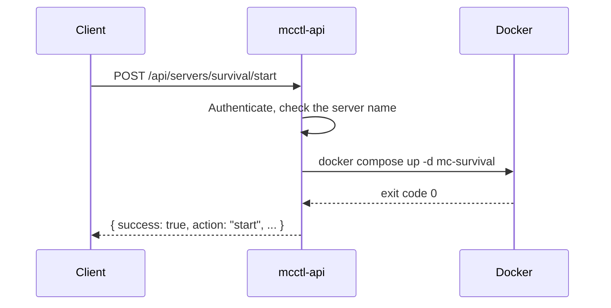
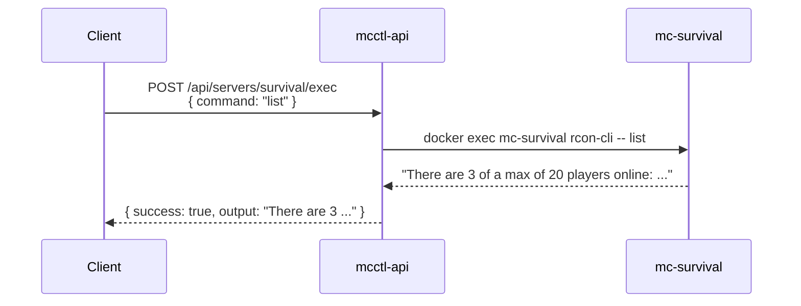
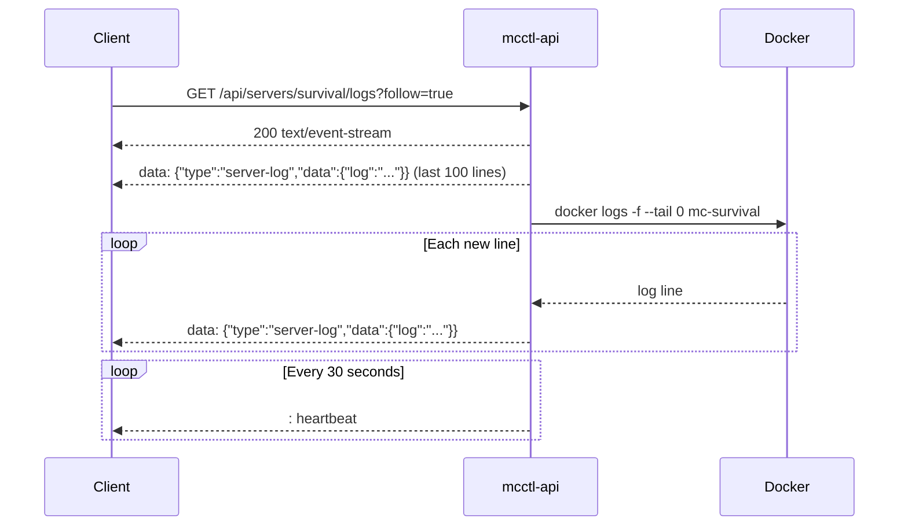

# REST API Overview

mcctl-api is the REST API behind the Web Console. It manages servers, worlds, players, backups and mc-router with the same code as the `mcctl` CLI, and you can call it directly from scripts and other tools.

- **Endpoints:** [API Endpoints](endpoints.md) documents every route.
- **Base URL:** `http://<host>:5001`. mcctl-api listens on `HOST` (default `0.0.0.0`) and `PORT` (default `5001`).

## Architecture { #architecture }

mcctl-api and the Web Console run on the host as the PM2 processes `mcctl-api` and `mcctl-console`; they are not containers. mcctl-api reads and writes the files under `MCCTL_ROOT` (default `~/minecraft-servers`) and controls containers with the `docker` and `docker compose` commands. Minecraft server containers publish no ports: players connect to mc-router on port `25565`, which routes each connection by hostname.



### Request flows { #request-flows }

**Start a server**



**Run an RCON command**



**Assign a world**

```mermaid
sequenceDiagram
    participant C as Client
    participant A as mcctl-api
    participant W as WorldManagementUseCase

    C->>A: POST /api/worlds/survival/assign<br/>{ serverName: "myserver" }
    A->>W: assignWorldByName("survival", "myserver")
    W->>W: 1. Check the world name and that worlds/survival exists
    W->>W: 2. Read every server's LEVEL; refuse if another server uses the world
    W->>W: 3. Refuse unless mc-myserver is stopped
    W->>W: 4. Write LEVEL=survival (server.yaml and config.env)
    W-->>A: success
    A-->>C: { success: true, worldName: "survival", serverName: "myserver" }
```

**Follow server logs (SSE)**



## Authentication { #authentication }

mcctl-api checks every request except the paths in `AUTH_EXCLUDE_PATHS` (default `/health`). The mode is set with `AUTH_MODE`:

| Mode | Requirement | Request header |
|------|-------------|----------------|
| `disabled` | None (development only) | - |
| `api-key` | `AUTH_API_KEY` | `X-API-Key: <key>` |
| `ip-whitelist` | The client address is in `AUTH_IP_WHITELIST` | - |
| `basic` | A user in `AUTH_USERS` | `Authorization: Basic <base64 of user:password>` |
| `combined` | API key and IP whitelist, both checked | `X-API-Key: <key>` |

```bash
# api-key or combined mode
curl -H "X-API-Key: mctk_your_key_here" http://localhost:5001/api/servers

# basic mode
curl -u admin:password http://localhost:5001/api/servers
```

The API key is read only from `X-API-Key`; an `Authorization: Bearer` header is not accepted.

### Configuration { #auth-configuration }

These are environment variables of the `mcctl-api` process. `mcctl console init` writes them to the `env` block of the `mcctl-api` app in `<MCCTL_ROOT>/ecosystem.config.cjs`.

| Variable | Description |
|----------|-------------|
| `AUTH_MODE` | One of the modes above. When unset or unknown: `api-key` if `NODE_ENV=production`, otherwise `disabled` |
| `AUTH_API_KEY` | Key compared with `X-API-Key`. Required for `api-key` and `combined` |
| `AUTH_IP_WHITELIST` | Comma-separated addresses or CIDR ranges, for example `127.0.0.1,192.168.1.0/24`. Required for `ip-whitelist` and `combined` |
| `AUTH_USERS` | JSON array of `{"username": "...", "passwordHash": "<bcrypt hash>"}`. Required for `basic` |
| `AUTH_EXCLUDE_PATHS` | Comma-separated paths that skip authentication. Default `/health,/health/` |

mcctl-api does not start when the selected mode lacks its required variable.

`mcctl console init` asks for an access mode and writes it as follows ([Access Modes](../console/installation.md#access-modes)):

| `mcctl console init` mode | `AUTH_MODE` written |
|---------------------------|---------------------|
| `internal` (default) | `ip-whitelist` with `127.0.0.1,::1,::ffff:127.0.0.1`: only clients on the host itself, such as the Web Console |
| `api-key` | `api-key` with a generated key, printed once |
| `ip-whitelist` | `ip-whitelist` with the addresses you enter |
| `api-key-ip` | `combined` with a generated key and the addresses you enter |
| `open` | `disabled` |

To change the mode or the key later, run `mcctl console init --force`. The `mcctl console api` commands only update `api-config.json`, which the running API does not read.

Authentication failures:

| Status | Body |
|--------|------|
| `401` | `{"error": "AuthenticationError", "message": "Missing X-API-Key header"}` (also `Invalid API key`, `Missing or invalid Authorization header`, `Invalid credentials`) |
| `403` | `{"error": "AuthenticationError", "message": "IP address not allowed"}` |

### User and role headers { #user-headers }

When the Web Console forwards a request that needs them, it adds the signed-in user's name and role as `X-User` and `X-Role`. Other clients send the same headers to use these routes:

| Header | Used by |
|--------|---------|
| `X-Role` | `DELETE /api/audit-logs`, `GET /api/platform-settings` and `PUT /api/platform-settings` answer `403` with `error: "Forbidden"` unless the value is `admin`. `GET /api/auth/me` returns it as `role` |
| `X-User` | Audit log actor `api:<user>` for the file routes and `PUT /api/platform-settings` (other routes record `api:console`). Required by `GET /api/auth/me` |

In the Web Console, more actions are limited to administrators by the console itself, for example restarting mc-router.

## Errors { #errors }

Errors use one JSON shape:

```json
{
  "error": "NotFound",
  "message": "Server 'unknown' not found"
}
```

| `error` | Status | Meaning |
|---------|--------|---------|
| `BadRequest` | 400 | The route refused the input, for example two world options at once |
| `Bad Request` | 400 | The request does not match the route's schema (type, range, pattern, required field) |
| `AuthenticationError` | 401, 403 | See [Authentication](#authentication) |
| `Forbidden` | 403 | The route needs `X-Role: admin`, or a path leaves the allowed directory (file and map routes) |
| `NotFound` | 404 | Server, world, player, file, schedule or entry not found |
| `Not Found` | 404 | Unknown route |
| `Conflict` | 409 | Refused because of the current state: the server exists or is running, the world is used by another server, another operation holds a lock |
| `PayloadTooLarge` | 413 | File or upload over the size limit |
| `InternalServerError` | 500 | The operation failed; `message` says why |
| `BadGateway` | 502 | Client-only mod detection failed (`GET /api/mods/:slug/client-only`) |
| `ServiceUnavailable` | 503 | Docker could not be queried (backup routes) |

A few routes use other names (the legacy routes, block statistics, server actions); their sections say so.

Schema violations name the field in `message`. Some routes also return `statusCode` and `code`:

```json
{
  "statusCode": 400,
  "code": "FST_ERR_VALIDATION",
  "error": "Bad Request",
  "message": "querystring/limit must be <= 200"
}
```

An unknown route answers `404` with `{"message": "Route GET:/api/unknown not found", "error": "Not Found", "statusCode": 404}`.

### Status codes { #status-codes }

| Code | Meaning |
|------|---------|
| 200 | Success |
| 201 | Created (server, world, world upload, config snapshot, backup or snapshot schedule) |
| 204 | Deleted, no body (config snapshot, config snapshot schedule) |
| 400 | Invalid request |
| 401 | Not authenticated |
| 403 | Address not allowed, admin role required, or path outside the allowed directory |
| 404 | Not found |
| 409 | Conflict with the current state |
| 413 | Too large |
| 500 | Operation failed |
| 502 | Upstream mod source failed |
| 503 | Docker could not be queried |

## Server-Sent Events { #sse }

Routes that stream use `Content-Type: text/event-stream`. There are two message styles:

| Style | Wire format | Routes |
|-------|-------------|--------|
| Named events | `event: <name>` and `data: <JSON>` | Server status, player roster and live positions, router status and logs, audit logs, map render, block statistics |
| Typed messages | `data: {"type": "<type>", "data": {...}}` without an `event:` line | Server logs (`server-log`, `connection-closed`), server create (`server-create`, `server-create-log`) |

- **Heartbeat.** Long-lived streams send the comment line `: heartbeat` every 30 seconds. The audit log stream sends `event: heartbeat` with `{"timestamp": "..."}` instead. The map render and block statistics streams end with their job and send no heartbeat.
- **Polling interval.** Streams that poll take `interval` in milliseconds (1000 to 60000, default 5000): server status, player roster, live player positions and router status.
- **Disconnect.** Closing the connection stops the polling or the `docker logs` process behind it. A server create keeps running after the client disconnects; a block statistics analysis is cancelled.
- **Browsers.** The browser `EventSource` API cannot add request headers, so it cannot send `X-API-Key`. Use it only when the API needs no header (`disabled` or `ip-whitelist`); otherwise read the stream with a client that sets headers, such as `curl -N` or `fetch` with a stream reader. The Web Console relays the streams to signed-in users through its own routes.

```bash
curl -N -H "X-API-Key: mctk_your_key_here" \
  "http://localhost:5001/api/servers/survival/logs?follow=true&lines=50"
```

## Quick Start { #quick-start }

```bash
# 1. Set up mcctl-api and the Web Console.
#    Choose the API access mode; the api-key modes print the key once.
mcctl console init

# 2. Start mcctl-api
mcctl console service start --api

# 3. Health check (no authentication)
curl http://localhost:5001/health

# 4. List servers. In the default internal mode, requests from the host itself need no key
curl http://localhost:5001/api/servers

# In api-key or api-key-ip mode, send the key
curl -H "X-API-Key: <key>" http://localhost:5001/api/servers
```

The key is also stored as `AUTH_API_KEY` in the `mcctl-api` `env` block of `ecosystem.config.cjs`.

## OpenAPI and Swagger UI { #swagger }

Swagger UI (`/docs`) and the OpenAPI document (`/docs/json`) are served only when `NODE_ENV` is not `production` or when `SWAGGER_ENABLED=true`. `mcctl console init` sets `NODE_ENV=production` for installed packages, so a normal install does not serve them. To enable them, add `SWAGGER_ENABLED: 'true'` to the `env` block of the `mcctl-api` app in `ecosystem.config.cjs` and run `mcctl console service restart --api --force`, which starts mcctl-api again from that file ([what `--force` stops](../console/cli-commands.md#mcctl-console-service-restart)).

Both paths use the same authentication as the other routes. In `api-key` mode a browser cannot open `/docs` directly; fetch the document with `curl -H "X-API-Key: <key>" http://localhost:5001/docs/json` and open it in an OpenAPI viewer.

## Endpoint groups { #endpoint-groups }

| Group | Routes |
|-------|--------|
| [Health](endpoints.md#health) | `GET /health` |
| [Servers](endpoints.md#servers) | List, detail, status streams, create, delete, start/stop/restart, RCON, logs |
| [Server configuration](endpoints.md#server-configuration) | `config.env` settings, world reset |
| [Hostnames](endpoints.md#hostnames) | Custom hostnames of a server |
| [Mods](endpoints.md#mods) | Server mods, installed jars, Modrinth search |
| [Files](endpoints.md#files) | File manager for `servers/<name>/data` |
| [Players and access lists](endpoints.md#players) | Roster, player detail, live positions, whitelist, bans, operators, kick |
| [Worlds](endpoints.md#worlds) | List, create, upload, assign, release, delete, world info, map, block statistics |
| [Router](endpoints.md#router) | mc-router status, streams, restart |
| [Backups](endpoints.md#backups) | GitHub world backups and backup schedules |
| [Config snapshots](endpoints.md#config-snapshots) | Snapshots of server configuration files, diff, schedules |
| [playit.gg](endpoints.md#playit) | playit-agent status, start, stop |
| [Platform Settings](endpoints.md#platform-settings) | The platform `.env` |
| [Audit logs](endpoints.md#audit-logs) | Query, statistics, stream, purge |
| [Legacy](endpoints.md#legacy) | `/api/auth/login`, `/api/auth/me`, `/servers/:id/console/exec` |

## Next Steps

- **[API Endpoints](endpoints.md)**: every route
- **[Installation](../console/installation.md)**: set up mcctl-api and the Web Console
- **[CLI Commands](../console/cli-commands.md)**: `mcctl console` commands
