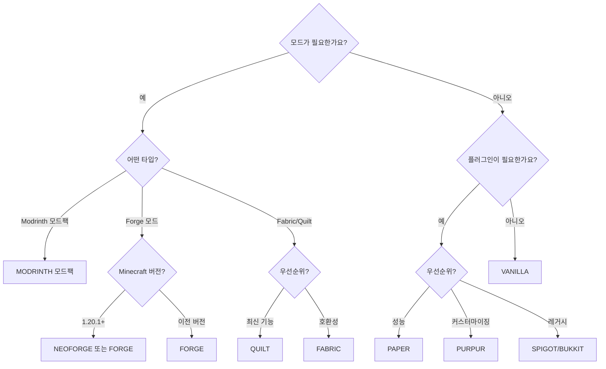

# 서버 타입

mcctl에서 지원하는 각 Minecraft 서버 플랫폼에 대한 상세 가이드입니다.

## 빠른 시작

mcctl을 사용하여 원하는 타입의 서버를 생성합니다:

```bash
# Paper (대부분의 사용자에게 권장)
mcctl create myserver -t PAPER -v 1.21.1

# Vanilla (순수 Minecraft)
mcctl create myserver -t VANILLA -v 1.21.1

# Forge (모드)
mcctl create myserver -t FORGE -v 1.20.4

# NeoForge (현대적인 Forge 포크, 1.20.1+)
mcctl create myserver -t NEOFORGE -v 1.21.1

# Fabric (경량 모드)
mcctl create myserver -t FABRIC -v 1.21.1

# Modrinth 모드팩 (이름 없이 `mcctl create`를 실행하면 대화형으로 묻습니다)
mcctl create myserver -t MODRINTH --modpack <modpack-slug>
```

## 개요

| 타입 | 플러그인 | 모드 | 성능 | 권장 용도 |
|------|----------|------|------|-----------|
| **PAPER** | 예 | 아니오 | 매우 좋음 | 일반 사용, 플러그인 |
| **VANILLA** | 아니오 | 아니오 | 좋음 | 순수 Minecraft 경험 |
| **FORGE** | 아니오 | 예 | 다양함 | Forge 모드팩 |
| **NEOFORGE** | 아니오 | 예 | 다양함 | 현대적인 Forge 모드 (1.20.1+) |
| **FABRIC** | 아니오 | 예 | 매우 좋음 | 성능 모드 |
| **MODRINTH** | 아니오 | 예 | 다양함 | Modrinth 모드팩 |
| **AUTO_CURSEFORGE** | 아니오 | 예 | 다양함 | CurseForge 모드팩 |
| **SPIGOT** | 예 | 아니오 | 좋음 | 레거시 플러그인 호환성 |
| **BUKKIT** | 예 | 아니오 | 보통 | 매우 오래된 플러그인 |
| **PURPUR** | 예 | 아니오 | 매우 좋음 | 고급 커스터마이징 |
| **PUFFERFISH** | 예 | 아니오 | 다양함 | 대규모 서버용 Paper 포크 |
| **FOLIA** | 예 | 아니오 | 다양함 | 큰 월드용 멀티스레드 Paper 포크 |
| **LEAF** | 예 | 아니오 | 다양함 | 경량 Paper 포크 |
| **QUILT** | 아니오 | 예 | 매우 좋음 | 현대적인 Fabric 대안 |

`mcctl create -t`가 받는 타입은 위와 같습니다. 이미지가 지원하는 다른 타입은 [기타 서버 타입](#기타-서버-타입)을 참고하세요.

---

## Paper

**대부분의 사용자에게 권장됩니다.**

Paper는 Bukkit 및 Spigot 플러그인을 지원하면서 상당한 성능 향상을 제공하는 고성능 Minecraft 서버입니다.

### Paper 서버 생성

```bash
mcctl create myserver -t PAPER -v 1.21.1
```

### 특징

- Vanilla 대비 상당한 성능 향상
- 완전한 Bukkit/Spigot 플러그인 호환성
- 비동기 청크 로딩
- 악용 방지 패치
- 광범위한 설정 옵션

### 권장 설정

```bash
# Aikar의 최적화된 JVM 플래그 활성화
mcctl config myserver USE_AIKAR_FLAGS true
```

### 플러그인 추가

```bash
# Modrinth에서
mcctl config myserver MODRINTH_PROJECTS "essentialsx,luckperms"

# Spigot에서
mcctl config myserver SPIGET_RESOURCES "28140,81534"

# 변경 사항 적용
mcctl stop myserver && mcctl start myserver
```

또는 플러그인 JAR 파일을 `shared/plugins/` 디렉토리에 넣습니다.

### 모범 사례

- 최적의 성능을 위해 항상 `USE_AIKAR_FLAGS=true` 활성화
- 가능한 경우 Paper 전용 플러그인 사용
- Paper의 내장 프로파일러로 모니터링: `/timings report`

---

## Vanilla

Mojang의 공식 Minecraft 서버입니다.

### Vanilla 서버 생성

```bash
mcctl create myserver -t VANILLA -v 1.21.1
```

### 특징

- 공식 Minecraft 경험
- 수정 없음
- 모든 Minecraft 기능과의 호환성 보장
- 가장 작은 용량

### 사용 사례

- 순수한 Minecraft 경험
- 바닐라 동작 테스트
- 최소한의 서버 요구사항

---

## Forge

Forge 모드를 실행하기 위한 서버입니다.

### Forge 서버 생성

```bash
mcctl create myserver -t FORGE -v 1.20.4
```

### 특징

- 대규모 모드 생태계
- 복잡한 모드팩 지원
- 산업/기술 모드
- RPG 모드

### 설정

```bash
# 메모리 설정 (모드팩은 더 많이 필요)
mcctl config myserver MEMORY 8G

# 모드 추가 (Java 17+ 이미지에서는 CF_API_KEY 선택 사항)
mcctl config myserver CURSEFORGE_FILES "jei,journeymap,create"

# 또는 특정 Forge 버전
mcctl config myserver FORGE_VERSION "47.2.0"

# 변경 사항 적용
mcctl stop myserver && mcctl start myserver
```

### Java 버전 요구사항

Forge는 해당 Minecraft 버전의 Java가 필요하며([Java 버전과 이미지 태그](#java-버전과-이미지-태그) 참고), Forge 1.16.5 이하는 Java 8에서만 실행됩니다.

!!! warning "Forge 1.16.5 이하"
    `mcctl create -t FORGE -v 1.16.5`로 만든 서버는 `java8` 이미지를 받습니다. 나중에 `VERSION`을 바꾼 서버는 이미지가 그대로이므로, `servers/<name>/server.yaml`에서 이미지를 설정한 뒤 파일을 쓰고 시작하세요:
    ```yaml
    image: itzg/minecraft-server:java8
    ```
    ```bash
    mcctl migrate spec myserver
    mcctl start myserver
    ```

### 메모리 권장사항

| 모드팩 크기 | 권장 메모리 |
|-------------|-------------|
| 가벼움 (10-30개 모드) | 4-6G |
| 중간 (30-100개 모드) | 6-8G |
| 무거움 (100개+ 모드) | 8-12G |

```bash
mcctl config myserver MEMORY 8G
```

---

## NeoForge

개선된 API와 활발한 개발이 이루어지는 현대적인 Forge 포크입니다. Minecraft 1.20.1 이상을 지원합니다.

### NeoForge 서버 생성

```bash
mcctl create myserver -t NEOFORGE -v 1.21.1
```

### 특징

- 현대적인 API로 활발한 개발
- Forge 모드 호환성 (많은 Forge 모드가 NeoForge에서 작동)
- 레거시 Forge 대비 향상된 성능
- 개선된 모드 로딩 및 의존성 관리

### 설정

```bash
# 메모리 설정 (모드팩은 더 많이 필요)
mcctl config myserver MEMORY 8G

# Modrinth에서 모드 추가
mcctl config myserver MODRINTH_PROJECTS "jei,create"

# 변경 사항 적용
mcctl stop myserver && mcctl start myserver
```

### 사용 시기

- Minecraft 1.20.1+를 대상으로 하는 새 모드 서버 프로젝트
- 현대적인 Forge API와 활발한 커뮤니티 개발을 선호하는 경우
- 레거시 Forge 대비 향상된 성능을 원하는 경우

!!! note "Minecraft 버전 요구사항"
    NeoForge는 Minecraft 1.20.1 이상이 필요합니다. 이전 버전의 경우 FORGE를 사용하세요.

---

## Modrinth 모드팩

Modrinth 모드팩으로 서버를 생성합니다. 모드팩에는 필요한 모든 모드, 설정, 구성이 미리 포함되어 있습니다.

### Modrinth 모드팩 서버 생성

```bash
# Modrinth URL의 모드팩 slug로 생성
mcctl create myserver -t MODRINTH --modpack <modpack-slug>

# 선택: 로더, 모드팩 버전, 제외할 모드
mcctl create myserver -t MODRINTH --modpack <modpack-slug> \
  --mod-loader fabric --modpack-version <version-id> --exclude-files <file1>,<file2>

# 대화형: 이름 없이 실행하고 "Modrinth Modpack" 선택
mcctl create
```

대화형 흐름은 다음을 묻습니다:

1. 모드팩 slug 또는 URL
2. 모드 로더: Auto-detect 또는 모드팩이 지원하는 로더 중 하나
3. 모드팩 버전 (비우면 최신)
4. 제외할 모드 (쉼표 구분)
5. 월드
6. 메모리 (기본값 `6G`)
7. 화이트리스트

### 특징

- 동적 로더 감지: 모드팩이 지원하는 로더만 표시 (Forge, NeoForge, Fabric, Quilt)
- Minecraft 버전은 모드팩이 정합니다. `-v`를 주지 않으면 `VERSION`을 쓰지 않습니다
- 즉시 플레이를 위한 미리 구성된 모드 세트

### 설정

모드팩 서버는 다음으로 구성됩니다:

```bash
TYPE=MODRINTH
MODRINTH_MODPACK=<modpack-slug>
MODRINTH_VERSION=<version-id>       # 선택사항, --modpack-version
MODRINTH_LOADER=<loader>            # 선택사항, --mod-loader: forge, neoforge, fabric, quilt
MODRINTH_EXCLUDE_FILES=<files>      # 선택사항, --exclude-files
```

### 메모리 권장사항

| 모드팩 크기 | 권장 메모리 |
|-------------|-------------|
| 가벼움 (10-30개 모드) | 4-6G |
| 중간 (30-100개 모드) | 6-8G |
| 무거움 (100개+ 모드) | 8-12G |

### Web Console

웹 콘솔의 Create Server 대화상자는 Modrinth에서 모드팩을 검색하고, 모드팩에 있는 로더와 Minecraft 버전 조합만 제시하며, 감지한 클라이언트 전용 모드를 **Exclude mods**에 채워 넣습니다. [클라이언트 전용 모드 제외](../mods-and-plugins/modpacks.ko.md#클라이언트-전용-모드-제외)를 참고하세요.

---

## CurseForge 모드팩

CurseForge 모드팩으로 서버를 생성합니다:

```bash
mcctl create myserver -t AUTO_CURSEFORGE --modpack all-the-mods-8
```

`--modpack`은 `CF_SLUG`로, `--modpack-version`은 `CF_FILENAME_MATCHER`(모드팩 파일 이름의 일부)로, `--exclude-files`는 `CF_EXCLUDE_MODS`로 기록됩니다. 로더는 모드팩 매니페스트가 정하므로 `--mod-loader`는 무시됩니다. Java 17+ 이미지에는 CurseForge API 키가 내장되어 있으므로 `CF_API_KEY`는 더 오래된 이미지 태그에서만 필요합니다. `CF_PAGE_URL`, `CF_FILE_ID` 등 다른 설정은 [CurseForge 모드팩](../mods-and-plugins/modpacks.ko.md#curseforge-모드팩)을 참고하세요.

---

## Fabric

뛰어난 성능을 가진 경량 모딩 플랫폼입니다.

### Fabric 서버 생성

```bash
mcctl create myserver -t FABRIC -v 1.21.1
```

### 특징

- 빠른 시작 및 런타임
- 성능 최적화 모드 (Lithium, Sodium)
- 현대적인 모딩 API
- 더 작은 모드 파일 크기

### 설정

```bash
# 메모리 설정
mcctl config myserver MEMORY 6G

# Modrinth에서 필수 Fabric 모드
mcctl config myserver MODRINTH_PROJECTS "fabric-api,lithium,starlight"
mcctl config myserver MODRINTH_DOWNLOAD_DEPENDENCIES required

# 또는 특정 Fabric 로더 버전
mcctl config myserver FABRIC_LOADER_VERSION "0.15.0"

# 변경 사항 적용
mcctl stop myserver && mcctl start myserver
```

### 권장 모드

| 모드 | 용도 | mcctl config |
|------|------|--------------|
| `fabric-api` | 대부분의 모드에 필요 | `MODRINTH_PROJECTS` |
| `lithium` | 게임 로직 최적화 | `MODRINTH_PROJECTS` |
| `starlight` | 조명 엔진 재작성 | `MODRINTH_PROJECTS` |
| `krypton` | 네트워크 최적화 | `MODRINTH_PROJECTS` |
| `ferritecore` | 메모리 최적화 | `MODRINTH_PROJECTS` |

```bash
mcctl config myserver MODRINTH_PROJECTS "fabric-api,lithium,starlight,krypton,ferritecore"
```

### 성능 비교

최적화 모드가 있는 Fabric은 일반적으로 다음을 제공합니다:

- Vanilla 대비 50-100% 더 나은 TPS
- 더 빠른 청크 로딩
- 더 낮은 메모리 사용량

---

## Spigot

플러그인을 지원하는 수정된 Bukkit 서버입니다.

### Spigot 서버 생성

```bash
mcctl create myserver -t SPIGOT -v 1.21.1
```

### 특징

- Bukkit 플러그인 호환성
- Bukkit 대비 성능 향상
- 넓은 플러그인 생태계

### 사용 시기

- 특정 Spigot 전용 플러그인이 필요한 경우
- 레거시 서버 마이그레이션
- Paper가 호환성 문제를 일으키는 경우

!!! note "Paper 권장"
    Paper는 더 나은 성능을 제공하고 완전한 Spigot 호환성을 유지하므로 일반적으로 Spigot보다 선호됩니다.

---

## Bukkit

클래식 Minecraft 플러그인 서버입니다.

### Bukkit 서버 생성

```bash
mcctl create myserver -t BUKKIT -v 1.21.1
```

### 특징

- 원래의 플러그인 API
- 레거시 플러그인 지원
- 안정적이고 잘 문서화됨

### 사용 시기

- Spigot/Paper와 작동하지 않는 매우 오래된 플러그인
- 역사적/보관 목적

---

## Purpur

추가 기능과 커스터마이징을 제공하는 Paper 포크입니다.

### Purpur 서버 생성

```bash
mcctl create myserver -t PURPUR -v 1.21.1
```

### 특징

- 모든 Paper 기능과 그 이상
- 확장된 설정 옵션
- 재미있는 게임플레이 추가 기능
- 활발한 개발

### 설정

```bash
mcctl config myserver USE_AIKAR_FLAGS true
```

### 고유 기능

- 탈 수 있는 몹 (어떤 몹을 탈 수 있는지 설정)
- 데미지 인디케이터에 플레이어 체력 표시
- 설정 가능한 주민 로보토미
- 확장된 권한

---

## Pufferfish

플레이어가 많은 서버용 Paper 포크입니다. 플러그인은 [Paper](#플러그인-추가)와 같은 방법으로 추가합니다.

### Pufferfish 서버 생성

```bash
mcctl create myserver -t PUFFERFISH -v 1.21.1
```

---

## Folia

월드의 지역을 별도 스레드에서 실행하는 큰 월드용 Paper 포크입니다. 모든 플러그인이 Folia를 지원하지는 않으므로, 추가하기 전에 플러그인마다 확인하세요.

### Folia 서버 생성

```bash
mcctl create myserver -t FOLIA -v 1.21.1
```

`FOLIA_CHANNEL`(`default` 또는 `experimental`)로 빌드 채널을 고르고, `FOLIA_DOWNLOAD_URL`로 원하는 URL에서 서버를 내려받습니다.

---

## Leaf

경량 Paper 포크입니다. 플러그인은 [Paper](#플러그인-추가)와 같은 방법으로 추가합니다.

### Leaf 서버 생성

```bash
mcctl create myserver -t LEAF -v 1.21.1
```

`LEAF_BUILD`로 특정 빌드를 고릅니다.

---

## Quilt

개선된 API를 가진 현대적인 Fabric 포크입니다.

### Quilt 서버 생성

```bash
mcctl create myserver -t QUILT -v 1.21.1
```

### 특징

- Fabric 모드 호환성
- 개선된 로더와 API
- 더 나은 모드 충돌 해결
- 커뮤니티 중심 개발

### 설정

```bash
mcctl config myserver MODRINTH_PROJECTS "qsl,fabric-api"
```

### 사용 시기

- Quilt의 모딩 접근 방식을 선호하는 경우
- Quilt 전용 모드가 필요한 경우
- 개선된 모드 호환성을 원하는 경우

---

## 기타 서버 타입

이미지는 `mcctl create -t`가 받는 것보다 많은 타입을 지원합니다. 예를 들어 하이브리드 `MOHIST`, `MAGMA_MAINTAINED`, `ARCLIGHT`, `KETTING`(한 서버에서 모드와 Bukkit 플러그인), `FTBA`(Feed The Beast 모드팩), `CUSTOM`(직접 준비한 서버 jar)이 있습니다. `-t`가 받는 타입과 `--no-start`로 서버를 만든 뒤 `mcctl config`로 `TYPE`과 타입별 변수를 설정합니다:

```bash
mcctl create hybrid -t FORGE -v 1.20.1 --no-start
mcctl config hybrid TYPE MOHIST
mcctl start hybrid
```

| 타입 | 변수 |
|------|------|
| `MOHIST` | `VERSION` |
| `MAGMA_MAINTAINED` | `VERSION`, `FORGE_VERSION` |
| `ARCLIGHT` | `VERSION`, `ARCLIGHT_TYPE` (`FORGE`, `NEOFORGE`, `FABRIC` 중 하나) |
| `KETTING` | `VERSION` |
| `FTBA` | `FTB_MODPACK_ID` ([FTB 모드팩](../mods-and-plugins/modpacks.ko.md#ftb-모드팩) 참고) |
| `CUSTOM` | `CUSTOM_SERVER`: 서버 jar의 URL 또는 컨테이너 경로 |

Minecraft 버전에 맞는 이미지 태그도 확인하세요([Java 버전과 이미지 태그](#java-버전과-이미지-태그) 참고).

---

## Java 버전과 이미지 태그

각 서버는 `servers/<name>/server.yaml`의 `image:`가 가리키는 이미지로 실행됩니다. 새 서버는 아래 표에서 `VERSION`에 맞는 태그를 받습니다. `LATEST`, `VERSION` 없음(모드팩이 정함), 스냅샷·프리릴리스처럼 mcctl이 읽지 못하는 버전은 `java25`를 받습니다. Minecraft 버전별로 맞는 태그는 다음과 같습니다:

| Minecraft 버전 | Java | 이미지 태그 |
|----------------|------|-------------|
| 26.x, `LATEST` | 25 | `java25` |
| 1.20.5 - 1.21.x | 21 | `java21` |
| 1.17 - 1.20.4 | 17 | `java17` |
| 1.16.5 이하 | 8 | `java8` |

Forge 1.16.5 이하는 더 새로운 Java에서 실패하므로 `java8`이 필요합니다.

이미지를 바꾸려면 `server.yaml`의 `image:`를 고치고 `mcctl migrate spec <name>`을 실행한 뒤 서버를 stop 후 start합니다. 서버의 `docker-compose.yml`에서 `image:`를 고쳐도 `server.yaml`로 가져옵니다.

`mcctl update`는 각 서버의 태그를 `VERSION`에 맞춰 이 표의 태그로 바꿉니다. 고정하지 않은 `itzg/minecraft-server` 태그는 모두 바꾸므로 `latest`나 `java21-graalvm`도 바뀝니다. `itzg/minecraft-server:2026.10.0-java21`처럼 릴리스 버전으로 시작하는 태그나 다이제스트(`itzg/minecraft-server:java21@sha256:…`)는 고정된 것으로 보고 유지하며, 그 Java가 `VERSION`에 필요한 버전보다 낮으면 경고합니다. `VERSION`이 스냅샷처럼 mcctl이 읽을 수 없는 값이면 태그를 그대로 둡니다. 다른 이미지는 바꾸지 않습니다.

| 오류 | 원인 | 해결 |
|------|------|------|
| `class file version 69.0` | Java 25 필요 | `java25` 태그 사용 |
| `class file version 65.0` | Java 21 필요 | `java21` 태그 사용 |
| `Unsupported class file major version` | 서버에 비해 Java가 너무 새로움 | 더 낮은 태그 사용(예: Forge 1.16.5 이하는 `java8`) |

---

## 서버 타입 선택

### 의사결정 트리



### 빠른 권장사항

| 사용 사례 | 명령어 |
|-----------|--------|
| 일반 멀티플레이어 | `mcctl create myserver -t PAPER -v 1.21.1` |
| 성능 중심 | `mcctl create myserver -t PAPER -v 1.21.1` 또는 `-t FABRIC` |
| 복잡한 모드팩 | `mcctl create myserver -t MODRINTH --modpack <modpack-slug>` |
| Forge 모드 (현대) | `mcctl create myserver -t NEOFORGE -v 1.21.1` |
| Forge 모드 (레거시) | `mcctl create myserver -t FORGE -v 1.20.4` |
| 가벼운 최적화 모드 | `mcctl create myserver -t FABRIC -v 1.21.1` |
| 순수 바닐라 | `mcctl create myserver -t VANILLA -v 1.21.1` |
| 최대 커스터마이징 | `mcctl create myserver -t PURPUR -v 1.21.1` |

## 완전한 설정 예제

### 서바이벌 서버 (Paper)

```bash
# 서버 생성
mcctl create survival -t PAPER -v 1.21.1

# 설정
mcctl config survival MOTD "서바이벌 서버 - 행운을 빕니다!"
mcctl config survival DIFFICULTY hard
mcctl config survival MODE survival
mcctl config survival USE_AIKAR_FLAGS true

# 플러그인 추가
mcctl config survival MODRINTH_PROJECTS "essentialsx,luckperms"

# 적용을 위해 재시작
mcctl stop survival && mcctl start survival

# 운영자 추가
mcctl op survival add YourName
```

### 모드 서버 (Forge)

```bash
# 서버 생성
mcctl create modded -t FORGE -v 1.20.4

# 설정
mcctl config modded MEMORY 8G
mcctl config modded USE_AIKAR_FLAGS true

# 모드 추가 (Java 17+ 이미지에서는 CF_API_KEY 선택 사항)
mcctl config modded CURSEFORGE_FILES "create,jei,journeymap"

# 적용을 위해 재시작
mcctl stop modded && mcctl start modded
```

### 모드 서버 (NeoForge)

```bash
# 서버 생성
mcctl create modern -t NEOFORGE -v 1.21.1

# 설정
mcctl config modern MEMORY 8G
mcctl config modern USE_AIKAR_FLAGS true

# Modrinth에서 모드 추가
mcctl config modern MODRINTH_PROJECTS "create,jei,journeymap"

# 적용을 위해 재시작
mcctl stop modern && mcctl start modern
```

### 모드팩 서버 (Modrinth)

```bash
# 시작하지 않고 모드팩 서버 생성
mcctl create modpack-server -t MODRINTH --modpack <modpack-slug> --no-start

# 모드팩 기본값(6G)보다 많은 메모리
mcctl config modpack-server MEMORY 8G

# 서버 시작
mcctl start modpack-server
```

### 성능 서버 (Fabric)

```bash
# 서버 생성
mcctl create performance -t FABRIC -v 1.21.1

# 설정
mcctl config performance MEMORY 6G
mcctl config performance MODRINTH_PROJECTS "fabric-api,lithium,starlight,krypton"
mcctl config performance MODRINTH_DOWNLOAD_DEPENDENCIES required

# 적용을 위해 재시작
mcctl stop performance && mcctl start performance
```

## 참고

- **[환경 변수](environment.ko.md)** - 모든 설정 옵션
- **[CLI 명령어](../cli/commands.ko.md)** - 전체 mcctl 레퍼런스
- **[itzg/minecraft-server 타입](https://docker-minecraft-server.readthedocs.io/en/latest/types-and-platforms/)** - 전체 문서
