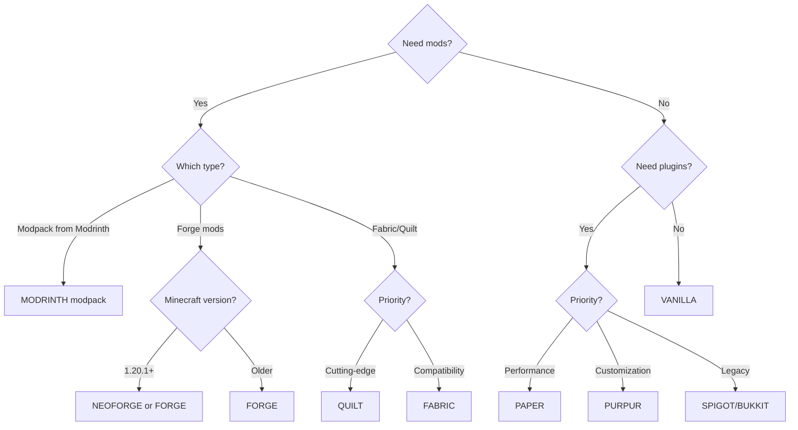

# Server Types

Detailed guide for each Minecraft server platform supported by mcctl.

## Quick Start

Create a server with your desired type using mcctl:

```bash
# Paper (recommended for most users)
mcctl create myserver -t PAPER -v 1.21.1

# Vanilla (pure Minecraft)
mcctl create myserver -t VANILLA -v 1.21.1

# Forge (mods)
mcctl create myserver -t FORGE -v 1.20.4

# NeoForge (modern Forge fork, 1.20.1+)
mcctl create myserver -t NEOFORGE -v 1.21.1

# Fabric (lightweight mods)
mcctl create myserver -t FABRIC -v 1.21.1

# Modrinth modpack (run `mcctl create` without a name to be asked instead)
mcctl create myserver -t MODRINTH --modpack <modpack-slug>
```

## Overview

| Type | Plugins | Mods | Performance | Recommended For |
|------|---------|------|-------------|-----------------|
| **PAPER** | Yes | No | Excellent | General use, plugins |
| **VANILLA** | No | No | Good | Pure Minecraft experience |
| **FORGE** | No | Yes | Varies | Forge mod packs |
| **NEOFORGE** | No | Yes | Varies | Modern Forge mods (1.20.1+) |
| **FABRIC** | No | Yes | Excellent | Performance mods |
| **MODRINTH** | No | Yes | Varies | Modrinth modpacks |
| **AUTO_CURSEFORGE** | No | Yes | Varies | CurseForge modpacks |
| **SPIGOT** | Yes | No | Good | Legacy plugin compatibility |
| **BUKKIT** | Yes | No | Moderate | Very old plugins |
| **PURPUR** | Yes | No | Excellent | Advanced customization |
| **PUFFERFISH** | Yes | No | Varies | Paper fork for large servers |
| **FOLIA** | Yes | No | Varies | Multi-threaded Paper fork for large worlds |
| **LEAF** | Yes | No | Varies | Lightweight Paper fork |
| **QUILT** | No | Yes | Excellent | Modern Fabric alternative |

These are the types `mcctl create -t` accepts. For other types the image supports, see [Other Server Types](#other-server-types).

---

## Paper

**Recommended for most users.**

Paper is a high-performance Minecraft server that supports Bukkit and Spigot plugins while providing significant performance improvements.

### Create Paper Server

```bash
mcctl create myserver -t PAPER -v 1.21.1
```

### Features

- Significant performance improvements over Vanilla
- Full Bukkit/Spigot plugin compatibility
- Async chunk loading
- Anti-exploit patches
- Extensive configuration options

### Recommended Configuration

```bash
# Enable Aikar's optimized JVM flags
mcctl config myserver USE_AIKAR_FLAGS true
```

### Adding Plugins

```bash
# From Modrinth
mcctl config myserver MODRINTH_PROJECTS "essentialsx,luckperms"

# From Spigot
mcctl config myserver SPIGET_RESOURCES "28140,81534"

# Apply changes
mcctl stop myserver && mcctl start myserver
```

Or place plugin JAR files in `shared/plugins/` directory.

### Best Practices

- Always enable `USE_AIKAR_FLAGS=true` for optimal performance
- Use Paper-specific plugins when available
- Monitor with Paper's built-in profiler: `/timings report`

---

## Vanilla

The official Minecraft server from Mojang.

### Create Vanilla Server

```bash
mcctl create myserver -t VANILLA -v 1.21.1
```

### Features

- Official Minecraft experience
- No modifications
- Guaranteed compatibility with all Minecraft features
- Smallest footprint

### Use Cases

- Pure Minecraft experience
- Testing vanilla behavior
- Minimal server requirements

---

## Forge

Server for running Forge mods.

### Create Forge Server

```bash
mcctl create myserver -t FORGE -v 1.20.4
```

### Features

- Large mod ecosystem
- Complex modpacks support
- Industrial/tech mods
- RPG mods

### Configuration

```bash
# Set memory (modpacks need more)
mcctl config myserver MEMORY 8G

# Add mods (CF_API_KEY optional on Java 17+ images)
mcctl config myserver CURSEFORGE_FILES "jei,journeymap,create"

# Or specific Forge version
mcctl config myserver FORGE_VERSION "47.2.0"

# Apply changes
mcctl stop myserver && mcctl start myserver
```

### Java Version Requirements

Forge needs the Java version of its Minecraft version (see [Java Versions and Image Tags](#java-versions-and-image-tags)), and Forge 1.16.5 and older run only on Java 8.

!!! warning "Forge 1.16.5 and Below"
    `mcctl create -t FORGE -v 1.16.5` gives the server the `java8` image. A server whose `VERSION` you change later keeps its image: set it in `servers/<name>/server.yaml`, then write the files and start it:
    ```yaml
    image: itzg/minecraft-server:java8
    ```
    ```bash
    mcctl migrate spec myserver
    mcctl start myserver
    ```

### Memory Recommendations

| Modpack Size | Recommended Memory |
|--------------|-------------------|
| Light (10-30 mods) | 4-6G |
| Medium (30-100 mods) | 6-8G |
| Heavy (100+ mods) | 8-12G |

```bash
mcctl config myserver MEMORY 8G
```

---

## NeoForge

Modern fork of Forge with improved APIs and active development. Supports Minecraft 1.20.1 and above.

### Create NeoForge Server

```bash
mcctl create myserver -t NEOFORGE -v 1.21.1
```

### Features

- Active development with modern APIs
- Forge mod compatibility (many Forge mods work on NeoForge)
- Improved performance over legacy Forge
- Better mod loading and dependency management

### Configuration

```bash
# Set memory (modpacks need more)
mcctl config myserver MEMORY 8G

# Add mods from Modrinth
mcctl config myserver MODRINTH_PROJECTS "jei,create"

# Apply changes
mcctl stop myserver && mcctl start myserver
```

### When to Use

- New modded server projects targeting Minecraft 1.20.1+
- Prefer modern Forge APIs and active community development
- Want improved performance over legacy Forge

!!! note "Minecraft Version Requirement"
    NeoForge requires Minecraft 1.20.1 or newer. For older versions, use FORGE instead.

---

## Modrinth Modpack

Create a server from a Modrinth modpack. The modpack includes all required mods, configurations, and settings pre-configured.

### Create Modrinth Modpack Server

```bash
# With the modpack slug from its Modrinth URL
mcctl create myserver -t MODRINTH --modpack <modpack-slug>

# Optional: loader, modpack version and mods to leave out
mcctl create myserver -t MODRINTH --modpack <modpack-slug> \
  --mod-loader fabric --modpack-version <version-id> --exclude-files <file1>,<file2>

# Interactive: run without a name and choose "Modrinth Modpack"
mcctl create
```

The interactive flow asks for:

1. The modpack slug or URL
2. The mod loader: Auto-detect, or one of the loaders the modpack supports
3. The modpack version (empty for the latest)
4. Mods to exclude (comma-separated)
5. The world
6. Memory (default `6G`)
7. The whitelist

### Features

- Dynamic loader detection: only shows loaders the modpack supports (Forge, NeoForge, Fabric, Quilt)
- The modpack decides the Minecraft version: no `VERSION` is written unless you pass `-v`
- Pre-configured mod sets for immediate play

### Configuration

The modpack server is configured with:

```bash
TYPE=MODRINTH
MODRINTH_MODPACK=<modpack-slug>
MODRINTH_VERSION=<version-id>       # optional, --modpack-version
MODRINTH_LOADER=<loader>            # optional, --mod-loader: forge, neoforge, fabric, quilt
MODRINTH_EXCLUDE_FILES=<files>      # optional, --exclude-files
```

### Memory Recommendations

| Modpack Size | Recommended Memory |
|--------------|-------------------|
| Light (10-30 mods) | 4-6G |
| Medium (30-100 mods) | 6-8G |
| Heavy (100+ mods) | 8-12G |

### Web Console

The Web Console's Create Server dialog searches Modrinth for the modpack, offers only the loader and Minecraft version pairs the modpack has, and fills **Exclude mods** with client-only mods it detects. See [Excluding Client-Only Mods](../mods-and-plugins/modpacks.md#excluding-client-only-mods).

---

## CurseForge Modpack

Create a server from a CurseForge modpack:

```bash
mcctl create myserver -t AUTO_CURSEFORGE --modpack all-the-mods-8
```

`--modpack` is written as `CF_SLUG`, `--modpack-version` as `CF_FILENAME_MATCHER` (part of the modpack file name), and `--exclude-files` as `CF_EXCLUDE_MODS`. `--mod-loader` is ignored: the modpack's manifest decides the loader. Java 17+ images include a CurseForge API key, so `CF_API_KEY` is only needed on older image tags. For `CF_PAGE_URL`, `CF_FILE_ID` and the other settings, see [CurseForge Modpacks](../mods-and-plugins/modpacks.md#curseforge-modpacks).

---

## Fabric

Lightweight modding platform with excellent performance.

### Create Fabric Server

```bash
mcctl create myserver -t FABRIC -v 1.21.1
```

### Features

- Fast startup and runtime
- Performance optimization mods (Lithium, Sodium)
- Modern modding API
- Smaller mod file sizes

### Configuration

```bash
# Set memory
mcctl config myserver MEMORY 6G

# Essential Fabric mods from Modrinth
mcctl config myserver MODRINTH_PROJECTS "fabric-api,lithium,starlight"
mcctl config myserver MODRINTH_DOWNLOAD_DEPENDENCIES required

# Or specific Fabric loader version
mcctl config myserver FABRIC_LOADER_VERSION "0.15.0"

# Apply changes
mcctl stop myserver && mcctl start myserver
```

### Recommended Mods

| Mod | Purpose | mcctl config |
|-----|---------|--------------|
| `fabric-api` | Required by most mods | `MODRINTH_PROJECTS` |
| `lithium` | Game logic optimization | `MODRINTH_PROJECTS` |
| `starlight` | Lighting engine rewrite | `MODRINTH_PROJECTS` |
| `krypton` | Network optimization | `MODRINTH_PROJECTS` |
| `ferritecore` | Memory optimization | `MODRINTH_PROJECTS` |

```bash
mcctl config myserver MODRINTH_PROJECTS "fabric-api,lithium,starlight,krypton,ferritecore"
```

### Performance Comparison

Fabric with optimization mods typically provides:

- 50-100% better TPS than Vanilla
- Faster chunk loading
- Lower memory usage

---

## Spigot

Modified Bukkit server with plugin support.

### Create Spigot Server

```bash
mcctl create myserver -t SPIGOT -v 1.21.1
```

### Features

- Bukkit plugin compatibility
- Performance improvements over Bukkit
- Wide plugin ecosystem

### When to Use

- Need specific Spigot-only plugins
- Legacy server migration
- Paper causes compatibility issues

!!! note "Paper Recommended"
    Paper is generally preferred over Spigot as it provides better performance and maintains full Spigot compatibility.

---

## Bukkit

Classic Minecraft plugin server.

### Create Bukkit Server

```bash
mcctl create myserver -t BUKKIT -v 1.21.1
```

### Features

- Original plugin API
- Legacy plugin support
- Stable and well-documented

### When to Use

- Very old plugins that don't work with Spigot/Paper
- Historical/archival purposes

---

## Purpur

Paper fork with additional features and customization.

### Create Purpur Server

```bash
mcctl create myserver -t PURPUR -v 1.21.1
```

### Features

- All Paper features plus more
- Extended configuration options
- Fun gameplay additions
- Active development

### Configuration

```bash
mcctl config myserver USE_AIKAR_FLAGS true
```

### Unique Features

- Rideable mobs (configure which mobs can be ridden)
- Player health on damage indicators
- Configurable villager lobotomization
- Extended permissions

---

## Pufferfish

Paper fork for servers with many players. Plugins are added the same way as for [Paper](#adding-plugins).

### Create Pufferfish Server

```bash
mcctl create myserver -t PUFFERFISH -v 1.21.1
```

---

## Folia

Paper fork that runs regions of the world on separate threads, for large worlds. Not all plugins support Folia; check each plugin before you add it.

### Create Folia Server

```bash
mcctl create myserver -t FOLIA -v 1.21.1
```

`FOLIA_CHANNEL` (`default` or `experimental`) picks the build channel, and `FOLIA_DOWNLOAD_URL` downloads the server from your own URL.

---

## Leaf

Lightweight Paper fork. Plugins are added the same way as for [Paper](#adding-plugins).

### Create Leaf Server

```bash
mcctl create myserver -t LEAF -v 1.21.1
```

`LEAF_BUILD` picks a specific build.

---

## Quilt

Modern Fabric fork with improved APIs.

### Create Quilt Server

```bash
mcctl create myserver -t QUILT -v 1.21.1
```

### Features

- Fabric mod compatibility
- Improved loader and API
- Better mod conflict resolution
- Community-focused development

### Configuration

```bash
mcctl config myserver MODRINTH_PROJECTS "qsl,fabric-api"
```

### When to Use

- Prefer Quilt's approach to modding
- Need Quilt-exclusive mods
- Want improved mod compatibility

---

## Other Server Types

The image supports more types than `mcctl create -t` accepts, for example the hybrids `MOHIST`, `MAGMA_MAINTAINED`, `ARCLIGHT` and `KETTING` (mods and Bukkit plugins on one server), `FTBA` (Feed The Beast modpacks) and `CUSTOM` (your own server jar). Create the server with an accepted type and `--no-start`, then set `TYPE` and the type's variables with `mcctl config`:

```bash
mcctl create hybrid -t FORGE -v 1.20.1 --no-start
mcctl config hybrid TYPE MOHIST
mcctl start hybrid
```

| Type | Variables |
|------|-----------|
| `MOHIST` | `VERSION` |
| `MAGMA_MAINTAINED` | `VERSION`, `FORGE_VERSION` |
| `ARCLIGHT` | `VERSION`, `ARCLIGHT_TYPE` (`FORGE`, `NEOFORGE` or `FABRIC`) |
| `KETTING` | `VERSION` |
| `FTBA` | `FTB_MODPACK_ID` (see [FTB Modpacks](../mods-and-plugins/modpacks.md#ftb-modpacks)) |
| `CUSTOM` | `CUSTOM_SERVER`: URL or container path of the server jar |

Check the image tag for the Minecraft version too (see [Java Versions and Image Tags](#java-versions-and-image-tags)).

---

## Java Versions and Image Tags

Each server runs the image named by `image:` in its `servers/<name>/server.yaml`. A new server gets the tag its `VERSION` needs from the table below. `LATEST`, no `VERSION` (a modpack decides it) and versions mcctl cannot read, such as snapshots and pre-releases, get `java25`. The tag that matches each Minecraft version:

| Minecraft version | Java | Image tag |
|-------------------|------|-----------|
| 26.x, `LATEST` | 25 | `java25` |
| 1.20.5 - 1.21.x | 21 | `java21` |
| 1.17 - 1.20.4 | 17 | `java17` |
| 1.16.5 and older | 8 | `java8` |

Forge 1.16.5 and older fail on newer Java, so they need `java8`.

To change the image, edit `image:` in `server.yaml`, run `mcctl migrate spec <name>`, then stop and start the server. An edit of `image:` in the server's `docker-compose.yml` is also taken into `server.yaml`.

`mcctl update` sets each server's tag to the one in this table for its `VERSION`. It replaces every `itzg/minecraft-server` tag that is not pinned, so `latest` or `java21-graalvm` is replaced too. A tag that starts with a release version, such as `itzg/minecraft-server:2026.10.0-java21`, or a digest (`itzg/minecraft-server:java21@sha256:…`) is pinned: `mcctl update` keeps it, and warns when its Java is older than `VERSION` needs. When `VERSION` is a snapshot or another value mcctl cannot read, the tag is left as it is. Other images are not changed.

| Error | Cause | Fix |
|-------|-------|-----|
| `class file version 69.0` | Java 25 required | Use the `java25` tag |
| `class file version 65.0` | Java 21 required | Use the `java21` tag |
| `Unsupported class file major version` | Java too new for the server | Use an older tag, for example `java8` for Forge 1.16.5 and older |

---

## Choosing a Server Type

### Decision Tree



### Quick Recommendations

| Use Case | Command |
|----------|---------|
| General multiplayer | `mcctl create myserver -t PAPER -v 1.21.1` |
| Performance-focused | `mcctl create myserver -t PAPER -v 1.21.1` or `-t FABRIC` |
| Complex modpacks | `mcctl create myserver -t MODRINTH --modpack <modpack-slug>` |
| Forge mods (modern) | `mcctl create myserver -t NEOFORGE -v 1.21.1` |
| Forge mods (legacy) | `mcctl create myserver -t FORGE -v 1.20.4` |
| Light optimization mods | `mcctl create myserver -t FABRIC -v 1.21.1` |
| Pure vanilla | `mcctl create myserver -t VANILLA -v 1.21.1` |
| Maximum customization | `mcctl create myserver -t PURPUR -v 1.21.1` |

## Complete Setup Examples

### Survival Server (Paper)

```bash
# Create server
mcctl create survival -t PAPER -v 1.21.1

# Configure
mcctl config survival MOTD "Survival Server - Good luck!"
mcctl config survival DIFFICULTY hard
mcctl config survival MODE survival
mcctl config survival USE_AIKAR_FLAGS true

# Add plugins
mcctl config survival MODRINTH_PROJECTS "essentialsx,luckperms"

# Restart to apply
mcctl stop survival && mcctl start survival

# Add operators
mcctl op survival add YourName
```

### Modded Server (Forge)

```bash
# Create server
mcctl create modded -t FORGE -v 1.20.4

# Configure
mcctl config modded MEMORY 8G
mcctl config modded USE_AIKAR_FLAGS true

# Add mods (CF_API_KEY optional on Java 17+ images)
mcctl config modded CURSEFORGE_FILES "create,jei,journeymap"

# Restart to apply
mcctl stop modded && mcctl start modded
```

### Modded Server (NeoForge)

```bash
# Create server
mcctl create modern -t NEOFORGE -v 1.21.1

# Configure
mcctl config modern MEMORY 8G
mcctl config modern USE_AIKAR_FLAGS true

# Add mods from Modrinth
mcctl config modern MODRINTH_PROJECTS "create,jei,journeymap"

# Restart to apply
mcctl stop modern && mcctl start modern
```

### Modpack Server (Modrinth)

```bash
# Create modpack server without starting it
mcctl create modpack-server -t MODRINTH --modpack <modpack-slug> --no-start

# More memory than the modpack default (6G)
mcctl config modpack-server MEMORY 8G

# Start the server
mcctl start modpack-server
```

### Performance Server (Fabric)

```bash
# Create server
mcctl create performance -t FABRIC -v 1.21.1

# Configure
mcctl config performance MEMORY 6G
mcctl config performance MODRINTH_PROJECTS "fabric-api,lithium,starlight,krypton"
mcctl config performance MODRINTH_DOWNLOAD_DEPENDENCIES required

# Restart to apply
mcctl stop performance && mcctl start performance
```

## See Also

- **[Environment Variables](environment.md)** - All configuration options
- **[CLI Commands](../cli/commands.md)** - Full mcctl reference
- **[itzg/minecraft-server Types](https://docker-minecraft-server.readthedocs.io/en/latest/types-and-platforms/)** - Full documentation
