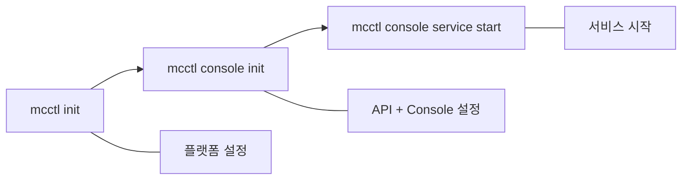

# 통합 설치 가이드: Init에서 Console까지

이 가이드에서는 mcctl 플랫폼 초기화부터 웹 기반 관리 콘솔 실행까지 **원스톱 설치 과정** 전체를 안내합니다. 이 가이드를 따라하면 CLI와 웹 기반 관리 기능을 모두 갖춘 마인크래프트 서버 관리 플랫폼이 완성됩니다.

## 전체 흐름 개요

설치 과정은 세 가지 주요 단계로 구성됩니다:



| 단계 | 명령어 | 수행 내용 |
|------|--------|----------|
| **1. 플랫폼 초기화** | `mcctl init` | 디렉토리 구조 생성, Docker 네트워크 설정, 호스트 IP 구성 |
| **2. 콘솔 초기화** | `mcctl console init` | API/Console 서비스 설치, 관리자 계정 생성, 인증 설정 |
| **3. 서비스 시작** | `mcctl console service start` | PM2로 관리되는 API 및 Console 프로세스 시작 |

## 사전 요구 사항

시작하기 전에 다음이 설치되어 있는지 확인하세요:

- [x] **Node.js 18 이상**
  ```bash
  node --version  # v18.0.0 이상이어야 합니다
  ```

- [x] **Docker Engine 24.0.0 이상**
  ```bash
  docker --version
  docker compose version  # v2.20.0 이상 필요
  ```

- [x] **mcctl CLI 전역 설치**
  ```bash
  npm install -g @minecraft-docker/mcctl
  mcctl --version
  ```

- [x] **PM2 6 이상 전역 설치** (2단계부터 필요)
  ```bash
  npm install -g pm2
  pm2 --version  # 6.0.0 이상이어야 합니다
  ```

- [x] **포트 사용 가능**
  - 웹 콘솔용 포트 5000
  - API용 포트 5001

!!! tip "처음 설치하시나요?"
    아직 mcctl을 설치하지 않았다면 [설치 가이드](../getting-started/installation.ko.md)에서 Node.js, Docker, mcctl 설치 방법을 확인하세요.

## 1단계: 플랫폼 초기화 (`mcctl init`)

`mcctl init` 명령은 마인크래프트 서버 운영을 위한 기본 플랫폼을 설정합니다.

### 명령 실행

```bash
mcctl init
```

초기화 과정은 6개 단계로 진행됩니다:

### Step 1: 사전 요구 사항 확인

mcctl이 필요한 소프트웨어의 설치 여부와 버전 요구 사항을 자동으로 확인합니다.

```
[1/6] Checking prerequisites...
  ✓ Node.js            v20.10.0  (>= 18.0.0)
  ✓ Docker Engine      v24.0.7  (>= 24.0.0)
  ✓ Docker Compose     v2.24.5  (>= 2.20.0)
  ✓ avahi-daemon       running  (>= any)
```

avahi-daemon은 선택 사항입니다. 없으면 해당 줄에 `⚠`와 설치 안내가 표시되고 초기화는 계속됩니다.

!!! warning "요구 사항 미충족 시"
    확인이 실패하면 초기화가 중단되고, 누락된 구성 요소의 설치 방법이 안내됩니다. 문제를 해결한 후 `mcctl init`를 다시 실행하세요.

### Step 2: 디렉토리 구조 생성

`~/minecraft-servers/` (기본 위치)에 플랫폼 디렉토리 구조를 생성합니다:

```
[2/6] Creating directory structure...

  Created: ~/.minecraft-servers/servers
  Created: ~/.minecraft-servers/servers/_template
  Created: ~/.minecraft-servers/worlds
  Created: ~/.minecraft-servers/shared/plugins
  Created: ~/.minecraft-servers/backups
```

!!! tip "커스텀 데이터 디렉토리"
    다른 위치를 사용하려면 `--root` 옵션을 지정하세요:
    ```bash
    mcctl --root /path/to/data init
    ```

### Step 3: 템플릿 파일 복사

구성 템플릿이 데이터 디렉토리로 복사됩니다:

```
[3/6] Copying template files...

  Copied: docker-compose.yml
  Copied: .env
  Copied: .gitignore
  Copied: servers/compose.yml
  Copied: servers/global.env
  Copied: servers/_template/docker-compose.yml
  Copied: servers/_template/config.env
  ✓ Set DOCKER_GID from docker socket
```

`servers/global.env`에는 모든 서버 컨테이너에 전달되는 플랫폼 `.env` 키가 나열됩니다. `DOCKER_GID`는 Docker 소켓의 그룹으로, mc-router가 소켓을 읽는 데 필요합니다.

### Step 4: 호스트 IP 설정

서버 호스트명 라우팅(nip.io)에 사용할 호스트 IP 주소를 선택합니다:

```
[4/6] Configuring host IP address(es)...

  Detected network interfaces:
    192.168.1.100 (eth0)
    172.17.0.1 (docker0)

? Select host IP address(es):
  ✓ 192.168.1.100 (eth0)

  ✓ Set HOST_IP=192.168.1.100
```

!!! info "다중 IP 지원"
    여러 네트워크 인터페이스가 있는 경우(예: LAN + VPN) 여러 IP를 선택할 수 있습니다. 첫 번째가 기본 `HOST_IP`가 되고, 모든 IP가 `HOST_IPS`에 저장되어 다중 호스트명 라우팅에 사용됩니다.

### Step 4.5: playit.gg 설정 (선택 사항)

포트 포워딩 없이 외부에서 접속할 수 있는 [playit.gg](https://playit.gg) 터널링을 선택적으로 활성화할 수 있습니다:

```
[4.5/6] Configuring playit.gg (optional)...

  playit.gg enables external access without port forwarding.
  Setup: https://playit.gg/account/agents/new-docker

? Enable playit.gg tunneling? No
  ✓ playit.gg disabled
```

!!! note "나중에 설정 가능"
    playit.gg는 나중에 `mcctl init --reconfigure`로 설정할 수 있습니다. 초기 설정 시에는 건너뛰어도 괜찮습니다.

### Step 5: 구성 파일 생성

플랫폼 구성 파일 `.mcctl.json`이 생성됩니다:

```
[5/6] Creating configuration...

  Created: .mcctl.json
```

### Step 6: Docker 네트워크 설정

마인크래프트 서버 전용 Docker 브리지 네트워크를 생성합니다:

```
[6/6] Setting up Docker network...

  ✓ Created network: minecraft-net
```

### 초기화 완료

모든 단계가 성공적으로 완료되면 다음과 같이 표시됩니다:

```
════════════════════════════════════════════════════════
  ✓ Platform initialized successfully!
════════════════════════════════════════════════════════

  Next steps:

  1. Edit configuration (optional):
     nano ~/minecraft-servers/.env

  2. Create your first server:
     mcctl create myserver

  3. Connect via Minecraft:
     myserver.local:25565

  For help:
     mcctl --help
```

이 시점에서 플랫폼은 CLI를 통해 마인크래프트 서버를 생성하고 관리할 준비가 되었습니다. 웹 기반 관리 인터페이스를 추가하려면 2단계로 계속 진행하세요.

---

## 2단계: 콘솔 초기화 (`mcctl console init`)

`mcctl console init` 명령은 REST API(`mcctl-api`)와 선택적 웹 관리 UI(`mcctl-console`)로 구성된 Management Console을 설치하고 구성합니다.

### 명령 실행

```bash
mcctl console init
```

### Step 1: 사전 요구 사항 확인

콘솔 초기화는 플랫폼 초기화 이상의 추가 사전 요구 사항을 확인합니다:

```
Checking prerequisites...
  ✓ Node.js            v20.10.0  (>= 18.0.0)
  ✓ Docker Engine      v24.0.7  (>= 24.0.0)
  ✓ Docker Compose     v2.24.5  (>= 2.20.0)
  ✓ PM2                v6.0.14  (>= 6.0.0)
```

!!! warning "PM2 필수"
    `pm2` 명령어가 `PATH`에 없거나 6.0.0보다 오래되었으면 `mcctl console init`이 중단됩니다. PM2를 전역으로 설치하세요:
    ```bash
    npm install -g pm2
    ```
    mcctl은 자체 호출(예: `mcctl console service`)을 위해 PM2 라이브러리를 함께 제공하지만, 이것으로는 `PATH`에 `pm2` 명령어가 생기지 않으므로 이 확인을 통과하지 못합니다.

### Step 2: 서비스 선택

설치할 서비스를 선택하는 프롬프트가 표시됩니다:

```
Initialize Console Service

  Node.js: v20.10.0
  PM2: 6.0.14

? Select services to install:
  ✓ mcctl-api       - REST API server for managing Minecraft servers
  ○ mcctl-console   - Web UI for server management
```

| 서비스 | 설명 | 기본 포트 |
|--------|------|----------|
| **mcctl-api** | Docker와 RCON을 통해 마인크래프트 서버를 관리하는 Fastify REST API 서버 | 5001 |
| **mcctl-console** | 대시보드, 서버 관리, 관리자 기능이 포함된 Next.js 웹 애플리케이션 | 5000 |

!!! tip "API 전용 모드"
    REST API만 필요한 경우(자동화, 스크립트, 자체 UI 개발 등) `mcctl-api`만 선택하세요. 나중에 `mcctl console init`을 다시 실행하여 `mcctl-console`을 추가할 수 있습니다.

### Step 3: 관리자 계정 설정 (Console 선택 시에만)

`mcctl-console`을 선택한 경우, 관리자 계정을 생성하는 프롬프트가 표시됩니다:

**관리자 이메일:**

```
? Admin email? admin@example.com
```

Better Auth를 통한 인증에 사용되는 이메일입니다.

**관리자 이름:**

```
? Admin name? Administrator
```

관리자 계정의 표시 이름입니다.

**관리자 비밀번호:**

```
? Admin password? ********
```

비밀번호 요구 사항:

- 최소 8자 이상
- 대문자(A-Z) 1개 이상
- 소문자(a-z) 1개 이상
- 숫자(0-9) 1개 이상

!!! note "API 전용 모드"
    `mcctl-console` 없이 `mcctl-api`만 선택한 경우, 관리자 계정 설정은 완전히 건너뜁니다. 인증은 API 접근 모드를 통해 처리됩니다.

### Step 4: API 접근 모드 선택

REST API의 인증 모드를 선택합니다:

```
? API access mode?
  ● internal       - Local network only (default, most secure)
  ○ api-key        - External access with API key
  ○ ip-whitelist   - IP-based access control
  ○ api-key-ip     - Both API key and IP required
  ○ open           - No authentication (development only)
```

| 모드 | 보안 수준 | 적합한 용도 |
|------|----------|------------|
| `internal` | 최고 | 가정/로컬 네트워크 배포 |
| `api-key` | 높음 | 원격 접근, 자동화 스크립트 |
| `ip-whitelist` | 높음 | 알려진 클라이언트 IP, 기업 네트워크 |
| `api-key-ip` | 최대 | API 키와 IP 모두 필요한 고보안 환경 |
| `open` | 없음 | 로컬 개발/테스트 전용 |

!!! note "접근 모드"
    `mcctl console init`은 접근 모드를 mcctl-api가 인식하는 값으로 변환해 `AUTH_MODE`에 기록합니다: `internal` → 루프백(127.0.0.1, ::1)만 허용하는 `ip-whitelist`, `api-key-ip` → `combined`, `open` → `disabled`. `api-key`와 `ip-whitelist`는 그대로 기록됩니다.

    각 모드와 나중에 모드를 바꾸는 방법은 [접근 모드](#access-modes)를 참고하세요.

!!! danger "open 모드 경고"
    `open` 모드는 모든 인증을 비활성화합니다. 선택하면 확인 프롬프트가 표시됩니다:
    ```
    WARNING: Open mode has no authentication. Use only for local development!
    ? Are you sure you want to use open mode? No
    ```
    프로덕션 환경이나 인터넷에서 접근 가능한 네트워크에서는 절대 `open` 모드를 사용하지 마세요.

### Step 5: API 키 생성 (조건부)

`api-key` 또는 `api-key-ip` 모드를 선택한 경우, API 키가 자동으로 생성됩니다:

```
Generating API key...  API key generated
```

API 키는 초기화 완료 시 표시됩니다. **안전한 곳에 저장하세요** -- 한 번만 표시됩니다.

### Step 6: IP 화이트리스트 설정 (조건부)

`ip-whitelist` 또는 `api-key-ip` 모드를 선택한 경우, 허용할 IP를 입력합니다:

```
? Allowed IPs (comma-separated)? 127.0.0.1, 192.168.1.0/24
```

개별 IPv4 주소 또는 CIDR 범위를 쉼표로 구분하여 입력할 수 있습니다.

!!! warning "mcctl-console도 설치한다면 127.0.0.1을 포함하세요"
    웹 콘솔은 같은 호스트에서 mcctl-api를 호출하며, mcctl-api는 목록에 없는 주소의 요청을 거부합니다(HTTP 403). mcctl-console도 설치한다면 `127.0.0.1`을 포함하세요. 주소로 적어야 합니다. `localhost`라고 입력하면 프롬프트는 받아들이지만 어떤 요청과도 일치하지 않습니다.

### Step 7: 서비스 패키지 설치

`mcctl-console`을 선택했다면 먼저 `data/mcctl.db`에 관리자 계정이 생성됩니다. 이어서 선택한 패키지(mcctl-api, mcctl-console)가 아직 없으면 npm에서 설치됩니다:

```
Creating admin user...  Admin user created
Checking mcctl-api installation...  mcctl-api ready
Checking mcctl-console installation...  mcctl-console ready
```

패키지는 데이터 루트 아래의 `.services/` 디렉토리에 설치됩니다.

### Step 8: PM2 Ecosystem 설정

PM2 ecosystem 구성 파일이 생성됩니다:

```
Resolving service script paths...  Using production node_modules paths
Generating PM2 ecosystem config...  PM2 ecosystem config generated
```

이 과정에서 데이터 디렉토리(기본값 `~/minecraft-servers`)에 `ecosystem.config.cjs`가 생성되며, PM2가 API와 Console 프로세스를 실행하는 방법을 정의합니다.

`mcctl-console`을 선택했다면 이 단계에서 콘솔 세션 시크릿 `BETTER_AUTH_SECRET`도 데이터 디렉토리의 `.env`에 기록됩니다. 이미 사용 중인 시크릿은 유지되므로 로그인한 사용자는 로그인 상태를 유지합니다.

### Step 9: 구성 저장

관리자 구성이 저장됩니다:

```
Saving configuration...  Configuration saved
```

### 콘솔 초기화 완료

모든 단계가 완료되면 요약 정보가 표시됩니다:

```
Console Service initialized!

  Configuration:
    Config file: /home/user/minecraft-servers/.mcctl-admin.yml
    Console DB:  /home/user/minecraft-servers/data/mcctl.db
    PM2 config:  /home/user/minecraft-servers/ecosystem.config.cjs
    Access mode: internal

  Endpoints:
    API:     http://localhost:5001
    Console: http://localhost:5000

  Next steps:
    1. Start the service: mcctl console service start
    2. Access the console in your browser
```

`api-key` 또는 `api-key-ip` 모드를 선택한 경우 API 키도 함께 표시됩니다:

```
  API Key (save this, shown only once):
    mctk_a1B2c3D4e5F6g7H8i9J0...
```

`ip-whitelist`와 `api-key-ip`에서는 요약에 허용 IP 목록도 표시됩니다. 사용 통계가 켜져 있으면 마지막에 이에 대한 안내가 출력됩니다([사용 통계](web-console.md#사용-통계) 참조).

!!! warning "API 키를 안전하게 보관하세요"
    API 키는 초기화 시 한 번만 표시됩니다. 복사하여 안전한 곳에 저장하세요. 실행 중인 API가 사용하는 키는 `ecosystem.config.cjs`의 `AUTH_API_KEY`이며, 새 키가 필요하면 `mcctl console init --force`로 다시 초기화하세요. `mcctl console api key regenerate`는 현재 이 키를 바꾸지 않습니다 ([CLI 명령어](cli-commands.ko.md#mcctl-console-api)의 경고 참조).

---

## 3단계: 서비스 시작 (`mcctl console service start`)

모든 설정이 완료되었으니 서비스를 시작합니다. `--console`은 mcctl-api와 mcctl-console을 시작하며, 플래그 없이 실행하면 두 서비스가 모두 설치된 경우 어느 서비스를 시작할지 묻습니다:

```bash
mcctl console service start --console
```

### 서비스 시작

PM2가 구성된 서비스를 시작합니다:

```
[INFO] Starting console services via PM2...
[INFO]   Started mcctl-api
[INFO]   Started mcctl-console
[INFO] Console services started successfully
```

### 상태 확인

시작 후 명령은 각 서비스를 HTTP로 확인하고(최대 15초 대기) 상태 보고서를 표시합니다. 서비스가 정상 상태가 되지 않으면 보고서에 해당 서비스의 `Health:` 줄이 표시되고 명령은 종료 코드 1로 끝납니다:

```
  Console Service Status (PM2)

  mcctl-api
    Status: online
    PID: 12345
    CPU: 0%
    Memory: 50.2 MB
    Uptime: 5s
    Restarts: 0

  mcctl-console
    Status: online
    PID: 12346
    URL: http://localhost:5000
    CPU: 0%
    Memory: 80.5 MB
    Uptime: 3s
    Restarts: 0

  All services healthy
```

### API 상태 확인

API 엔드포인트를 테스트합니다:

```bash
curl http://localhost:5001/health
```

예상 응답:

```json
{"status":"ok","timestamp":"2026-10-25T12:00:00.000Z"}
```

### 웹 콘솔 접속

1. 브라우저에서 `http://localhost:5000`으로 이동합니다
2. `mcctl console init`에서 생성한 관리자 이메일과 비밀번호로 로그인합니다
3. 마인크래프트 서버 목록이 포함된 대시보드가 표시됩니다

---

## 전체 설치 예시

처음부터 끝까지의 전체 설치 흐름입니다:

```bash
# 1단계: mcctl 설치
npm install -g @minecraft-docker/mcctl

# 2단계: 플랫폼 초기화
mcctl init
# 대화형 프롬프트 따라하기 (IP 선택, playit.gg)

# 3단계: 첫 번째 마인크래프트 서버 생성
mcctl create survival -t PAPER -v 1.21.1

# 4단계: Management Console 초기화
mcctl console init
# 서비스 선택 -> 관리자 계정 생성 -> 접근 모드 선택

# 5단계: Console 서비스 시작
mcctl console service start --console

# 6단계: 모든 것이 실행 중인지 확인
mcctl status                    # 마인크래프트 서버 확인
mcctl console service status    # Console 서비스 확인
curl http://localhost:5001/health  # API 상태 확인

# 7단계: 웹 콘솔 열기
# 브라우저에서 http://localhost:5000 으로 이동
```

---

## 구성 파일 참조

전체 설치 완료 후 데이터 디렉토리에 다음 파일들이 존재합니다:

| 파일 | 생성 주체 | 설명 |
|------|----------|------|
| `.mcctl.json` | `mcctl init` | 플랫폼 구성 (버전, 기본값, 기능) |
| `.env` | `mcctl init` | 환경 변수 (HOST_IP, 시간대, RCON 비밀번호 등). `mcctl console init`이 콘솔 세션 시크릿 `BETTER_AUTH_SECRET`을 추가합니다 |
| `docker-compose.yml` | `mcctl init` | mc-router용 메인 Docker 오케스트레이션 |
| `.mcctl-admin.yml` | `mcctl console init` | Console 서비스 구성 (접근 모드, 포트) |
| `data/mcctl.db` | `mcctl console init` | 사용자 계정용 SQLite 데이터베이스 (Better Auth) |
| `ecosystem.config.cjs` | `mcctl console init` | API와 Console용 PM2 프로세스 구성 |

### 환경 변수 { #environment-variables }

| 변수 | 설명 | 기본값 |
|------|------|--------|
| `MCCTL_ROOT` | 데이터 디렉토리 경로 | `~/minecraft-servers` |
| `PORT` | 각 서비스의 리슨 포트. 서비스별 `env` 블록에서 설정 | `5001` (mcctl-api), `5000` (mcctl-console) |
| `HOST` | mcctl-api 대기 주소 | `internal` 접근 모드는 `127.0.0.1`, 다른 모드는 `0.0.0.0` |
| `HOSTNAME` | 콘솔 서버 호스트 이름 | `0.0.0.0` |
| `MCCTL_API_URL` | 내부 API URL | `http://127.0.0.1:5001` |
| `NODE_ENV` | 실행 환경 모드 | `production` |
| `LOG_LEVEL` | mcctl-api 로그 레벨: `fatal`, `error`, `warn`, `info`, `debug`, `trace`, `silent` | `NODE_ENV=production`이면 `info`, 그 외에는 `debug` |
| `WORLD_UPLOAD_MAX_SIZE` | 월드 ZIP 업로드 최대 크기 (바이트, `POST /api/worlds/upload`) | `1073741824` (1 GB) |
| `BETTER_AUTH_SECRET` | 콘솔 세션 시크릿. `mcctl console init`이 `<root>/.env`에 기록합니다. 바꾸면 모든 사용자가 로그아웃됩니다 | 자동 생성 |
| `BETTER_AUTH_BASE_URL` | 콘솔의 공개 URL로, `<root>/.env`에서 읽습니다. 사용자가 `localhost`, 사설 LAN 주소, `.local` 이름이 아닌 주소로 콘솔을 연다면 설정하세요 ([웹 콘솔에 로그인할 수 없음](#웹-콘솔에-로그인할-수-없음) 참조) | `http://localhost:<console port>` |

### PM2 Ecosystem 구성 { #pm2-ecosystem-configuration }

`mcctl console init` 명령은 데이터 디렉토리에 `ecosystem.config.cjs`를 생성합니다 (`<root>/ecosystem.config.cjs`, `<root>`는 `MCCTL_ROOT`이며 기본값은 `~/minecraft-servers`). 서비스 패키지는 `<root>/.services/` 아래에 설치되며, 이 파일은 절대 경로로 해당 패키지를 가리킵니다. 아래 값은 `<root>` = `/home/user/minecraft-servers`인 경우의 예시입니다:

```javascript
// ecosystem.config.cjs
module.exports = {
  apps: [
    {
      name: 'mcctl-api',
      script: '/home/user/minecraft-servers/.services/node_modules/@minecraft-docker/mcctl-api/dist/index.js',
      cwd: '/home/user/minecraft-servers',
      env: {
        NODE_ENV: 'production',
        PORT: 5001,
        HOST: '127.0.0.1', // internal 접근 모드; 다른 모드는 0.0.0.0
        MCCTL_ROOT: '/home/user/minecraft-servers',
        AUTH_MODE: 'ip-whitelist', // "internal" 접근 모드일 때 기록되는 값. Step 4의 "접근 모드" 참고 사항 확인
        AUTH_IP_WHITELIST: '127.0.0.1,::1,::ffff:127.0.0.1',
        // api-key 계열 접근 모드에서는 AUTH_API_KEY가 추가됩니다
      },
      instances: 1,
      exec_mode: 'fork',
      watch: false,
      autorestart: true,
      max_memory_restart: '500M',
      // Shutdown waits for a running auto-backup to re-enable auto-save (#734)
      kill_timeout: 130000,
    },
    {
      name: 'mcctl-console',
      script: '/home/user/minecraft-servers/.services/node_modules/@minecraft-docker/mcctl-console/.next/standalone/platform/services/mcctl-console/server.js',
      cwd: '/home/user/minecraft-servers',
      env: {
        NODE_ENV: 'production',
        PORT: 5000,
        HOSTNAME: '0.0.0.0',
        MCCTL_API_URL: 'http://127.0.0.1:5001',
        MCCTL_ROOT: '/home/user/minecraft-servers',
        // api-key 계열 접근 모드에서는 MCCTL_API_KEY가 추가됩니다
        // BETTER_AUTH_SECRET은 여기가 아니라 .env에 기록됩니다
      },
      instances: 1,
      exec_mode: 'fork',
      watch: false,
      autorestart: true,
      max_memory_restart: '500M',
    },
  ],
};
```

`AUTH_MODE` 값은 선택한 접근 모드에서 변환된 값입니다. [Step 4](#step-4-api-접근-모드-선택)의 "접근 모드" 참고 사항을 확인하세요.

파일에는 `mcctl console init`에서 선택한 서비스만 포함됩니다. `.services/` 디렉토리가 도입되기 이전에 설치한 환경은 패키지가 `<root>/node_modules/`에 있으며, 패키지가 그 위치에서 발견되면 `mcctl console init`은 계속 해당 위치를 사용합니다.

`kill_timeout: 130000`은 mcctl-api가 종료될 때 진행 중인 자동 백업을 마칠 시간을 줍니다. v3.0.0 이전 버전이 작성한 파일에는 이 설정이 없습니다. [mcctl-api가 자동 백업을 마칠 시간 주기](../advanced/upgrade-runbook.md#pm2-kill-timeout)를 참고하세요.

---

## 접근 모드 { #access-modes }

`mcctl console init`은 설정 중에 접근 모드를 묻습니다([Step 4](#step-4-api-접근-모드-선택)). 모드, API 키, IP 화이트리스트는 `ecosystem.config.cjs`의 `env` 블록(`AUTH_MODE`, `AUTH_API_KEY`, `AUTH_IP_WHITELIST`)에 기록되며, 실행 중인 mcctl-api가 읽는 값이 바로 이것입니다. `mcctl console api` 명령어는 아직 이 값을 바꾸지 않으므로([CLI 명령어](cli-commands.ko.md#mcctl-console-api)의 경고 참조), 모드를 바꾸거나 API 키 또는 IP 화이트리스트를 변경하려면 현재는 `mcctl console init --force`로 다시 초기화해야 합니다.

### internal (프로덕션 권장)

내부 접근만 허용, 외부 노출 없음. 가정/로컬 배포에서 가장 안전한 옵션입니다.

```bash
mcctl console init
# API 접근 모드를 묻는 프롬프트에서 "internal" 선택
```

### api-key

모든 API 요청에 `X-API-Key` 헤더가 필요합니다.

```bash
mcctl console init
# 프롬프트에서 "api-key" 선택
# API 키가 생성되어 표시됩니다
```

초기화 후 API 키가 표시됩니다. 안전하게 저장하세요.

새 API 키가 필요하면 `mcctl console init --force`로 다시 초기화하세요. `mcctl console api key regenerate`는 현재 실행 중인 API가 사용하는 키를 바꾸지 않습니다.

### ip-whitelist

지정된 IP 주소나 CIDR 범위에서만 접근을 허용합니다.

```bash
mcctl console init
# 프롬프트에서 "ip-whitelist" 선택
# 허용할 IP를 입력합니다 (쉼표로 구분)
```

허용 IP를 바꾸려면 `mcctl console init --force`로 다시 초기화하고 새 목록을 입력하세요. `mcctl console api whitelist`는 현재 실행 중인 API가 사용하는 화이트리스트를 바꾸지 않습니다.

mcctl-console도 설치한다면 목록에 `127.0.0.1`을 포함하세요. [Step 6](#step-6-ip-화이트리스트-설정-조건부)의 경고를 참고하세요. `api-key-ip`도 마찬가지입니다.

### api-key-ip

유효한 API 키와 화이트리스트에 등록된 클라이언트 IP를 모두 요구하는 모드입니다.

### open (개발 환경 전용)

!!! danger "보안 위험"
    이 모드는 모든 인증을 비활성화합니다. 프로덕션에서는 절대 사용하지 마세요!

---

## 사용자 관리 { #user-management }

`mcctl console user`로 웹 콘솔에 로그인하는 계정을 관리합니다:

```bash
mcctl console user add                                   # 사용자 추가 (대화형)
mcctl console user list                                  # 사용자 목록
mcctl console user update operator@example.com --role admin  # 역할 변경
mcctl console user reset-password operator@example.com   # 비밀번호 재설정
mcctl console user remove operator@example.com           # 사용자 삭제
```

마지막 관리자는 삭제하거나 역할을 바꿀 수 없습니다. 실수로 계정이 잠기는 일을 막기 위해서입니다. 모든 옵션과 출력은 [CLI 명령어](cli-commands.ko.md#mcctl-console-user)를 참고하세요.

---

## 부팅 시 자동 시작 설정

시스템 부팅 시 서비스가 자동으로 시작되도록 설정하려면:

```bash
# PM2 시작 스크립트 생성
pm2 startup

# PM2가 표시하는 명령을 실행합니다 (예시):
sudo env PATH=$PATH:/usr/bin pm2 startup systemd -u $USER --hp $HOME

# 현재 프로세스 목록 저장
pm2 save
```

---

## 커스텀 포트 설정

기본 포트(5000, 5001)가 다른 서비스와 충돌하는 경우 커스텀 포트를 지정하세요:

```bash
mcctl console init --api-port 8001 --console-port 8000
```

`mcctl console init`은 포트를 대화형으로 묻지 않으며, `--api-port`와 `--console-port` 플래그가 포트를 지정하는 유일한 방법입니다. 기본값은 API `5001`, 콘솔 `5000`입니다.

포트는 `ecosystem.config.cjs`에 기록되며, 서비스는 항상 이 포트로 시작됩니다. 기존 설치의 포트를 바꾸려면 새 값으로 다시 초기화하세요: `mcctl console init --force --api-port 8001 --console-port 8000`

---

## 재초기화

### 플랫폼 설정 재구성

완전한 재초기화 없이 플랫폼 설정(IP, 메모리, 시간대)을 변경하려면:

```bash
mcctl init --reconfigure
```

### 콘솔 재초기화

Console 구성을 초기화하려면 (주요 업데이트 후 유용):

```bash
mcctl console init --force
```

`--force` 플래그는 확인 프롬프트를 건너뛰고 기존 구성을 정리한 후 재초기화합니다. 재초기화한 뒤에는 서비스를 다시 시작하세요:

```bash
mcctl console service start --console
```

`--force`는 기존 설정을 보존하지 않습니다. PM2 서비스를 중지하고 `.mcctl-admin.yml`과 `ecosystem.config.cjs`를 삭제하므로, API 접근 모드를 다시 선택해야 하고, `--api-port`와 `--console-port`를 지정하지 않으면 포트는 기본값으로 돌아가며, api-key 계열 모드에서는 새 API 키가 생성됩니다. 콘솔 데이터베이스 `data/mcctl.db`는 유지되므로 다른 사용자는 그대로입니다. `.env`의 세션 시크릿 `BETTER_AUTH_SECRET`도 유지되므로 다른 사용자는 로그인 상태를 유지합니다. 기존 관리자의 이메일을 입력하면 해당 사용자는 (세션 포함) 삭제된 뒤 지금 입력한 비밀번호로 다시 생성됩니다. 다른 이메일을 입력하면 기존 관리자는 그대로 남고 새 관리자가 추가됩니다.

---

## 업그레이드 { #upgrading }

### mcctl 및 서비스 업데이트

```bash
mcctl update
```

`mcctl update`는 mcctl CLI와 `<root>/.services/`에 설치된 서비스(`mcctl-api`, `mcctl-console`, `shared` 라이브러리)를 한 번에 업데이트합니다. 업데이트된 PM2 서비스는 자동으로 재시작됩니다. 출력에 서비스별로 `Updated (restart manually)`가 표시되면 `mcctl console service restart`를 실행하세요. `.services/` 디렉토리가 없는 설치는 패키지가 `<root>/node_modules`에 있으며, `mcctl update`는 그 위치의 패키지를 업데이트합니다. 서비스 패키지가 하나 이상 설치되어 있으면 이 명령은 Minecraft 서버의 이미지 태그를 맞추고 Docker 이미지를 pull하기도 합니다. `--check`, `--cli-only`를 지정하거나 설치된 서비스 패키지가 없으면 건너뜁니다.

| 옵션 | 설명 |
|------|------|
| `--check` | 업데이트 여부만 확인하고 설치하지 않음 |
| `--cli-only` | CLI만 업데이트하고 서비스는 그대로 둠 |
| `--yes` | 확인 프롬프트 건너뛰기 |

`npm update -g @minecraft-docker/mcctl`은 CLI 패키지만 업데이트하며 `.services/`의 서비스는 건드리지 않습니다. 모든 옵션은 [mcctl update 레퍼런스](../cli/commands.ko.md#mcctl-update)를 참조하세요.

### 주요 업데이트 후 재초기화

호환성을 깨는 변경 사항이 있는 릴리스라면 [콘솔 재초기화](#콘솔-재초기화)에 따라 콘솔을 재초기화하세요.

---

## 제거 { #uninstallation }

Management Console를 제거하려면:

```bash
# 콘솔 서비스 제거 (대화형)
mcctl console remove

# 또는 확인 없이 강제 제거
mcctl console remove --force

# 나중에 재설치할 수 있도록 설정 파일 유지
mcctl console remove --keep-config
```

다음 작업이 수행됩니다:

- PM2 프로세스 중지 및 제거 (mcctl-api, mcctl-console)
- 설정 파일 삭제 (`.mcctl-admin.yml`, 그리고 존재하는 경우 레거시 `users.yaml`)
- PM2 에코시스템 설정 삭제 (`ecosystem.config.cjs`)

!!! warning "데이터 보존"
    Management Console를 제거해도 Minecraft 서버나 월드 데이터에는 영향이 없습니다.

!!! note "콘솔 데이터베이스는 유지됩니다"
    `data/mcctl.db`(콘솔 사용자, 세션, 사용자별 서버 권한)와 `.services/`의 패키지는 삭제되지 않습니다. 재설치 후에도 계정이 남도록 의도한 동작입니다. 같은 관리자 이메일로 `mcctl console init`을 다시 실행하려면 `--force`가 필요하며, 없으면 `User '<email>' already exists` 오류로 실패합니다.

완전히 처음부터 시작하려면 데이터베이스도 함께 삭제하세요:

!!! danger "되돌릴 수 없습니다"
    데이터베이스를 삭제하면 모든 콘솔 사용자, 세션, 사용자별 서버 권한이 사라집니다.

```bash
rm -f ~/minecraft-servers/data/mcctl.db*
```

삭제되는 항목과 유지되는 항목의 전체 목록은 [`mcctl console remove`](cli-commands.ko.md#mcctl-console-remove)를 참조하세요.

### PM2 정리 (선택 사항)

PM2 구성을 완전히 제거하려면:

```bash
# 저장된 프로세스 목록 제거
pm2 unstartup

# PM2 데몬 종료
pm2 kill
```

---

## 문제 해결

### 플랫폼 초기화 문제

#### `mcctl init`이 "이미 초기화됨"으로 표시

```
[WARN] Platform is already initialized
```

**해결 방법**: `--reconfigure`를 사용하여 설정을 변경하거나, 데이터 디렉토리를 삭제하여 새로 시작하세요:

```bash
# 방법 1: 기존 설정 재구성
mcctl init --reconfigure

# 방법 2: 전체 초기화 (주의: 모든 서버 데이터가 삭제됩니다)
rm -rf ~/minecraft-servers
mcctl init
```

#### Docker 네트워크 생성 실패

```
[WARN] Failed to create Docker network (may already exist)
```

**해결 방법**: 네트워크가 이미 존재할 수 있습니다. 다음으로 확인하세요:

```bash
docker network ls | grep minecraft-net
```

### 콘솔 초기화 문제

#### "Platform not initialized" 오류

```
[ERROR] Platform not initialized. Run: mcctl init
```

**해결 방법**: `mcctl console init` 전에 먼저 `mcctl init`을 실행하세요.

#### PM2 미설치

```
  ✗ PM2                not found  (>= 6.0.0)
    npm install -g pm2

[ERROR] PM2 is not installed
```

PM2가 6.0.0보다 오래되었으면 해당 줄에 그 버전이 표시되고, 오류는 `PM2 version <version> does not meet minimum requirement >= 6.0.0`입니다.

**해결 방법**:

```bash
npm install -g pm2
```

#### 패키지 설치 실패

```
[ERROR] Failed to install mcctl-api: ...
[INFO] Try installing manually: npm install @minecraft-docker/mcctl-api
```

**해결 방법**: 수동으로 설치해 보세요:

```bash
cd ~/minecraft-servers/.services
npm install @minecraft-docker/mcctl-api@latest
npm install @minecraft-docker/mcctl-console@latest
```

### 서비스 시작 문제

#### Ecosystem 설정 파일 없음

```
[ERROR] Ecosystem config not found.
[INFO] Please run 'mcctl console init' to initialize console services
```

**해결 방법**: `mcctl console init`을 실행하여 ecosystem 구성을 생성하세요.

#### 포트 사용 중

```bash
# 어떤 프로세스가 포트를 사용하고 있는지 확인
lsof -i :5000
lsof -i :5001

# 또는 netstat 사용
netstat -tlnp | grep -E "5000|5001"
```

**해결 방법**: 충돌하는 프로세스를 중지하거나 `--api-port`와 `--console-port`로 커스텀 포트를 사용하세요.

#### 서비스가 계속 재시작됨

```bash
# 오류 로그 확인
mcctl console service logs -f

# 또는 PM2 로그 직접 확인
pm2 logs mcctl-api --lines 100
pm2 logs mcctl-console --lines 100
```

일반적인 원인:

- 의존성 누락: `mcctl console init`을 다시 실행하세요
- 포트 충돌: 커스텀 포트를 사용하세요
- 메모리 제한: PM2는 `max_memory_restart`(`ecosystem.config.cjs`의 `500M`)를 넘은 서비스를 재시작합니다. 이 값을 늘린 뒤 `mcctl console service restart --console --force`로 적용하세요. 일반 재시작은 이전 PM2 설정을 그대로 유지합니다

서비스 패키지가 설치되어 있는지 확인하려면 (패키지는 데이터 디렉토리의 `.services/` 디렉토리에 설치됩니다):

```bash
cd ~/minecraft-servers/.services
npm ls @minecraft-docker/mcctl-api @minecraft-docker/mcctl-console
```

`.services/` 디렉토리가 없는 설치는 패키지가 `~/minecraft-servers/node_modules`에 있으므로, 대신 `~/minecraft-servers`에서 `npm ls`를 실행하세요.

### API 접근 문제

#### API에서 401 Unauthorized 반환 { #api-returns-401-unauthorized }

1. **접근 모드 확인** (실행 중인 API는 `ecosystem.config.cjs`에서 읽으며, `mcctl console api status`는 대신 `api-config.json`을 보여줍니다):
   ```bash
   grep AUTH_MODE ~/minecraft-servers/ecosystem.config.cjs
   ```

2. **API 키 확인 (api-key 모드 사용 시):**
   - 요청에 `X-API-Key` 헤더가 포함되어 있는지 확인
   - 사용 중인 키는 `ecosystem.config.cjs`의 `AUTH_API_KEY`입니다. 새 키가 필요하면 `mcctl console init --force`로 다시 초기화하세요

3. **IP 화이트리스트 확인 (ip-whitelist 모드 사용 시):** 목록에 없는 클라이언트 IP는 HTTP 403을 받습니다
   ```bash
   grep AUTH_IP_WHITELIST ~/minecraft-servers/ecosystem.config.cjs
   ```

### 로그인 문제

#### 웹 콘솔에 로그인할 수 없음

1. 관리자 계정이 생성되었는지 확인:
   ```bash
   mcctl console user list
   ```

2. 관리자 비밀번호 재설정:
   ```bash
   mcctl console user reset-password admin@example.com
   ```

3. `mcctl-console`이 실행 중인지 확인:
   ```bash
   mcctl console service status
   ```

4. `localhost`, 사설 LAN 주소, `.local` 이름이 아닌 주소(예: Tailscale `100.x` 주소, 도메인 이름, HTTPS 리버스 프록시)로 콘솔을 연다면 `.env`에서 `BETTER_AUTH_BASE_URL`을 그 URL로 설정하고 `mcctl console service restart --console`을 실행하세요. [로그인 실패](web-console.md#로그인-실패)를 참고하세요.

---

## 다음 단계

설치가 완료되면:

- **[웹 콘솔 가이드](web-console.ko.md)** - 웹 관리 인터페이스 사용법
- **[CLI 명령어 참조](cli-commands.ko.md)** - Console CLI 전체 참조
- **[API 참조](../api/endpoints.md)** - REST API 문서
- **[빠른 시작 가이드](../getting-started/quickstart.ko.md)** - 마인크래프트 서버 생성 및 관리
