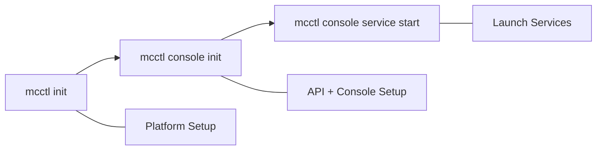

# Complete Setup Guide: From Init to Console

This guide walks you through the **complete one-stop setup** process, from initializing the mcctl platform to launching the Management Console with a web-based admin interface. By the end, you will have a fully operational Minecraft server management platform with both CLI and web-based management capabilities.

## Overview

The setup process consists of three main phases:



| Phase | Command | What It Does |
|-------|---------|-------------|
| **1. Platform Init** | `mcctl init` | Creates directory structure, configures Docker network, sets up host IP |
| **2. Console Init** | `mcctl console init` | Installs API/Console services, creates admin user, configures authentication |
| **3. Service Start** | `mcctl console service start` | Starts PM2-managed API and Console processes |

## Prerequisites

Before starting, ensure you have the following installed:

- [x] **Node.js 18 or higher**
  ```bash
  node --version  # Should be v18.0.0 or higher
  ```

- [x] **Docker Engine 24.0.0 or higher**
  ```bash
  docker --version
  docker compose version  # v2.20.0 or higher required
  ```

- [x] **mcctl CLI installed globally**
  ```bash
  npm install -g @minecraft-docker/mcctl
  mcctl --version
  ```

- [x] **PM2 6 or higher installed globally** (needed from Phase 2)
  ```bash
  npm install -g pm2
  pm2 --version  # Should be 6.0.0 or higher
  ```

- [x] **Ports available**
  - Port 5000 for the web console
  - Port 5001 for the API

!!! tip "New Installation?"
    If you haven't installed mcctl yet, see the [Installation Guide](../getting-started/installation.md) for detailed instructions on setting up Node.js, Docker, and mcctl.

## Phase 1: Platform Initialization (`mcctl init`)

The `mcctl init` command sets up the foundational platform for running Minecraft servers.

### Running the Command

```bash
mcctl init
```

The initialization process goes through 6 steps:

### Step 1: Prerequisite Check

mcctl automatically checks that all required software is installed and meets version requirements.

```
[1/6] Checking prerequisites...
  ✓ Node.js            v20.10.0  (>= 18.0.0)
  ✓ Docker Engine      v24.0.7  (>= 24.0.0)
  ✓ Docker Compose     v2.24.5  (>= 2.20.0)
  ✓ avahi-daemon       running  (>= any)
```

avahi-daemon is optional: when it is missing the line shows `⚠` with an install hint, and init continues.

!!! warning "Prerequisite Failures"
    If any check fails, the init process stops and displays instructions on how to install the missing component. Fix the issue and run `mcctl init` again.

### Step 2: Directory Structure

mcctl creates the platform directory structure at `~/minecraft-servers/` (default):

```
[2/6] Creating directory structure...

  Created: ~/.minecraft-servers/servers
  Created: ~/.minecraft-servers/servers/_template
  Created: ~/.minecraft-servers/worlds
  Created: ~/.minecraft-servers/shared/plugins
  Created: ~/.minecraft-servers/backups
```

!!! tip "Custom Data Directory"
    To use a different location, specify `--root`:
    ```bash
    mcctl --root /path/to/data init
    ```

### Step 3: Template Files

Configuration templates are copied to the data directory:

```
[3/6] Copying template files...

  Copied: docker-compose.yml
  Copied: .env
  Copied: .gitignore
  Copied: servers/compose.yml
  Copied: servers/global.env
  Copied: servers/_template/docker-compose.yml
  Copied: servers/_template/config.env
  ✓ Set DOCKER_GID from docker socket
```

`servers/global.env` lists the platform `.env` keys that are passed to every server container. `DOCKER_GID` is the group of the Docker socket, which mc-router needs to read it.

### Step 4: Host IP Configuration

You are prompted to select the host IP address(es) used for server hostname routing (nip.io):

```
[4/6] Configuring host IP address(es)...

  Detected network interfaces:
    192.168.1.100 (eth0)
    172.17.0.1 (docker0)

? Select host IP address(es):
  ✓ 192.168.1.100 (eth0)

  ✓ Set HOST_IP=192.168.1.100
```

!!! info "Multiple IPs"
    If you have multiple network interfaces (e.g., LAN + VPN), you can select multiple IPs. The first becomes the primary `HOST_IP`, and all are stored in `HOST_IPS` for multi-hostname routing.

### Step 4.5: playit.gg Configuration (Optional)

You can optionally enable [playit.gg](https://playit.gg) tunneling for external access without port forwarding:

```
[4.5/6] Configuring playit.gg (optional)...

  playit.gg enables external access without port forwarding.
  Setup: https://playit.gg/account/agents/new-docker

? Enable playit.gg tunneling? No
  ✓ playit.gg disabled
```

!!! note "Skip for Now"
    You can always configure playit.gg later with `mcctl init --reconfigure`. For the initial setup, it is fine to skip this step.

### Step 5: Configuration File

The platform configuration file `.mcctl.json` is created:

```
[5/6] Creating configuration...

  Created: .mcctl.json
```

### Step 6: Docker Network

mcctl creates a dedicated Docker bridge network for Minecraft servers:

```
[6/6] Setting up Docker network...

  ✓ Created network: minecraft-net
```

### Init Complete

After all steps complete successfully, you see:

```
════════════════════════════════════════════════════════
  ✓ Platform initialized successfully!
════════════════════════════════════════════════════════

  Next steps:

  1. Edit configuration (optional):
     nano ~/minecraft-servers/.env

  2. Create your first server:
     mcctl create myserver

  3. Connect via Minecraft:
     myserver.local:25565

  For help:
     mcctl --help
```

At this point, your platform is ready to create and manage Minecraft servers via the CLI. To add the web-based management interface, continue to Phase 2.

---

## Phase 2: Console Initialization (`mcctl console init`)

The `mcctl console init` command installs and configures the Management Console, which provides a REST API (`mcctl-api`) and an optional web management UI (`mcctl-console`).

### Running the Command

```bash
mcctl console init
```

### Step 1: Prerequisite Check

Console init verifies additional prerequisites beyond the platform init:

```
Checking prerequisites...
  ✓ Node.js            v20.10.0  (>= 18.0.0)
  ✓ Docker Engine      v24.0.7  (>= 24.0.0)
  ✓ Docker Compose     v2.24.5  (>= 2.20.0)
  ✓ PM2                v6.0.14  (>= 6.0.0)
```

!!! warning "PM2 Required"
    `mcctl console init` stops when the `pm2` command is not on your `PATH` or is older than 6.0.0. Install PM2 globally:
    ```bash
    npm install -g pm2
    ```
    mcctl also ships the PM2 library for its own calls (for example `mcctl console service`), but that does not put a `pm2` command on your `PATH`, so it does not satisfy this check.

### Step 2: Service Selection

You are prompted to select which services to install:

```
Initialize Console Service

  Node.js: v20.10.0
  PM2: 6.0.14

? Select services to install:
  ✓ mcctl-api       - REST API server for managing Minecraft servers
  ○ mcctl-console   - Web UI for server management
```

| Service | Description | Default Port |
|---------|-------------|-------------|
| **mcctl-api** | Fastify REST API server that manages Minecraft servers via Docker and RCON | 5001 |
| **mcctl-console** | Next.js web application with dashboard, server management, and admin features | 5000 |

!!! tip "API-Only Mode"
    If you only need the REST API (for automation, scripts, or building your own UI), select only `mcctl-api`. You can always add `mcctl-console` later by running `mcctl console init` again.

### Step 3: Admin User Setup (Console Only)

If you selected `mcctl-console`, you are prompted to create an admin account:

**Admin Email:**

```
? Admin email? admin@example.com
```

The email is used for authentication via Better Auth.

**Admin Name:**

```
? Admin name? Administrator
```

A display name for the admin account.

**Admin Password:**

```
? Admin password? ********
```

Password requirements:

- At least 8 characters
- At least one uppercase letter (A-Z)
- At least one lowercase letter (a-z)
- At least one number (0-9)

!!! note "API-Only Mode"
    If you only selected `mcctl-api` (without `mcctl-console`), the admin user setup is skipped entirely. Authentication is handled via API access modes instead.

### Step 4: API Access Mode

Select the authentication mode for the REST API:

```
? API access mode?
  ● internal       - Local network only (default, most secure)
  ○ api-key        - External access with API key
  ○ ip-whitelist   - IP-based access control
  ○ api-key-ip     - Both API key and IP required
  ○ open           - No authentication (development only)
```

| Mode | Security Level | Best For |
|------|---------------|----------|
| `internal` | Highest | Home/local network deployments |
| `api-key` | High | Remote access, automation scripts |
| `ip-whitelist` | High | Known client IPs, corporate networks |
| `api-key-ip` | Maximum | High-security environments requiring both |
| `open` | None | Local development/testing only |

!!! note "Access modes"
    `mcctl console init` writes the access mode to `AUTH_MODE` as the value mcctl-api recognises: `internal` → `ip-whitelist` limited to loopback (127.0.0.1, ::1), `api-key-ip` → `combined`, `open` → `disabled`; `api-key` and `ip-whitelist` are written as is.

    See [Access Modes](#access-modes) for each mode and how to change it later.

!!! danger "open Mode Warning"
    The `open` mode disables all authentication. If you select it, a confirmation prompt appears:
    ```
    WARNING: Open mode has no authentication. Use only for local development!
    ? Are you sure you want to use open mode? No
    ```
    Never use `open` mode in production or on networks accessible from the internet.

### Step 5: API Key Generation (Conditional)

If you selected `api-key` or `api-key-ip` mode, an API key is automatically generated:

```
Generating API key...  API key generated
```

The API key is displayed at the end of initialization. **Save it securely** -- it is shown only once.

### Step 6: IP Whitelist Configuration (Conditional)

If you selected `ip-whitelist` or `api-key-ip` mode, you are prompted for allowed IPs:

```
? Allowed IPs (comma-separated)? 127.0.0.1, 192.168.1.0/24
```

You can enter individual IPv4 addresses or CIDR ranges, separated by commas.

!!! warning "Include 127.0.0.1 when you install mcctl-console"
    The web console calls mcctl-api from the same host, and mcctl-api refuses requests from addresses that are not in the list (HTTP 403). If you also install mcctl-console, include `127.0.0.1`. Write the address: an entry `localhost` is accepted by the prompt but does not match any request.

### Step 7: Service Installation

When `mcctl-console` is selected, the admin user is created in `data/mcctl.db` first. Then the selected packages (mcctl-api, mcctl-console) are installed from npm if they are not installed yet:

```
Creating admin user...  Admin user created
Checking mcctl-api installation...  mcctl-api ready
Checking mcctl-console installation...  mcctl-console ready
```

The packages are installed in the `.services/` directory under your data root.

### Step 8: PM2 Ecosystem Configuration

A PM2 ecosystem configuration file is generated:

```
Resolving service script paths...  Using production node_modules paths
Generating PM2 ecosystem config...  PM2 ecosystem config generated
```

This creates `ecosystem.config.cjs` in the data directory (`~/minecraft-servers` by default), which tells PM2 how to run the API and Console processes.

When `mcctl-console` is selected, this step also writes the console session secret `BETTER_AUTH_SECRET` to `.env` in the data directory. The secret already in use is kept, so signed-in users stay signed in.

### Step 9: Configuration Save

The admin configuration is saved:

```
Saving configuration...  Configuration saved
```

### Console Init Complete

After all steps, a summary is displayed:

```
Console Service initialized!

  Configuration:
    Config file: /home/user/minecraft-servers/.mcctl-admin.yml
    Console DB:  /home/user/minecraft-servers/data/mcctl.db
    PM2 config:  /home/user/minecraft-servers/ecosystem.config.cjs
    Access mode: internal

  Endpoints:
    API:     http://localhost:5001
    Console: http://localhost:5000

  Next steps:
    1. Start the service: mcctl console service start
    2. Access the console in your browser
```

If you chose `api-key` or `api-key-ip` mode, the API key is also displayed:

```
  API Key (save this, shown only once):
    mctk_a1B2c3D4e5F6g7H8i9J0...
```

For `ip-whitelist` and `api-key-ip`, the summary also lists the allowed IPs. While usage analytics is on, a notice about it is printed at the end (see [Usage Analytics](web-console.md#usage-analytics)).

!!! warning "Save Your API Key"
    The API key is only shown once during initialization. Copy and store it in a secure location. The key the running API uses is `AUTH_API_KEY` in `ecosystem.config.cjs`; to get a new one, reinitialize with `mcctl console init --force`. `mcctl console api key regenerate` currently does not change that key (see the warning in [CLI Commands](cli-commands.md#mcctl-console-api)).

---

## Phase 3: Starting Services (`mcctl console service start`)

Now that everything is configured, start the services. `--console` starts mcctl-api and mcctl-console; without a flag the command asks which services to start when both are installed:

```bash
mcctl console service start --console
```

### Service Startup

PM2 starts the configured services:

```
[INFO] Starting console services via PM2...
[INFO]   Started mcctl-api
[INFO]   Started mcctl-console
[INFO] Console services started successfully
```

### Status Verification

After starting, the command checks each service over HTTP (waiting up to 15 seconds) and displays a status report. If a service does not become healthy, the report shows a `Health:` line for it and the command exits with code 1:

```
  Console Service Status (PM2)

  mcctl-api
    Status: online
    PID: 12345
    CPU: 0%
    Memory: 50.2 MB
    Uptime: 5s
    Restarts: 0

  mcctl-console
    Status: online
    PID: 12346
    URL: http://localhost:5000
    CPU: 0%
    Memory: 80.5 MB
    Uptime: 3s
    Restarts: 0

  All services healthy
```

### Verify API Health

Test the API endpoint:

```bash
curl http://localhost:5001/health
```

Expected response:

```json
{"status":"ok","timestamp":"2026-10-25T12:00:00.000Z"}
```

### Access the Web Console

1. Open your browser and navigate to `http://localhost:5000`
2. Log in with the admin email and password you created during `mcctl console init`
3. You should see the Dashboard with your Minecraft server list

---

## Complete Setup Example

Here is the entire setup flow from start to finish:

```bash
# Step 1: Install mcctl
npm install -g @minecraft-docker/mcctl

# Step 2: Initialize platform
mcctl init
# Follow interactive prompts (IP selection, playit.gg)

# Step 3: Create your first Minecraft server
mcctl create survival -t PAPER -v 1.21.1

# Step 4: Initialize Management Console
mcctl console init
# Select services -> Create admin user -> Choose access mode

# Step 5: Start Console services
mcctl console service start --console

# Step 6: Verify everything is running
mcctl status                    # Check Minecraft servers
mcctl console service status    # Check Console services
curl http://localhost:5001/health  # Check API health

# Step 7: Open web console
# Navigate to http://localhost:5000 in your browser
```

---

## Configuration Files Reference

After completing the full setup, the following files exist in your data directory:

| File | Created By | Description |
|------|-----------|-------------|
| `.mcctl.json` | `mcctl init` | Platform configuration (version, defaults, features) |
| `.env` | `mcctl init` | Environment variables (HOST_IP, timezone, RCON password, and more). `mcctl console init` adds `BETTER_AUTH_SECRET`, the console session secret |
| `docker-compose.yml` | `mcctl init` | Main Docker orchestration for mc-router |
| `.mcctl-admin.yml` | `mcctl console init` | Console service configuration (access mode, ports) |
| `data/mcctl.db` | `mcctl console init` | SQLite database for user accounts (Better Auth) |
| `ecosystem.config.cjs` | `mcctl console init` | PM2 process configuration for API and Console |

### Environment Variables

| Variable | Description | Default |
|----------|-------------|---------|
| `MCCTL_ROOT` | Data directory path | `~/minecraft-servers` |
| `PORT` | Listening port of each service, set in its `env` block | `5001` (mcctl-api), `5000` (mcctl-console) |
| `HOST` | mcctl-api listening address | `127.0.0.1` for the `internal` access mode, `0.0.0.0` for the others |
| `HOSTNAME` | Console server hostname | `0.0.0.0` |
| `MCCTL_API_URL` | Internal API URL | `http://127.0.0.1:5001` |
| `NODE_ENV` | Environment mode | `production` |
| `LOG_LEVEL` | mcctl-api log level: `fatal`, `error`, `warn`, `info`, `debug`, `trace`, `silent` | `info` when `NODE_ENV=production`, otherwise `debug` |
| `WORLD_UPLOAD_MAX_SIZE` | Max world ZIP size in bytes for `POST /api/worlds/upload` | `1073741824` (1 GB) |
| `BETTER_AUTH_SECRET` | Console session secret, written to `<root>/.env` by `mcctl console init`. Changing it signs everyone out | Generated |
| `BETTER_AUTH_BASE_URL` | Public URL of the console, read from `<root>/.env`. Set it when users open the console from an address other than `localhost`, a private LAN address, or a `.local` name (see [Cannot Log In to Web Console](#cannot-log-in-to-web-console)) | `http://localhost:<console port>` |

### PM2 Ecosystem Configuration

The `mcctl console init` command generates `ecosystem.config.cjs` in the data directory (`<root>/ecosystem.config.cjs`, where `<root>` is `MCCTL_ROOT`, default `~/minecraft-servers`). The service packages are installed under `<root>/.services/`, and the file points to them with absolute paths. The values below are an example for `<root>` = `/home/user/minecraft-servers`:

```javascript
// ecosystem.config.cjs
module.exports = {
  apps: [
    {
      name: 'mcctl-api',
      script: '/home/user/minecraft-servers/.services/node_modules/@minecraft-docker/mcctl-api/dist/index.js',
      cwd: '/home/user/minecraft-servers',
      env: {
        NODE_ENV: 'production',
        PORT: 5001,
        HOST: '127.0.0.1', // internal access mode; 0.0.0.0 for the other modes
        MCCTL_ROOT: '/home/user/minecraft-servers',
        AUTH_MODE: 'ip-whitelist', // written for the "internal" access mode, see the "Access modes" note in Step 4
        AUTH_IP_WHITELIST: '127.0.0.1,::1,::ffff:127.0.0.1',
        // AUTH_API_KEY is added for the api-key access modes
      },
      instances: 1,
      exec_mode: 'fork',
      watch: false,
      autorestart: true,
      max_memory_restart: '500M',
      // Shutdown waits for a running auto-backup to re-enable auto-save (#734)
      kill_timeout: 130000,
    },
    {
      name: 'mcctl-console',
      script: '/home/user/minecraft-servers/.services/node_modules/@minecraft-docker/mcctl-console/.next/standalone/platform/services/mcctl-console/server.js',
      cwd: '/home/user/minecraft-servers',
      env: {
        NODE_ENV: 'production',
        PORT: 5000,
        HOSTNAME: '0.0.0.0',
        MCCTL_API_URL: 'http://127.0.0.1:5001',
        MCCTL_ROOT: '/home/user/minecraft-servers',
        // MCCTL_API_KEY is added for the api-key access modes
        // BETTER_AUTH_SECRET is written to .env, not here
      },
      instances: 1,
      exec_mode: 'fork',
      watch: false,
      autorestart: true,
      max_memory_restart: '500M',
    },
  ],
};
```

The `AUTH_MODE` value is translated from the access mode you chose; see the "Access modes" note in [Step 4](#step-4-api-access-mode).

Only the services you selected during `mcctl console init` appear in the file. Installations that predate the `.services/` directory keep their packages in `<root>/node_modules/`, and `mcctl console init` still uses that location when the packages are found there.

`kill_timeout: 130000` gives mcctl-api time to finish a running auto-backup when it shuts down. Files written by versions before v3.0.0 do not have it; see [Give mcctl-api time to finish an auto-backup](../advanced/upgrade-runbook.md#pm2-kill-timeout).

---

## Access Modes

`mcctl console init` asks for the access mode during setup ([Step 4](#step-4-api-access-mode)). The mode, API key and IP whitelist are written to the `env` block of `ecosystem.config.cjs` (`AUTH_MODE`, `AUTH_API_KEY`, `AUTH_IP_WHITELIST`), which is what the running mcctl-api reads. The `mcctl console api` commands do not change those values yet (see the warning in [CLI Commands](cli-commands.md#mcctl-console-api)), so to switch modes, change the key or change the IP whitelist today, reinitialize with `mcctl console init --force`.

### internal (Recommended for Production)

Internal access only, no external exposure. The most secure option for home/local deployments.

```bash
mcctl console init
# Select "internal" when prompted for API access mode
```

### api-key

Requires `X-API-Key` header for all API requests.

```bash
mcctl console init
# Select "api-key" when prompted
# An API key will be generated and displayed
```

After initialization, your API key will be displayed. Save it securely.

To get a new API key, reinitialize with `mcctl console init --force`. `mcctl console api key regenerate` currently does not change the key the running API uses.

### ip-whitelist

Only allows access from specified IP addresses or CIDR ranges.

```bash
mcctl console init
# Select "ip-whitelist" when prompted
# Enter allowed IPs when prompted (comma-separated)
```

To change the allowed IPs, reinitialize with `mcctl console init --force` and enter the new list. `mcctl console api whitelist` currently does not change the whitelist the running API uses.

If you also install mcctl-console, include `127.0.0.1` in the list; see the warning in [Step 6](#step-6-ip-whitelist-configuration-conditional). The same applies to `api-key-ip`.

### api-key-ip

Requires both a valid API key AND a client IP from the whitelist.

### open (Development Only)

!!! danger "Security Risk"
    This mode disables all authentication. Never use in production!

---

## User Management

`mcctl console user` manages the accounts that sign in to the web console:

```bash
mcctl console user add                                   # Add a user (interactive)
mcctl console user list                                  # List users
mcctl console user update operator@example.com --role admin  # Change a role
mcctl console user reset-password operator@example.com   # Reset a password
mcctl console user remove operator@example.com           # Remove a user
```

You cannot remove the last admin or change its role, which prevents an accidental lockout. See [CLI Commands](cli-commands.md#mcctl-console-user) for all options and output.

---

## Auto-Start on Boot

To ensure your services start automatically when the system boots:

```bash
# Generate PM2 startup script
pm2 startup

# Run the command that PM2 displays (example):
sudo env PATH=$PATH:/usr/bin pm2 startup systemd -u $USER --hp $HOME

# Save current process list
pm2 save
```

---

## Custom Port Configuration

If the default ports (5000, 5001) conflict with other services, specify custom ports:

```bash
mcctl console init --api-port 8001 --console-port 8000
```

`mcctl console init` never asks for ports interactively; the `--api-port` and `--console-port` flags are the only way to set them. The defaults are `5001` for the API and `5000` for the console.

The ports are written to `ecosystem.config.cjs`, and the services always start on them. To change the ports of an existing installation, reinitialize with the new values: `mcctl console init --force --api-port 8001 --console-port 8000`.

---

## Reinitializing

### Reconfigure Platform Settings

To change platform settings (IP, memory, timezone) without full reinitialization:

```bash
mcctl init --reconfigure
```

### Reinitialize Console

To reset the Console configuration (useful after major updates):

```bash
mcctl console init --force
```

The `--force` flag skips the confirmation prompt and cleans up existing configuration before reinitializing. Start the services again afterwards:

```bash
mcctl console service start --console
```

`--force` does not preserve your settings. It stops the PM2 services and deletes `.mcctl-admin.yml` and `ecosystem.config.cjs`, so you choose the API access mode again, the ports return to the defaults unless you pass `--api-port` and `--console-port`, and a new API key is generated for the api-key modes. The console database `data/mcctl.db` is kept: other users stay as they are. The session secret `BETTER_AUTH_SECRET` in `.env` is kept as well, so other users stay signed in. If you enter the email of an existing admin, that user is deleted (including its sessions) and created again with the password you enter now. If you enter a different email, the existing admin stays and a new admin is added.

---

## Upgrading

### Update mcctl and Services

```bash
mcctl update
```

`mcctl update` updates the mcctl CLI and the services installed in `<root>/.services/` (`mcctl-api`, `mcctl-console` and the `shared` library) in one step. Each updated PM2 service is restarted automatically; if the output shows `Updated (restart manually)` for a service, run `mcctl console service restart`. Installations without a `.services/` directory keep the packages in `<root>/node_modules`, and `mcctl update` updates them there. When at least one service package is installed, the command also aligns the image tags of your Minecraft servers and pulls the Docker images; this is skipped with `--check` and `--cli-only`, and when no service package is installed.

| Option | Description |
|--------|-------------|
| `--check` | Only check for updates, install nothing |
| `--cli-only` | Update only the CLI and leave the services as they are |
| `--yes` | Skip the confirmation prompt |

`npm update -g @minecraft-docker/mcctl` updates only the CLI package and does not touch the services in `.services/`. See the [mcctl update reference](../cli/commands.md#mcctl-update) for all options.

### Reinitialize After Major Update

If a release has breaking changes, reinitialize the console as described in [Reinitialize Console](#reinitialize-console).

---

## Uninstallation

To remove Management Console:

```bash
# Remove console service (interactive)
mcctl console remove

# Or force remove without confirmation
mcctl console remove --force

# Keep configuration files for later reinstall
mcctl console remove --keep-config
```

This will:

- Stop and remove PM2 processes (mcctl-api, mcctl-console)
- Delete configuration files (`.mcctl-admin.yml`, and the legacy `users.yaml` if it exists)
- Delete PM2 ecosystem config (`ecosystem.config.cjs`)

!!! warning "Data Preservation"
    Removing Management Console does not affect your Minecraft servers or world data.

!!! note "Console database is kept"
    `data/mcctl.db` (console users, sessions and per-user server permissions) and the packages in `.services/` are not removed. This is intentional, so accounts survive a reinstall. To run `mcctl console init` again with the same admin email you need `--force`; without it the command fails with `User '<email>' already exists`.

To start completely from scratch, also delete the database:

!!! danger "This cannot be undone"
    Deleting the database removes every console user, session and per-user server permission.

```bash
rm -f ~/minecraft-servers/data/mcctl.db*
```

See [`mcctl console remove`](cli-commands.md#mcctl-console-remove) for the full list of removed and kept items.

### Clean Up PM2 (Optional)

If you want to completely remove PM2 configuration:

```bash
# Remove saved process list
pm2 unstartup

# Kill PM2 daemon
pm2 kill
```

---

## Troubleshooting

### Platform Init Issues

#### `mcctl init` Says "Already Initialized"

```
[WARN] Platform is already initialized
```

**Solution**: Use `--reconfigure` to change settings, or delete the data directory to start fresh:

```bash
# Option 1: Reconfigure existing setup
mcctl init --reconfigure

# Option 2: Full reset (WARNING: deletes all server data)
rm -rf ~/minecraft-servers
mcctl init
```

#### Docker Network Creation Fails

```
[WARN] Failed to create Docker network (may already exist)
```

**Solution**: The network may already exist. Check with:

```bash
docker network ls | grep minecraft-net
```

### Console Init Issues

#### "Platform not initialized" Error

```
[ERROR] Platform not initialized. Run: mcctl init
```

**Solution**: Run `mcctl init` first before running `mcctl console init`.

#### PM2 Not Installed

```
  ✗ PM2                not found  (>= 6.0.0)
    npm install -g pm2

[ERROR] PM2 is not installed
```

With a PM2 older than 6.0.0 the line shows its version, and the error is `PM2 version <version> does not meet minimum requirement >= 6.0.0`.

**Solution**:

```bash
npm install -g pm2
```

#### Package Installation Fails

```
[ERROR] Failed to install mcctl-api: ...
[INFO] Try installing manually: npm install @minecraft-docker/mcctl-api
```

**Solution**: Try installing manually:

```bash
cd ~/minecraft-servers/.services
npm install @minecraft-docker/mcctl-api@latest
npm install @minecraft-docker/mcctl-console@latest
```

### Service Start Issues

#### Ecosystem Config Not Found

```
[ERROR] Ecosystem config not found.
[INFO] Please run 'mcctl console init' to initialize console services
```

**Solution**: Run `mcctl console init` to generate the ecosystem configuration.

#### Port Already in Use

```bash
# Check which process is using the port
lsof -i :5000
lsof -i :5001

# Or use netstat
netstat -tlnp | grep -E "5000|5001"
```

**Solution**: Either stop the conflicting process or use custom ports with `--api-port` and `--console-port`.

#### Services Keep Restarting

```bash
# Check logs for errors
mcctl console service logs -f

# Or check PM2 logs directly
pm2 logs mcctl-api --lines 100
pm2 logs mcctl-console --lines 100
```

Common causes:

- Missing dependencies: Run `mcctl console init` again
- Port conflicts: Use custom ports
- Memory limit: PM2 restarts a service that grows past `max_memory_restart` (`500M` in `ecosystem.config.cjs`). Raise the value there, then apply it with `mcctl console service restart --console --force`, because a plain restart keeps the previous PM2 settings

To check that the service packages are installed (they are installed in the `.services/` directory of your data directory):

```bash
cd ~/minecraft-servers/.services
npm ls @minecraft-docker/mcctl-api @minecraft-docker/mcctl-console
```

Installations without a `.services/` directory keep the packages in `~/minecraft-servers/node_modules`; run `npm ls` in `~/minecraft-servers` instead.

### API Access Issues

#### API Returns 401 Unauthorized

1. **Check access mode** (the running API reads it from `ecosystem.config.cjs`; `mcctl console api status` shows `api-config.json` instead):
   ```bash
   grep AUTH_MODE ~/minecraft-servers/ecosystem.config.cjs
   ```

2. **Verify API key (if using api-key mode):**
   - Ensure `X-API-Key` header is included in requests
   - The key in use is `AUTH_API_KEY` in `ecosystem.config.cjs`. To get a new one, reinitialize with `mcctl console init --force`

3. **Check IP whitelist (if using ip-whitelist mode):** a client IP that is not in the list gets HTTP 403
   ```bash
   grep AUTH_IP_WHITELIST ~/minecraft-servers/ecosystem.config.cjs
   ```

### Login Issues

#### Cannot Log In to Web Console

1. Verify the admin user was created:
   ```bash
   mcctl console user list
   ```

2. Reset the admin password:
   ```bash
   mcctl console user reset-password admin@example.com
   ```

3. Check that `mcctl-console` is running:
   ```bash
   mcctl console service status
   ```

4. If you open the console from an address other than `localhost`, a private LAN address, or a `.local` name (for example a Tailscale `100.x` address, a domain name, or an HTTPS reverse proxy), set `BETTER_AUTH_BASE_URL` to that URL in `.env` and run `mcctl console service restart --console`. See [Login Fails](web-console.md#login-fails).

---

## Next Steps

After completing the setup:

- **[Web Console Guide](web-console.md)** - Learn how to use the web management interface
- **[CLI Commands](cli-commands.md)** - Complete Console CLI reference
- **[API Reference](../api/endpoints.md)** - REST API documentation
- **[Quick Start](../getting-started/quickstart.md)** - Create and manage Minecraft servers
