# 웹 콘솔 가이드

**mcctl-console** 웹 관리 인터페이스의 전체 사용 가이드입니다. 브라우저에서 Docker Minecraft 서버를 관리할 수 있는 현대적이고 기능이 풍부한 대시보드입니다.

## 개요

mcctl-console은 Minecraft 서버 인프라의 모든 측면을 그래픽 인터페이스로 관리할 수 있는 Next.js 웹 애플리케이션입니다. CLI 명령어를 실행하는 대신, 서버, 월드, 플레이어, 백업, 감사 로그, 라우팅을 직관적인 다크 테마 UI에서 관리할 수 있으며, Server-Sent Events(SSE)를 통한 실시간 업데이트를 지원합니다.

**기본 URL:** `http://localhost:5000`

## 아키텍처

mcctl-console은 안전한 API 통신을 위해 Backend-for-Frontend(BFF) 프록시 패턴을 사용합니다:

```
+------------------+      +-------------------+      +---------------+
|   웹 브라우저     | ---> |   mcctl-console   | ---> |   mcctl-api   |
|   (React Query)  |      |   (Next.js BFF)   |      |   (Fastify)   |
+------------------+      +-------------------+      +---------------+
       ^                          |
       |                   세션 인증 +
       |                   X-API-Key 전달
       |
   React Query
   (자동 새로고침)
```

### BFF 프록시를 사용하는 이유

1. **보안**: API 키가 서버 측에 유지되어 브라우저에 노출되지 않습니다
2. **세션 관리**: Better Auth가 JWT 토큰 기반 사용자 인증을 처리합니다
3. **타입 안전성**: 프론트엔드와 백엔드 간 TypeScript 인터페이스를 공유합니다
4. **캐싱**: React Query가 낙관적 업데이트와 지능적인 캐싱을 제공합니다

## 콘솔 접속

### 로그인

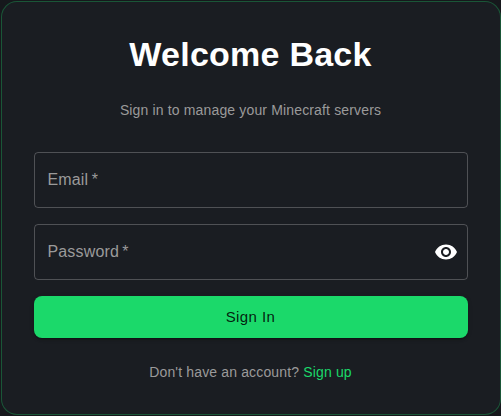

1. Management Console 서비스를 시작합니다:
   ```bash
   mcctl console service start
   ```

2. 브라우저를 열고 `http://localhost:5000`으로 이동합니다. **Welcome Back** 로그인 페이지로 이동합니다.

3. 자격 증명을 입력합니다:
    - **Email:** `mcctl console init` 과정에서 입력한 관리자 이메일
    - **Password:** 관리자 비밀번호 (눈 아이콘으로 표시/숨김을 전환할 수 있습니다)

4. **Sign In**을 클릭합니다. 로그인에 성공하면 [대시보드](#대시보드)로 이동합니다.

!!! tip "세션 유지"
    세션은 7일 동안 유효하며, 콘솔을 계속 사용하는 동안 자동으로 연장됩니다(24시간에 한 번 이하). 우측 상단의 사용자 아바타 메뉴에서 **Logout**을 클릭하면 수동으로 세션을 종료할 수 있습니다.

### 회원가입

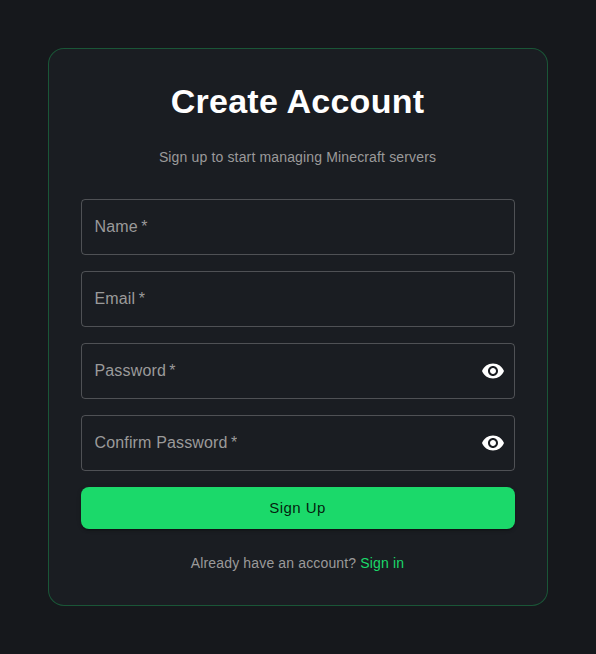

아직 계정이 없다면 로그인 폼 아래의 **Sign up**("Don't have an account? Sign up")을 클릭하여 **Create Account** 페이지를 엽니다:

1. **Name**과 **Email**을 입력합니다
2. **Password**(8자 이상)를 정하고 **Confirm Password**에 한 번 더 입력합니다
3. **Sign Up**을 클릭합니다

계정이 생성되면 바로 로그인된 상태로 대시보드로 이동합니다. 로그인 페이지로 돌아가려면 폼 아래의 **Sign in**을 클릭합니다.

!!! note "새 계정은 User 역할로 시작합니다"
    새 계정은 **User** 역할을 받습니다. User는 관리자 또는 서버 Owner가 접근 권한을 부여한 서버([Access 탭](#access-탭) 참조)만 볼 수 있으므로, 권한이 부여되기 전까지 Servers 페이지는 비어 있습니다. User가 직접 만든 서버에는 생성한 User에게 자동으로 Owner 권한이 부여됩니다. 회원가입 페이지는 인증 이메일을 발송하지 않습니다.

---

## 대시보드

대시보드는 여러분의 지휘 센터입니다. Minecraft 서버 인프라 전체를 한눈에 파악할 수 있습니다.

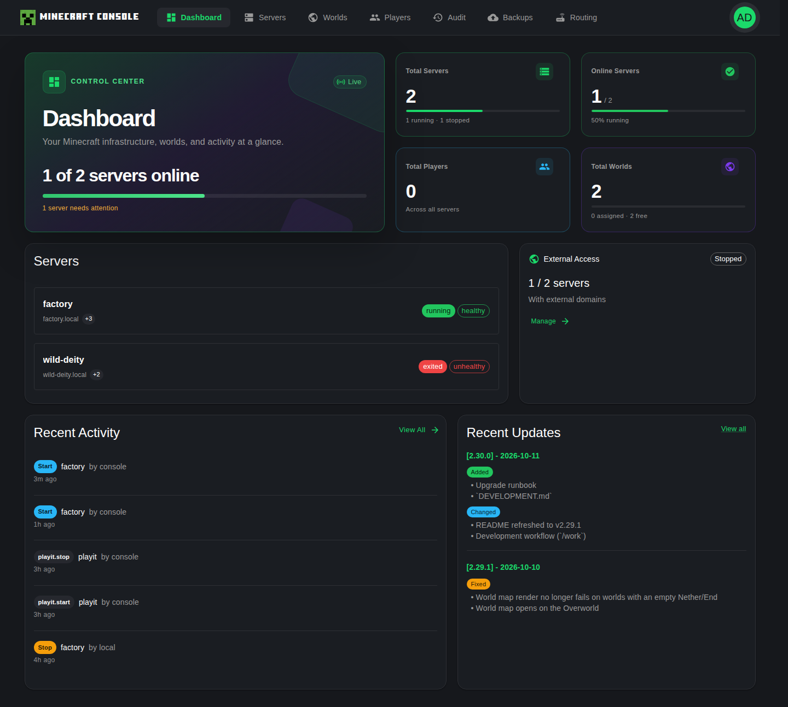

### 상태 히어로

v2.28.0부터 대시보드 최상단에 플랫폼 상태를 요약하는 상태 히어로가 표시됩니다. 온라인 서버 수(예: "2 of 3 servers online"과 진행 막대), 주의가 필요한 서버 수(실행 중이 아니거나 `unhealthy`인 서버), 그리고 실시간(SSE) 연결 상태를 나타내는 **Live** / **Reconnecting** 칩을 보여줍니다. 서버 데이터를 불러오지 못한 경우에는 0으로 표시하지 않고 데이터를 사용할 수 없음을 명시합니다.

### 통계 카드

상태 히어로 아래에 4개의 통계 카드가 주요 지표를 보여줍니다:

| 카드 | 설명 |
|------|------|
| **Total Servers** | 플랫폼에 구성된 전체 Minecraft 서버 수와 실행 중 / 중지 구분 |
| **Online Servers** | 현재 `running` 상태인 서버 수 (SSE를 통해 실시간 업데이트) |
| **Total Players** | 실행 중인 모든 서버의 총 접속 플레이어 수 |
| **Total Worlds** | 월드 저장소에 있는 사용 가능한 월드 수와 할당됨 / 미할당 구분 |

### 서버 패널

대시보드 왼쪽에는 **Servers** 패널이 최대 5개의 서버를 목록으로 표시합니다:

- **서버 이름**과 호스트명 (예: `botagent.local`)
- **상태 칩** -- `running`, `exited`, `stopped` 등 색상으로 구분됩니다
- **헬스 칩** -- 컨테이너가 헬스 상태를 보고하면 `healthy`, `unhealthy`, `starting` 같은 윤곽선 칩이 표시됩니다

서버를 클릭하면 해당 서버의 상세 페이지로 바로 이동합니다. 서버가 5개를 넘으면 패널 헤더에 **View All (N)** 링크가 나타나 전체 Servers 페이지로 이동합니다.

### External Access 카드

오른쪽에 있는 **External Access** 카드는 playit.gg 터널 상태를 보여줍니다:

- 외부 도메인이 구성된 서버 수 (예: "1 / 3 servers")
- 현재 에이전트 상태 (`Running` 또는 `Stopped`). playit.gg가 설정되지 않았다면 `Not configured` 칩이 표시됩니다
- 상세 설정을 위한 Routing 페이지로의 **Manage** 링크

### 최근 활동 피드

**Recent Activity** 피드는 서버에서 수행된 최근 관리 작업을 표시합니다:

- 서버 시작/중지 이벤트
- 백업 스케줄 변경
- 구성 수정
- 플레이어 관리 작업

각 항목에는 액션 유형(색상별 배지), 대상 서버 또는 리소스, 수행자, 경과 시간이 표시됩니다(마우스를 올리면 정확한 시각이 표시됩니다). 실패한 작업에는 상태 배지가 추가로 표시됩니다. **View All**을 클릭하면 전체 감사 로그 페이지로 이동합니다.

### 최근 업데이트 피드

**Recent Updates** 섹션은 mcctl 플랫폼 자체의 최신 버전 변경 로그를 보여줍니다. 최근 릴리스에 추가된 기능이나 수정된 버그를 빠르게 확인할 수 있습니다.

---

## 서버

서버 페이지에서 모든 Minecraft 서버를 관리합니다.

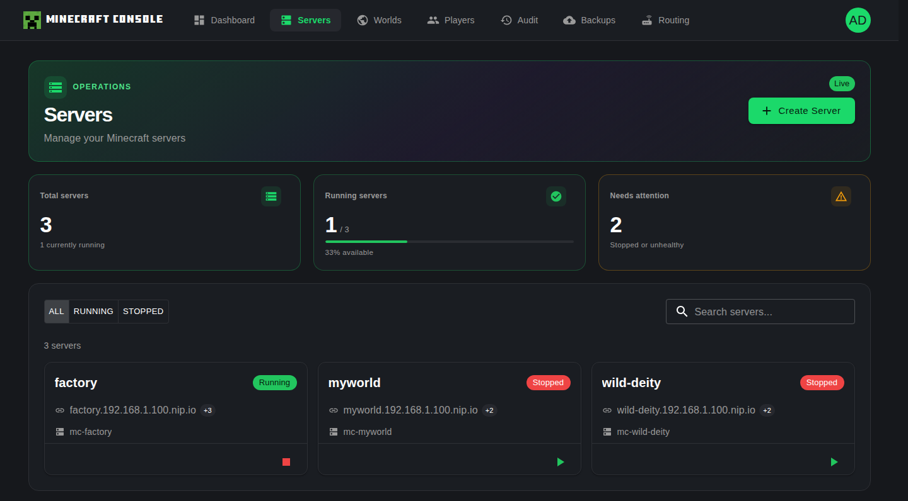

### 서버 목록

페이지 상단의 요약 패널에는 **Live** / **Reconnecting** 표시와 **+ Create Server** 버튼이 있습니다. 그 아래 세 개의 카드가 **Total servers**, **Running servers**, **Needs attention**(중지되었거나 unhealthy인 서버)을 보여줍니다. 이어서 구성된 모든 서버가 그리드 레이아웃의 카드로 표시됩니다. 각 서버 카드에는 다음이 표시됩니다:

- **서버 이름** (예: `botagent`, `factory`, `wild-deity`)
- **상태 배지** -- `Running`(녹색), `Stopped`(빨간색), 또는 `Created` / `Not Created`
- **호스트명**과 추가 호스트명 수 (예: `botagent.local +2`) -- `+2` 칩을 클릭하면 모든 호스트명이 표시됩니다
- **컨테이너 이름** (예: `mc-botagent`)
- **빠른 작업 버튼** -- 우측 하단에 중지된 서버는 시작(Play), 실행 중인 서버는 중지(Stop) 버튼

### 필터링 및 검색

카드 위에서 상태별로 서버를 필터링할 수 있습니다:

- **ALL** -- 모든 서버 표시
- **RUNNING** -- 실행 중인 서버만 표시
- **STOPPED** -- 중지된 서버만 표시

오른쪽의 **Search servers...** 박스로 서버 이름을 실시간으로 검색할 수 있습니다. 필터 아래에 조건에 맞는 서버 수가 표시됩니다.

### 새 서버 만들기

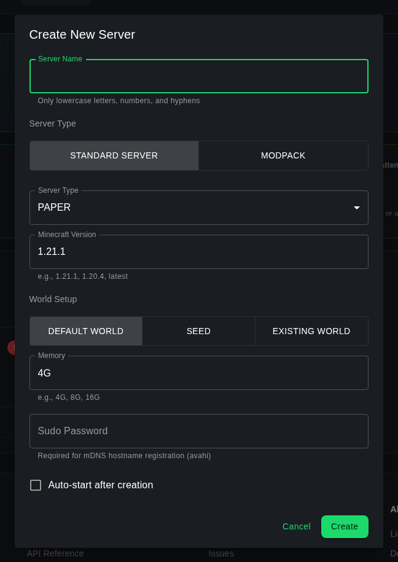

페이지 헤더의 **+ Create Server** 버튼을 클릭하면 **Create New Server** 다이얼로그가 열립니다. 다이얼로그에서 다음을 설정합니다:

1. **Server Name** -- 서버의 고유 식별자 (소문자, 숫자, 하이픈만 사용 가능)
2. **Server Type** -- 토글로 카테고리를 선택합니다:
    - **Standard Server** -- **Server Type**(VANILLA, PAPER, FABRIC, FORGE, NEOFORGE)과 **Minecraft Version**(예: `1.21.1`, `LATEST`)을 선택합니다. 기본값은 VANILLA와 `LATEST`입니다. 다른 유형은 로더가 최신 Minecraft 릴리스를 아직 지원하지 않을 수 있으니, 그럴 때는 `1.21.1`처럼 버전을 지정하세요
    - **Modpack** -- Modrinth 모드팩을 이름으로 검색하거나(`cobblemon` 같은 slug를 직접 입력해도 됩니다) **Mod Loader**와 호환되는 **Minecraft Version**을 선택합니다. 감지된 클라이언트 전용 모드는 **Exclude mods (optional)**에 자동으로 추가되며, 쉼표로 구분된 이 목록은 직접 수정할 수 있습니다
3. **World Setup** -- **Default World**, **Seed**(시드 입력), **Existing World**(할당되지 않은 월드 선택)
4. **Memory** -- 할당할 RAM 용량 (기본값: 일반 서버 `4G`, 모드팩 `6G`)
5. **Sudo Password** -- mDNS 호스트명 등록(avahi)에 필요합니다. 비워 두고 **Create**를 누르면 확인 창이 뜹니다. 호스트의 sudo가 비밀번호를 묻지 않으면 **Continue without password**를, 비밀번호를 입력하려면 **Enter password**를 선택하세요
6. **Auto-start after creation** -- 생성 직후 서버를 시작합니다

**Create**를 클릭하면 시작됩니다. 다이얼로그가 Server-Sent Events 기반의 진행 화면(**Initializing**, **Creating**, **Configuring**, **Starting**)으로 바뀌고, **Server Created Successfully** 또는 **Creation Failed**로 끝납니다.

### 서버 상세 페이지

서버 카드를 클릭하면 상세 서버 관리 화면이 열립니다. 상세 페이지의 구성:

#### 헤더 섹션

- 목록으로 돌아가는 **All servers** 버튼
- 서버 이름, `Minecraft <버전> · <유형>`, 호스트명, 가동 시간(Uptime)
- 현재 서버 상태를 나타내는 상태 배지, 헬스 배지(예: `Healthy`, `Unhealthy`), 실시간 연결 복구 중에 표시되는 **Reconnecting** 배지
- 중지된 서버에는 **Start**, 실행 중인 서버에는 **Stop**과 **Restart** 버튼
- **⋮** 메뉴의 **Delete Server**. 확인 다이얼로그에서 서버 이름을 직접 입력해야 하며, 삭제는 되돌릴 수 없습니다

#### 탐색 탭

서버 상세 페이지는 10개의 탭으로 구성됩니다:

| 탭 | 설명 |
|----|------|
| **Overview** | 실시간 로그 출력과 RCON 명령 입력이 가능한 서버 콘솔, 서버 정보, 플레이어, 연결 정보 |
| **Players** | 관리 액션과 플레이어별 상세 보기를 제공하는 온라인 + 오프라인 플레이어 목록 (v2.27.0+) |
| **World** | 할당된 월드의 정보, BlueMap 웹 지도, 광석 및 블록 통계, 플레이어 위치 |
| **Activity** | 이 서버에서 수행된 모든 작업의 서버별 감사 기록 |
| **Mods** | 모드 관리 -- Modrinth에서 모드 검색, 설치, 제거 |
| **Files** | 서버 파일 탐색, 편집, 업로드, 다운로드를 위한 파일 관리자 |
| **Config History** | 서버 구성 스냅샷 타임라인 -- 비교, 복원, 삭제 |
| **Backups** | 이 서버의 Config Snapshots와 World Backups |
| **Access** | 사용자 권한 관리 -- 사용자별 접근 권한 부여, 수정, 철회 |
| **Options** | 호스트명 관리와 게임 설정이 포함된 서버 구성 편집기 |

#### 리소스 모니터링

탭 아래의 3개 통계 카드가 선형 진행 막대와 함께 실시간 리소스 사용량을 표시합니다:

- **CPU usage** -- 현재 CPU 사용률
- **Memory usage** -- 할당된 메모리 대비 현재 RAM 소비량 백분율
- **World size** -- 현재 월드가 사용하는 디스크 공간

### Overview 탭

Overview 탭은 서버 상세 페이지를 열었을 때 기본으로 표시되는 화면입니다. 서버를 실시간으로 모니터링하고 상호작용할 수 있는 지휘 센터 역할을 합니다.

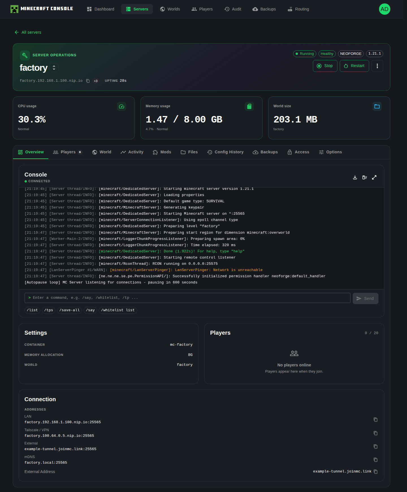

#### 콘솔

Overview 탭의 핵심은 **Console** 패널로, 서버의 실시간 로그 출력과 명령어 인터페이스에 직접 접근할 수 있습니다:

- **실시간 로그 스트림** -- 콘솔은 서버 로그 메시지를 실시간으로 표시합니다. 월드 로딩, 플레이어 접속, 게임 상태 변경 등의 서버 이벤트에 대한 타임스탬프가 포함된 항목을 보여줍니다. 각 로그 줄에는 타임스탬프와 로그 레벨(예: `INFO`)이 포함되어 문제 해결에 유용합니다. RCON 관련 로그 줄은 숨겨지며, 헤더에는 로그 스트림의 **Connected** / **Disconnected** 표시가 있습니다.
- **명령어 입력** -- 콘솔 하단의 **"Send a command"** 입력 필드에서 RCON을 통해 Minecraft 서버 명령어를 직접 실행할 수 있습니다. 명령어(예: `say Hello!`, `gamemode creative Player1`, `time set day`)를 입력하고 Enter를 누르면 서버로 전송됩니다. 명령어 결과는 위의 로그 스트림에 표시됩니다. 로그 스트림 연결이 끊기면 입력 필드가 비활성화됩니다.
- **자동 스크롤** -- 콘솔은 최신 로그 항목이 도착하면 자동으로 스크롤됩니다. 이전 로그를 읽으려고 위로 스크롤하면 모서리에 맨 아래로 이동하는 버튼이 나타납니다.
- **확장 콘솔** -- 콘솔 우측 상단의 확장 버튼을 누르면 전체 화면 **Console - `<서버>`** 다이얼로그가 열립니다. 로그 레벨 필터(**ALL**, **INFO**, **WARN**, **ERROR**), **Auto-scroll** 및 **Hide RCON** 체크박스, 로그 지우기 버튼, 연결이 끊겼을 때의 **Reconnect** 버튼, **Quick** 명령 버튼(`say`, `give`, `tp`, `gamemode`), 그리고 **Enter command...** 입력창과 **Send** 버튼이 제공됩니다.

!!! tip "콘솔 명령어"
    콘솔은 모든 표준 Minecraft 서버 명령어를 지원합니다. 명령어 앞에 `/`를 붙일 필요 없이, 명령어 이름과 인수를 직접 입력하면 됩니다 (예: `whitelist add Player1`).

#### 서버 정보

콘솔 아래의 **Server Information** 카드는 서버 구성과 런타임 상태에 대한 핵심 정보를 표시합니다:

| 필드 | 설명 |
|------|------|
| **Name** | 서버의 표시 이름 (예: `botagent`) |
| **Container** | Docker 컨테이너 이름 (예: `mc-botagent`) |
| **Hostname** | 클라이언트 연결을 위한 주 호스트명 (예: `botagent.local`) |
| **Type** | 서버 플랫폼 유형 (VANILLA, PAPER, FORGE, NEOFORGE, FABRIC 등) |
| **Version** | Minecraft 게임 버전 (예: `1.21.11`) |
| **Memory** | 할당된 JVM 메모리 (예: `2G`) |
| **Uptime** | 마지막 시작 이후 서버 실행 시간 |

#### 플레이어

**Players** 카드는 `online / max` 플레이어 수와 현재 서버에 접속 중인 플레이어의 이름을 보여줍니다. 플레이어 목록을 읽을 수 없을 때는 "Player information unavailable"이 표시됩니다.

#### 연결 정보

**Connection** 카드는 클라이언트가 서버에 접속하는 방법을 보여줍니다:

- **Addresses** -- 포트 `25565`가 붙은 서버의 모든 호스트명과 복사 버튼. 각 주소에는 종류 라벨이 붙습니다: **LAN**, **Tailscale / VPN**, **nip.io**, **External**(직접 지정한 도메인), **mDNS**(`.local`). LAN 주소가 먼저 표시됩니다
- **External Address** -- 이 서버에 할당된 playit.gg 도메인(복사 버튼 포함) 또는 `Not configured`. playit.gg가 활성화된 경우에 이 행이 표시됩니다

복사 버튼은 다른 기기에서 일반 HTTP로 콘솔을 열었을 때도 동작하며, 복사에 실패하면 메시지를 표시합니다.

### Players 탭

*v2.27.0부터 사용할 수 있습니다.*

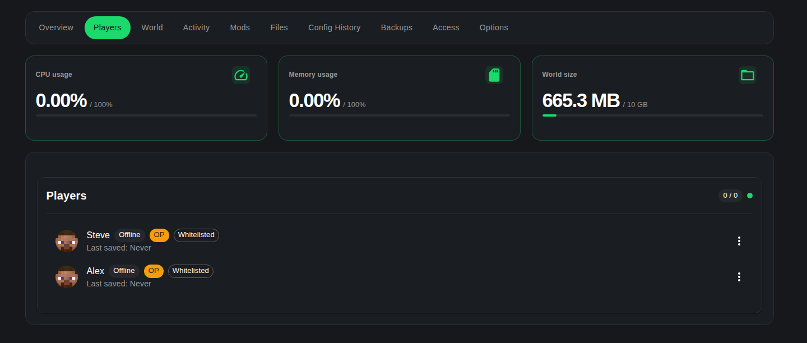

**Players** 탭은 현재 접속 중인 플레이어뿐 아니라 서버가 알고 있는 모든 플레이어를 보여줍니다. 두 가지 소스를 합쳐서 표시합니다:

- **온라인 플레이어** -- 서버 실행 중 RCON으로 실시간 조회
- **알려진 플레이어** -- 서버 파일(`usercache.json`, `playerdata/`, `ops.json`, `whitelist.json`, `banned-players.json`)에서 읽음

파일 기반 목록은 RCON이 필요 없으므로 서버가 **중지된 상태**에서도 목록이 표시됩니다(이때 모든 플레이어가 Offline으로 표시됩니다). 목록은 SSE로 실시간 갱신되며, 헤더의 `online / max` 카운터 옆 점은 실시간 연결 여부를 나타냅니다.

각 행에는 플레이어 아바타(`mc-heads.net`), 이름, 배지가 표시됩니다:

| 배지 | 의미 |
|------|------|
| **Online** / **Offline** | 현재 접속 상태 |
| **OP** | 서버 운영자(Operator) |
| **Banned** | 차단 목록에 등록됨 |
| **Whitelisted** | 화이트리스트에 등록됨 |

오프라인 플레이어에는 서버가 플레이어 데이터를 마지막으로 저장한 시각이 **Last saved**로 함께 표시됩니다.

#### 플레이어 액션

행의 **⋮** 메뉴를 클릭하여 플레이어를 관리합니다. 플레이어의 현재 상태에 해당하는 액션만 표시됩니다:

| 액션 | 표시 조건 | 비고 |
|------|-----------|------|
| **Details** | UUID가 있는 플레이어 | 플레이어 상세 모달을 엽니다 (아래 참조) |
| **Kick** | 온라인 플레이어 | 사유(선택) 입력이 가능한 확인 대화상자 |
| **Ban** / **Unban** | 미차단 / 차단됨 | Ban 시 사유 입력 (기본값: `Banned by administrator`) |
| **Make OP** / **Remove OP** | OP 아님 / OP | Make OP는 권한 레벨 4를 부여합니다 |
| **Add to Whitelist** / **Remove from Whitelist** | 미등록 / 등록됨 | |

!!! note "Players 탭과 플레이어 관리 페이지의 차이"
    Players 탭은 서버 상세 페이지에서 해당 서버 하나의 플레이어를 관리합니다. 상단 내비게이션 바에서 이동하는 [플레이어 관리](#플레이어-관리) 페이지는 서버 선택기와 함께 화이트리스트/운영자/차단 목록을 제공합니다.

#### 플레이어 상세 모달

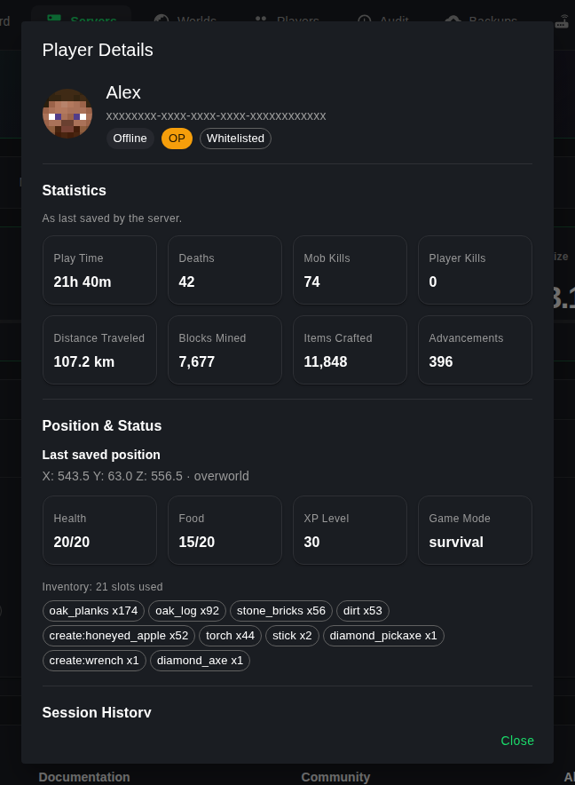

액션 메뉴에서 **Details**를 선택하면 플레이어 상세 모달이 열립니다. 헤더에는 아바타, 이름, UUID와 목록과 동일한 배지가 표시되며, 본문은 세 개의 섹션으로 구성됩니다.

**Statistics** -- 서버가 마지막으로 저장한 값입니다(월드 폴더의 `stats/<uuid>.json`, `advancements/<uuid>.json` 기반):

| 항목 | 설명 |
|------|------|
| Play Time | 누적 게임 플레이 시간 (`Xh Ym`) |
| Deaths | 사망 횟수 |
| Mob Kills / Player Kills | 몹 / 플레이어 처치 수 |
| Distance Traveled | 총 이동 거리 (m / km) |
| Blocks Mined | 채굴한 블록 수 |
| Items Crafted | 제작한 아이템 수 |
| Advancements | 달성한 발전과제 수 |

통계 파일이 아직 없으면 "No statistics recorded yet."이 표시됩니다.

**Position & Status** -- 플레이어의 `playerdata/<uuid>.dat`에서 파싱한 정보입니다:

- 좌표(X / Y / Z)와 차원(dimension)
- 체력과 허기(각 20 기준), XP 레벨, 게임 모드
- 인벤토리 요약: 사용 중인 슬롯 수와 최대 10개의 아이템 스택

플레이어가 온라인이고 서버가 실행 중이면 좌표를 RCON으로 실시간 조회하며 **Live position**과 **Live** 배지가 표시됩니다. 플레이어가 온라인인 동안 모달은 5초마다 갱신됩니다. 오프라인 플레이어는 **Last saved position**(마지막 저장 위치)이 표시됩니다.

**Session History** -- 서버 로그에서 수집한 접속/퇴장 이력입니다:

- **Visits**(방문 횟수), **Total Playtime**(누적 플레이 시간), **Last Seen**(마지막 접속)
- 최근 세션 목록(최신순, 최대 20개): 접속 → 퇴장 시각과 머문 시간. 아직 접속 중인 세션은 **Online now**로 표시됩니다

!!! warning "세션 이력은 수집기 도입 시점부터 기록됩니다"
    세션 이력은 월드 파일에서 읽는 정보가 아닙니다. mcctl-api가 30초마다 실행 중인 각 서버의 Docker 로그에서 `<player> joined/left the game` 메시지를 파싱하여 `data/players.db`(SQLite, 플랫폼 루트 하위)에 저장합니다. 따라서 이력은 **mcctl-api v2.27.0 이상이 수집기를 처음 실행한 시점부터**만 존재합니다. 서버별 최초 수집 시에는 해당 컨테이너 로그의 **최근 24시간분까지만** 소급하며, 그 이전 세션은 복구되지 않습니다. 이후에는 서버별 커서(cursor)부터 이어서 수집하므로, 공백 기간(예: mcctl-api가 중지되어 있던 동안)은 해당 로그가 컨테이너 로그에 아직 남아 있을 때만 채워집니다. 컨테이너를 재생성하면 이전 로그는 사라집니다. 서버가 중지된 것이 감지되면 열려 있는 세션은 그 시각으로 종료 처리됩니다.

    수집된 데이터가 없으면 "No sessions recorded yet (history is collected from server logs)."가 표시됩니다.

### World 탭

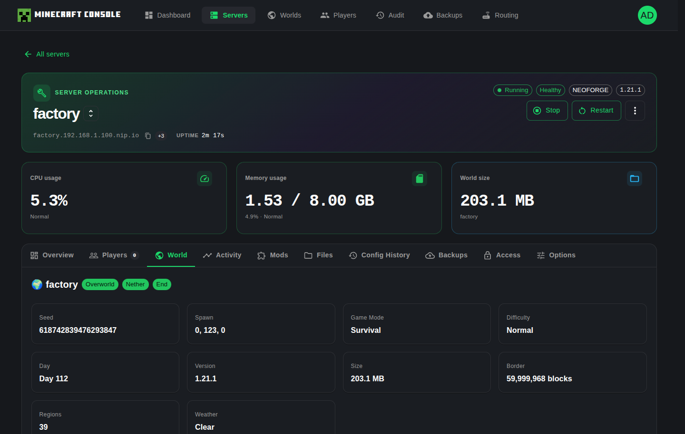

**World** 탭은 서버에 할당된 월드를 보여줍니다. 할당된 월드가 없으면 "No world is assigned to this server."가 표시됩니다. [월드](#월드) 페이지에서 월드 카드를 클릭했을 때 **World Details**로 열리는 패널과 같은 화면입니다. 구성은 다음과 같습니다:

- **헤더** -- 월드 이름과 **Overworld**, **Nether**, **End** 칩. 해당 차원이 월드에 있으면 칩이 채워져 표시됩니다
- **정보 카드** -- **Seed**, **Spawn**, **Game Mode**, **Difficulty**(하드코어면 "(Hardcore)" 표시), **Day**, **Version**, **Size**, **Border**, **Regions**, **Weather**. Seed 또는 Spawn 카드를 클릭하면 값이 복사됩니다
- **Map** -- BlueMap 웹 지도 (아래 참조)
- **Ore & Block Stats** -- 월드 전체의 블록 통계 (아래 참조)
- **Players** -- 알려진 각 플레이어의 `online` / `offline` 칩, 이름, 좌표(클릭하면 복사), 차원. 온라인 플레이어는 실시간 위치를, 오프라인 플레이어는 마지막 저장 위치를 사용하며, 접속 중인 플레이어가 없으면 그 사실을 안내합니다

#### 지도

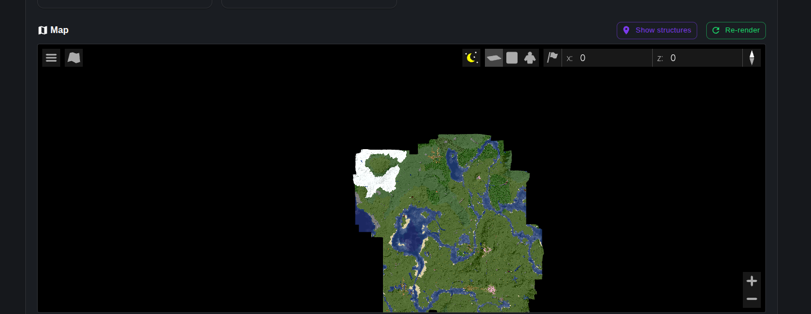

**Render map**은 월드의 BlueMap 웹 지도를 생성하고, **Re-render**는 이를 갱신합니다. 지도는 버튼 바로 아래에 삽입되며, 렌더링 중에는 진행 막대가 표시됩니다. 지도는 기본적으로 **Overworld**에서 열립니다 (Nether와 End는 뷰어에서 선택할 수 있습니다). v2.29.0 이전에 렌더링한 월드는 **Re-render** 시 이 설정이 적용됩니다. 렌더링 후에는 **Show structures**로 지도에 구조물을 표시할 수 있으며, 구조물 유형은 BlueMap 범례에서 켜고 끌 수 있습니다.

#### 광석 및 블록 통계

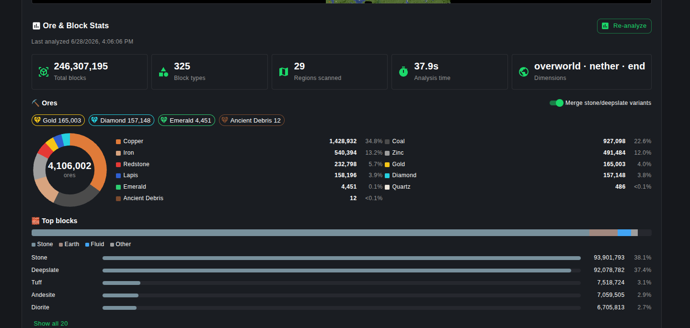

**Analyze**는 월드의 모든 청크를 스캔하고(큰 월드에서는 수 분이 걸릴 수 있으며 진행률이 표시됨) 결과를 캐시하며, **Re-analyze**로 갱신합니다. 패널에는 마지막 분석 시각이 표시되고, 이어서 다음과 같이 결과가 나타납니다:

- **KPI 카드**: 전체 블록 수, 블록 종류, 스캔한 리전 수, 분석 시간, 차원
- **광석(Ores)**: 범례(개수와 비율)가 있는 도넛 차트, 희귀 광석(gold, diamond, emerald, ancient debris) 강조 칩, **Merge stone/deepslate variants** 토글
- **상위 블록(Top blocks)**: 카테고리별(Stone, Earth, Wood, Fluid, Nether, Other) 누적 막대와 상위 5개 목록 (**Show all**로 확장)

### Activity 탭

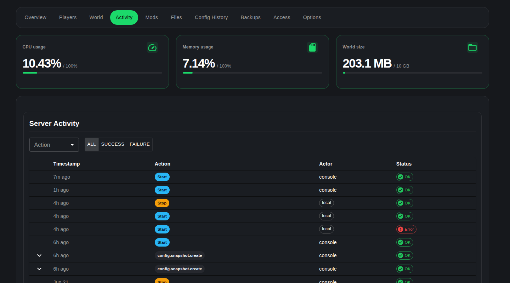

**Activity** 탭은 이 서버의 감사 기록을 [감사 로그](#감사-로그) 페이지와 같은 테이블로, Target 컬럼 없이 보여줍니다:

- **Action** 드롭다운(**All Actions** 또는 특정 서버 액션)과 상태 토글(**ALL**, **SUCCESS**, **FAILURE**)
- 페이지당 행 수 25 또는 50
- 이 서버로 이미 필터링된 감사 로그 페이지를 여는 **View Full History** 링크

### Mods 탭

Mods 탭은 모드 서버 플랫폼(FORGE, NEOFORGE, FABRIC)을 실행하는 서버를 위한 완전한 모드 관리 인터페이스를 제공합니다. 수동 파일 관리 없이 [Modrinth](https://modrinth.com/) 저장소에서 직접 모드를 검색, 설치, 제거할 수 있습니다.

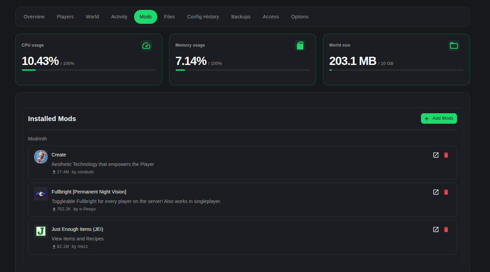

!!! note "모드 서버 전용"
    Mods 탭은 모드 서버 유형(FORGE, NEOFORGE, FABRIC)에서 가장 유용합니다. 모든 서버에서 탭이 표시되지만, 모드 설치에는 호환되는 서버 플랫폼이 필요합니다.

#### 설치된 모드

**Installed Mods** 카드는 추가한 모드를 출처(예: `Modrinth`)별로 묶어 보여줍니다. 각 항목에는 다음이 표시됩니다:

- **모드 아이콘** -- Modrinth에서 가져온 모드의 썸네일 이미지
- **모드 이름** -- 모드의 표시 이름 (예: `Create`)
- **설명** -- 모드의 기능을 간략하게 요약한 텍스트 (예: "Aesthetic Technology that empowers the Player")
- **다운로드 수** -- Modrinth에서의 총 다운로드 수 (예: `12.6M`)로, 모드의 인기도를 나타냅니다
- **제작자** -- 모드 제작자의 사용자명 (예: `simibubi`)
- **View on Modrinth** 버튼 (외부 링크 아이콘) -- Modrinth에서 모드의 상세 정보, 변경 로그, 문서를 새 탭에서 엽니다
- **Remove** 버튼 (빨간색 쓰레기통 아이콘) -- 확인 프롬프트 없이 서버의 모드 목록에서 모드를 즉시 제거합니다

추가한 모드가 없으면 카드에 "No mods installed"가 표시됩니다.

#### 새 모드 추가

Installed Mods 카드 우측 상단의 **+ Add Mods** 버튼을 클릭하면 **Search Mods** 다이얼로그가 열립니다:

1. **Search Modrinth...** 입력창에 모드 이름이나 키워드를 입력합니다 -- 입력하는 동안 결과가 나타납니다
2. 각 결과의 아이콘, 제목, 설명, 다운로드 수, 제작자를 확인합니다
3. **Add**를 클릭해 모드를 추가합니다. 이미 서버에 있는 모드에는 **Installed**가 표시됩니다

#### 설치된 Jar 파일

모드팩으로 만든 서버에서는 **Installed Jar Files (from modpack)** 카드가 mods 디렉토리의 모든 `.jar` 파일을 보여줍니다. 행의 **Included** / **Excluded** 스위치로 다음 설치에서 제외할 모드를 지정할 수 있습니다 -- 전용 서버에서 충돌을 일으키는 클라이언트 전용 모드에 유용합니다. 모드팩이 처음 설치되기 전에는 "No jar files found in the mods directory."가 표시됩니다.

!!! warning "서버 재시작 필요"
    모드를 추가하거나 제거한 후, 또는 제외 목록을 변경한 후에는 변경사항을 적용하기 위해 서버를 재시작해야 합니다. 변경하면 탭에 "Restart the server to apply mod changes." 안내가 표시됩니다.

### Files 탭

Files 탭은 서버 파일 시스템을 위한 완전한 기능의 파일 관리자를 제공합니다.

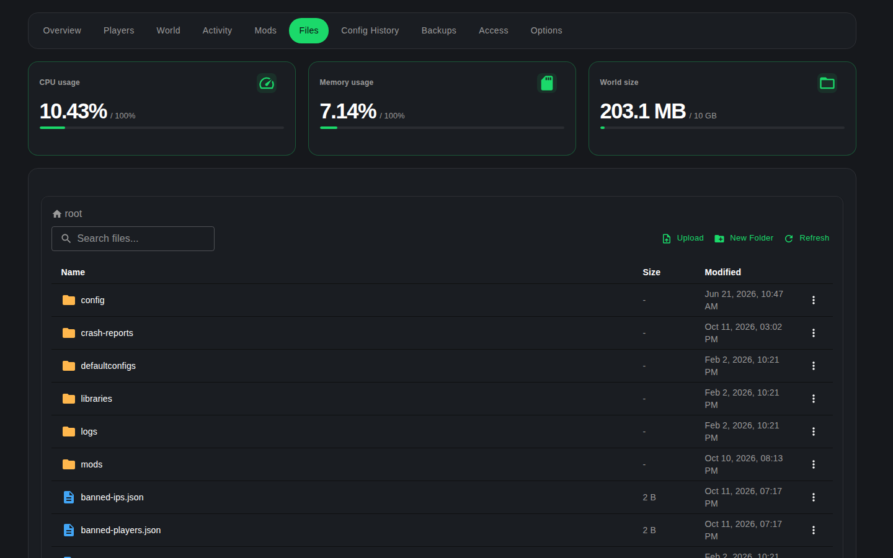

#### 파일 브라우저

파일 브라우저는 서버의 데이터 디렉토리 내용을 익숙한 목록 레이아웃으로 표시합니다:

- 상단의 **경로 탐색(Breadcrumb)**이 현재 경로(예: `root /`)를 보여주며, 클릭으로 상위 디렉토리로 이동할 수 있습니다
- 현재 디렉토리에서 파일 이름으로 필터링하는 **Search files...** 박스
- 각 파일 항목에 파일 이름, 크기, 마지막 수정일이 표시됩니다
- **폴더**가 먼저 나열되고, 그 다음에 파일이 표시됩니다

#### 파일 작업

툴바에서 여러 작업을 수행할 수 있습니다:

| 작업 | 설명 |
|------|------|
| **Upload** | 드래그 앤 드롭 다이얼로그를 통해 현재 디렉토리에 파일 업로드 |
| **New Folder** | 현재 경로에 새 디렉토리 생성 |
| **Refresh** | 파일 목록 새로고침 |

각 행 끝의 **⋮** 메뉴에서 다음을 수행할 수 있습니다:

- **Open** -- 폴더 열기 (폴더에만 표시)
- **Edit** -- 에디터에서 파일 열기 (텍스트 파일에만 표시)
- **Download** -- 로컬 머신으로 파일 다운로드 (파일에만 표시)
- **Rename** -- 파일 또는 폴더 이름 변경
- **Delete** -- 확인 다이얼로그를 거쳐 파일 또는 폴더 삭제. 중요한 파일은 파일 이름을 직접 입력해야 삭제됩니다

#### 스마트 파일 에디터

파일 관리자에는 파일 유형에 맞게 적응하는 지능적인 에디터가 포함되어 있습니다:

- **server.properties** -- **Form** 보기(카테고리별, 검색 가능한 필드)와 **Raw** 보기(일반 텍스트)를 제공하는 특화된 에디터로 열립니다
- **플레이어 데이터 파일** (whitelist.json, ops.json, banned-players.json) -- Mojang API 통합으로 사용자명 조회가 가능한 전용 플레이어 에디터로 열립니다
- **텍스트 파일** (.txt, .md, .json, .yml, .yaml, .properties, .cfg, .conf, .ini, .toml, .xml, .csv, .log, .sh, .bat) -- 구문 인식이 가능한 코드 에디터로 열립니다
- **기타 파일** -- 다운로드만 가능합니다

!!! warning "server.properties 편집"
    `server.properties` 에디터는 실행 중인 서버의 파일을 직접 수정합니다. 이 변경은 서버 컨테이너를 재생성하면 유지되지 않습니다. 영구적으로 유지할 설정은 [Options 탭](#options-탭)을 사용하세요.

### Config History 탭

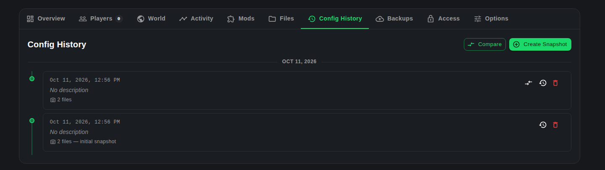

**Config History** 탭은 이 서버의 구성 스냅샷 타임라인을 보관합니다. 스냅샷은 서버의 구성 파일(`server.properties`, `config.env` 등)을 저장하므로, 버전을 비교하고 이전 상태로 되돌릴 수 있습니다. 같은 스냅샷은 [백업](#백업) 페이지에서도 확인할 수 있습니다.

- **Create Snapshot** -- 현재 구성을 저장합니다. "Before modpack update" 같은 설명을 선택적으로 입력할 수 있습니다
- **타임라인** -- 스냅샷이 최신순으로 날짜별로 묶여 표시됩니다. 각 항목에는 시각, 스케줄이 생성한 경우 **Scheduled** 칩, 설명("No description"일 수 있음), 파일 수가 표시됩니다
- **View diff** -- 해당 스냅샷을 이전 스냅샷과 비교합니다
- **Restore** -- 구성을 해당 스냅샷으로 되돌립니다
- **Delete** -- 휴지통 버튼을 누른 뒤 3초 안에 **Confirm**을 클릭합니다
- **Compare** -- 스냅샷이 2개 이상일 때 나타납니다. 비교 모드에서 임의의 스냅샷 2개를 선택하고 **View Diff**를 클릭합니다
- **Load More** -- 목록이 길면 이전 스냅샷을 더 불러옵니다

**Config Diff** 다이얼로그는 **Snapshot A**와 **Snapshot B**를 왼쪽 파일 트리, **Unified** / **Split** 보기 전환, 수정/추가/삭제된 파일 요약과 함께 보여줍니다. 이 탭에서는 **Restore to Snapshot A** 버튼도 제공됩니다.

**Restore Configuration** 다이얼로그는 적용될 변경 사항을 나열하며, **Create safety snapshot before restoring (recommended)**가 기본으로 선택되어 있습니다. 서버가 실행 중이면 변경 사항을 적용하려면 재시작이 필요할 수 있다고 안내합니다.

### Backups 탭

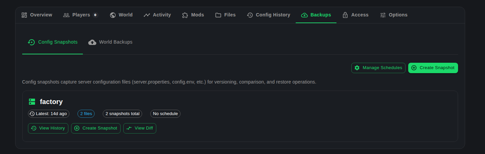

서버의 **Backups** 탭에는 두 개의 하위 탭이 있습니다:

- **Config Snapshots** (기본) -- 이 서버의 스냅샷 요약 카드(최신 스냅샷, 파일 수, 전체 스냅샷 수, 스케줄 상태)와 **View History**, **Create Snapshot**, **View Diff** 버튼. **Manage Schedules**는 [Config Snapshots](#config-snapshots)에서 설명하는 스케줄 패널을 엽니다
- **World Backups** -- 플랫폼 전체의 월드 백업 화면: **Push Backup**, 백업 상태, 백업 스케줄, 백업 이력이 [백업](#백업) 페이지와 동일하게 표시됩니다

### Access 탭

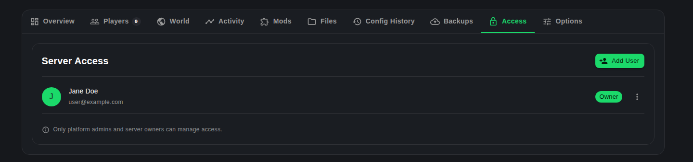

**Access** 탭은 이 서버를 다룰 수 있는 사용자를 제어합니다. 각 행에는 사용자의 아바타, 이름, 이메일, 권한 배지가 표시됩니다:

| 권한 | 의미 (권한 부여 다이얼로그의 설명) |
|------|-----------------------------------|
| **Viewer** | 서버 상태와 로그를 볼 수 있음 |
| **Operator** | 서버를 시작, 중지하고 구성할 수 있음 |
| **Owner** | 다른 사용자 관리를 포함한 전체 제어 |

- **Add User**를 누르면 **Add User Access** 다이얼로그가 열립니다. 이름 또는 이메일로 검색(2자 이상 입력)하고 **Permission Level**을 선택한 뒤 **Add User**를 클릭합니다
- 행의 **⋮** 메뉴에는 **Change to Owner**, **Change to Operator**, **Change to Viewer**, **Remove Access**가 있습니다. 서버의 마지막 Owner는 강등하거나 제거할 수 없습니다
- 접근 권한은 플랫폼 관리자와 서버 Owner만 관리할 수 있습니다. 플랫폼 관리자는 모든 서버를 볼 수 있고, 그 외 사용자는 권한을 부여받은 서버만 볼 수 있습니다

### Options 탭

Options 탭은 서버의 포괄적인 구성 편집기를 제공합니다.

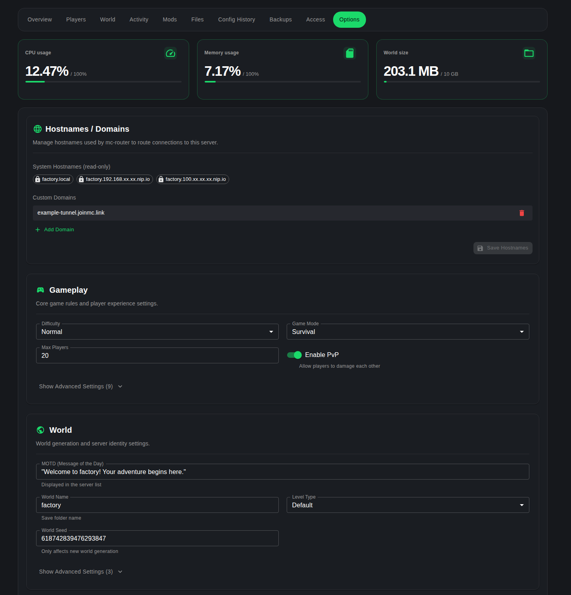

#### 호스트명 / 도메인

Options 탭 상단의 **Hostnames / Domains** 카드는 이 서버로의 연결 라우팅에 구성된 모든 호스트명을 보여줍니다:

- **System Hostnames (read-only)** -- 자동 생성된 호스트명 (예: `botagent.local`, `botagent.192.168.xx.xx.nip.io`)
- **Custom Domains** -- 사용자 정의 커스텀 도메인 이름. 각 도메인에 삭제 버튼이 있습니다
- 추가 커스텀 호스트명을 입력하는 **+ Add Domain** 버튼. `.local` 또는 `.nip.io`로 끝나는 도메인은 시스템 호스트명 전용이므로 사용할 수 없습니다
- 목록을 저장하는 **Save Hostnames** 버튼. 호스트명 변경은 서버 컨테이너를 재생성해야 적용됩니다 -- `docker compose up -d`를 실행하거나 웹 콘솔에서 서버를 재시작하세요

#### 설정 섹션

호스트명 아래에는 설정이 카드별로 묶여 있습니다. 각 카드는 필수 필드를 먼저 보여주고, 카드 하단의 **Show Advanced Settings (N)** 토글을 누르면 추가 필드가 나타납니다:

| 섹션 | 필수 필드 |
|------|-----------|
| **Gameplay** | Difficulty (Peaceful, Easy, Normal, Hard), Game Mode (Survival, Creative, Adventure, Spectator), Max Players, Enable PvP |
| **World** | MOTD (Message of the Day), World Name, Level Type (Default, Flat, Large Biomes, Amplified, Buffet), World Seed |
| **Security** | Online Mode (Mojang Auth), Enable Whitelist |
| **Performance & JVM** | Memory, Aikar's Flags, View Distance |
| **Auto-pause / Auto-stop** | Enable Auto-pause, Pause Timeout |
| **System** | Timezone, Resource Pack URL, Enable RCON |
| **Remote Access** | Enable WebSocket Console, Enable SSH Console |
| **Configuration Repositories** | `server.properties`와 Paper, Pufferfish, Purpur 설정용 Git 저장소 URL (시작 시 적용) |

고급 필드의 예로는 Gameplay의 Hardcore, Allow Flight, Spawn Protection, Performance & JVM의 Simulation Distance, Initial Heap, Max Heap, JVM -XX Options, Auto-pause / Auto-stop의 Enable Auto-stop, System의 RCON Password, RCON Port, UID, GID가 있습니다.

#### 저장 및 재시작

설정을 수정하면:

1. 페이지 하단에 **고정 액션 바**가 나타나 "N unsaved changes"를 표시합니다 (재시작이 필요한 필드가 있으면 함께 표시됩니다)
2. **Save Changes (N)**를 클릭하여 변경사항을 적용합니다
3. 서버가 실행 중이고 변경된 설정 중 재시작이 필요한 항목(예: 메모리, 온라인 모드, 월드 설정)이 있으면 **Save Only**, **Save & Restart**, **Cancel** 버튼이 있는 **Restart Required** 다이얼로그가 나타납니다
4. **Discard**를 클릭하면 저장하지 않은 변경사항을 취소합니다

!!! warning "재시작 필요"
    메모리 할당, 온라인 모드, 월드 시드 같은 일부 설정은 적용하려면 서버 재시작이 필요합니다. UI에서 변경 후 어떤 설정이 재시작을 필요로 하는지 명확하게 표시합니다.

#### Danger Zone

Options 탭 맨 아래의 **Danger Zone** 카드에는 현재 월드를 영구 삭제하고 새 월드를 생성하는 **Reset World**가 있습니다. 서버가 실행 중이면 버튼이 비활성화되며("Stop the server first"), 확인 다이얼로그에서 `RESET`을 입력해야 합니다. 이 작업은 되돌릴 수 없습니다.

---

## 플레이어 관리

Players 페이지에서 모든 서버의 플레이어를 종합적으로 관리합니다.

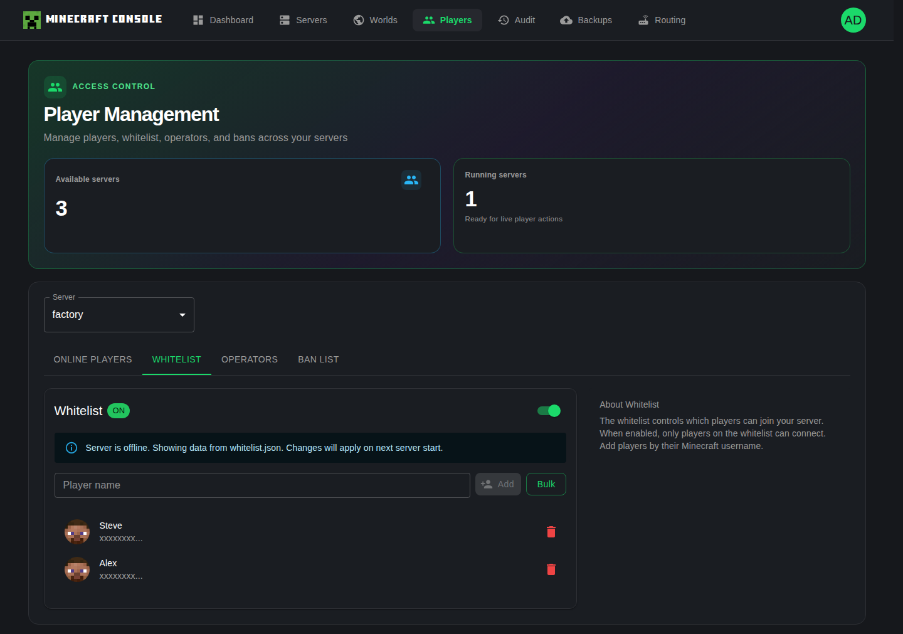

### 서버 선택

페이지 상단의 **Server** 드롭다운으로 관리할 서버를 선택합니다. 선택한 서버에 따라 아래 **Whitelist**, **Operators**, **Ban List** 탭에 표시되는 데이터가 결정됩니다. 드롭다운 위의 두 카드는 사용 가능한 서버 수와 실행 중인 서버 수를 보여줍니다.

### 탭

플레이어 관리 페이지는 4개의 탭으로 구성됩니다:

#### Online Players

현재 접속 중인 플레이어를 서버별로 묶어 보여주며, **Kick** 액션(사유는 선택)을 제공합니다. 이 탭은 모든 서버를 대상으로 하며 Server 드롭다운과 무관합니다. 새로고침 버튼으로 목록을 다시 불러올 수 있습니다.

#### Whitelist

서버에 참여할 수 있는 플레이어를 관리합니다:

- **Whitelist 토글** -- 화이트리스트 활성화/비활성화 (ON/OFF 스위치)
- **플레이어 입력 필드** -- 화이트리스트에 추가할 Minecraft 사용자명 입력
- **Add 버튼** -- 단일 플레이어 추가
- **Bulk 버튼** -- 여러 줄 입력(`player1, player2, player3`)으로 전환하여 **Add All**로 여러 플레이어를 한 번에 추가
- **플레이어 목록** -- 화이트리스트에 등록된 모든 플레이어가 Minecraft 아바타와 함께 표시되며, 제거 버튼 포함. 목록이 5명 이상이면 검색 박스가 나타납니다

!!! info "오프라인 서버 데이터"
    서버가 오프라인일 때 Players 페이지는 서버의 파일(whitelist.json, ops.json, banned-players.json)에서 직접 데이터를 읽습니다. "Server is offline. Showing data from whitelist.json. Changes will apply on next server start."라는 안내 배너가 표시됩니다.

#### Operators

운영자(관리자) 권한을 가진 플레이어를 관리합니다:

- 구성 가능한 권한 레벨(1-4)로 플레이어를 운영자로 추가
- **레벨 1**: 스폰 보호를 우회할 수 있음
- **레벨 2**: /clear, /gamemode 등을 사용할 수 있음
- **레벨 3**: /ban, /kick, /op 등을 사용할 수 있음
- **레벨 4**: /stop 사용 가능, 전체 접근 권한

오른쪽 정보 패널에서 각 OP 레벨에 대한 상세 설명을 확인할 수 있습니다.

#### Ban List

차단된 플레이어를 관리합니다:

- 선택적 사유와 함께 사용자명으로 플레이어 차단
- 현재 차단된 모든 플레이어 조회
- 한 번의 클릭으로 플레이어 차단 해제(사면)
- 차단 작동 방식을 설명하는 정보 패널

---

## 월드

Worlds 페이지에서 플랫폼에 저장된 모든 Minecraft 월드를 관리합니다.

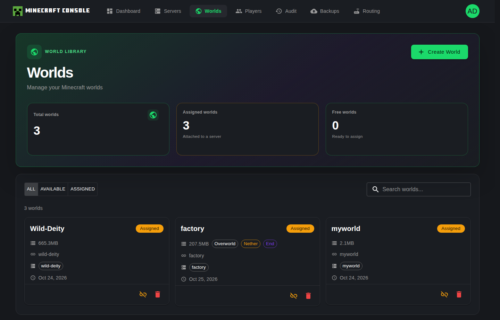

### 월드 목록

페이지 헤더에는 **+ Create World** 버튼과 **Total worlds**, **Assigned worlds**, **Free worlds** 세 개의 카드가 있습니다. 월드가 그리드 레이아웃의 카드로 표시됩니다. 각 월드 카드에는 다음이 표시됩니다:

- **월드 이름** (예: `Wild-Deity`, `botagent`, `factory`)
- **상태 배지** -- 잠금 해제된 월드는 `Available`(녹색), 현재 서버에 할당된 월드는 `Locked`
- **크기** -- 월드가 사용하는 디스크 공간 (예: `610.2MB`, `20.5MB`). 월드에 차원이 둘 이상이면 **Overworld** / **Nether** / **End** 칩도 표시됩니다
- **서버** -- 월드를 사용하는 서버 또는 "No servers". 잠긴 월드에는 할당된 서버도 표시됩니다
- **날짜** -- 월드가 마지막으로 수정된 시점
- **작업 버튼**:
    - **Assign** (링크 아이콘) -- 사용 가능한 월드를 서버에 할당
    - **Release** (링크 해제 아이콘) -- 잠긴 월드를 서버에서 해제
    - **Delete** (빨간색 쓰레기통 아이콘) -- 월드 삭제

카드 본문을 클릭하면 서버의 [World 탭](#world-탭)과 같은 패널(정보 카드, 지도, 광석 및 블록 통계, 플레이어 위치)이 **World Details**로 열립니다.

### 필터링 및 검색

목록 상단에서:

- **ALL** -- 모든 월드 표시
- **AVAILABLE** -- 사용 가능한(잠금 해제된) 월드만 표시
- **LOCKED** -- 현재 서버에 할당된 월드만 표시

**Search worlds...** 박스로 월드 이름을 검색할 수 있습니다.

### 새 월드 만들기

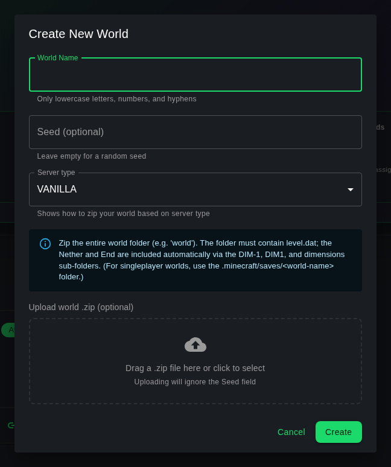

페이지 헤더의 **+ Create World**를 클릭하면 **Create New World** 다이얼로그가 열립니다:

1. **World Name** 입력 (소문자, 숫자, 하이픈)
2. 선택적으로 **Seed** 지정 (비워 두면 무작위 시드)
3. **Create** 클릭

기존 월드를 가져오려면 **Upload world .zip (optional)** 영역에 `.zip` 파일을 끌어다 놓거나(클릭하여 파일을 선택해도 됩니다) 합니다. 그러면 **Seed** 필드가 사라지고 버튼이 **Import**로 바뀝니다. **Server type** 드롭다운은 결과에 영향을 주지 않으며, 월드를 압축하는 방법에 대한 화면 안내만 바꿉니다:

- VANILLA, FORGE, NEOFORGE, FABRIC, QUILT -- 월드 폴더를 압축합니다 (`level.dat`가 있어야 하며 Nether와 End는 그 안에 포함됩니다). 일부 모드팩은 `<world-name>_nether`, `<world-name>_the_end`로 따로 저장하므로, 그런 경우 세 폴더를 함께 압축하세요
- PAPER, SPIGOT, BUKKIT -- `<world-name>`, `<world-name>_nether`, `<world-name>_the_end`를 함께 압축합니다. 하나라도 빠지면 해당 차원이 사라집니다

### 월드를 서버에 할당

사용 가능한 월드 카드의 **Assign**(링크) 아이콘을 클릭하면 **Assign World** 다이얼로그가 열립니다. **Select Server**에서 서버를 선택합니다. 중지된 서버는 **Available Servers**에, 실행 중인 서버는 **Running Servers (not recommended)**에 표시됩니다. **Assign**을 클릭하면 월드가 해당 서버에 연결되고 `Locked`로 표시됩니다.

할당을 취소하려면 잠긴 월드 카드의 **Release** 아이콘을 클릭합니다.

### 월드 삭제

월드 카드의 **빨간색 쓰레기통 아이콘**을 클릭합니다. 실수로 삭제하는 것을 방지하기 위해 정확한 월드 이름을 입력해야 하는 **Delete World** 다이얼로그가 나타납니다. 이 작업은 되돌릴 수 없습니다.

!!! warning "데이터 손실"
    월드를 삭제하면 지형, 플레이어 건축물, 엔티티를 포함한 모든 월드 데이터가 영구적으로 제거됩니다. 월드를 삭제하기 전에 반드시 백업을 생성하세요.

---

## 백업

Backups 페이지에서 월드 백업, 자동 백업 스케줄, 서버 구성 스냅샷을 관리합니다. 헤더의 칩은 백업이 `Configured` 상태인지 보여줍니다.

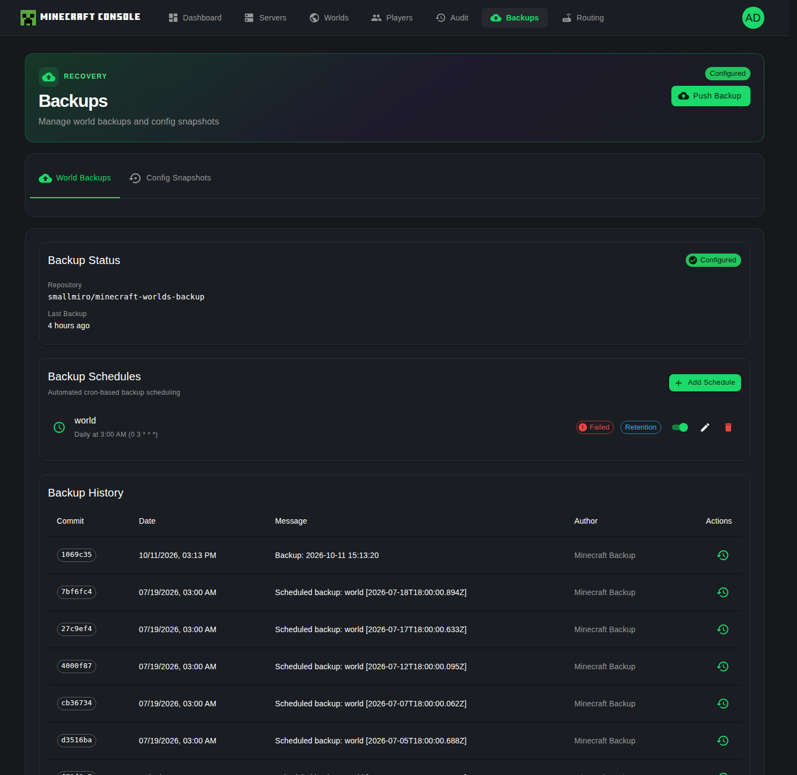

페이지에는 **World Backups**(기본)와 **Config Snapshots** 두 개의 탭이 있습니다. 선택한 탭은 URL(`/backups?tab=config-snapshots`)에 유지됩니다.

### World Backups

#### 백업 상태

**Backup Status** 카드에 현재 백업 구성이 표시됩니다:

- **Status** -- 백업 시스템이 `Configured`(녹색 체크마크)인지 `Not Configured`인지 여부. 구성되지 않았다면 카드가 `BACKUP_GITHUB_REPO`와 `BACKUP_GITHUB_TOKEN` 설정을 안내합니다
- **Repository** -- 백업 저장소로 구성된 Git 리포지토리 (예: `smallmiro/minecraft-worlds-backup`)
- **Last Backup** -- 마지막 백업이 실행된 시점 (예: "5 minutes ago") 또는 "No backups yet"

#### 수동 백업

페이지 헤더의 **Push Backup** 버튼을 클릭하면 모든 월드를 구성된 Git 리포지토리로 즉시 수동 백업합니다. 다이얼로그에서 선택 사항인 **Commit Message**를 입력한 뒤 **Push**를 클릭합니다.

#### 백업 스케줄

**Backup Schedules** 카드에서 자동 cron 기반 백업 스케줄을 관리합니다:

- 각 스케줄에 **이름**, 사람이 읽을 수 있는 빈도 (예: "Every hour"), cron 표현식이 표시됩니다
- 마지막 실행 결과 칩(**OK** 또는 **Failed**) -- 마우스를 올리면 시각과 메시지가 표시됩니다
- **Retention** 배지 -- 백업 보존 정책(최대 개수 또는 기간)의 구성 여부를 나타냅니다
- **토글 스위치** -- 개별 스케줄 활성화/비활성화
- **편집 버튼** (연필 아이콘) -- 스케줄 수정
- **삭제 버튼** (쓰레기통 아이콘) -- 스케줄 제거
- **+ Add Schedule** 버튼으로 새 자동 백업 스케줄 생성 (이름, 빈도 프리셋 또는 사용자 정의 cron 표현식, 최대 백업 수, 최대 보존 일수)

#### 백업 이력

**Backup History** 카드(백업 시스템이 구성된 경우 표시)는 과거 백업의 커밋 해시, 날짜, 메시지, 작성자를 보여줍니다. 행의 복원 버튼은 **Restore Backup**을 여는데, 선택한 백업으로 모든 월드가 복원되며 현재 월드 데이터를 덮어쓴다는 경고가 표시됩니다.

### Config Snapshots

**Config Snapshots** 탭은 모든 서버의 구성 스냅샷을 한곳에서 관리합니다. 서버마다 카드가 하나씩 표시되며 다음을 보여줍니다:

- 최신 스냅샷("Latest: 2h ago"), 파일 수, 전체 스냅샷 수 (또는 "No snapshots yet")
- 스케줄 칩: **Schedule: Active**, **Schedule: Paused**, **No schedule**
- **View History**(스냅샷이 2개 이상 필요), **Create Snapshot**, **View Diff**(서버에 스냅샷이 2개 이상일 때 표시되며 최신 2개를 비교합니다)

헤더에는 두 개의 버튼이 있습니다:

- **Create Snapshot** -- **Create Config Snapshot**을 엽니다. **Server**를 선택하고, 선택적으로 설명(예: "Before modpack update")을 입력한 뒤 **Create Snapshot**을 클릭합니다
- **Manage Schedules** -- **Config Snapshot Schedules** 패널을 엽니다. **Add Schedule**을 클릭하고 **Server**, **Schedule Name**, **Cron Preset**(Every hour, Every 6 hours, Daily at midnight, Daily at 3 AM, Weekly, Custom) 또는 **Cron Expression**, **Retention Count**(서버당 보관할 스케줄 스냅샷의 최대 개수)를 입력합니다. 기존 스케줄은 스위치로 활성화/비활성화하거나 수정, 삭제할 수 있습니다

한 서버의 스냅샷 타임라인에서 비교, 복원, 삭제를 하려면 해당 서버의 [Config History 탭](#config-history-탭)을 사용하세요.

---

## 감사 로그

Audit Log 페이지는 서버 전체에서 수행된 모든 관리 작업에 대한 포괄적인 활동 로그를 제공합니다.

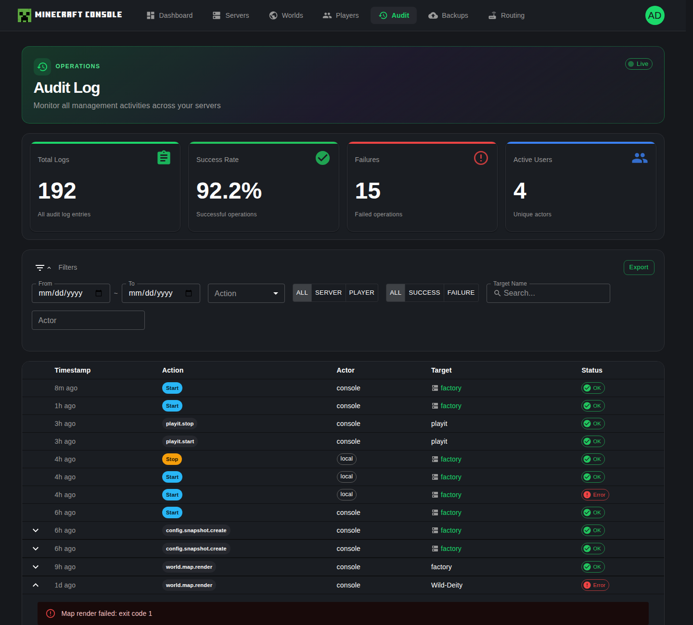

### 실시간 모니터링

감사 로그에는 페이지 헤더에 실시간 SSE 연결 상태를 보여주는 **Live** 인디케이터가 있습니다:

- **녹색 점 + "Live"** -- 연결됨, 실시간 이벤트 수신 중
- **회색 점 + "Disconnected"** -- SSE 연결 끊김 (자동 재연결)

페이지를 보는 동안 새 감사 이벤트가 도착하면 알림 배너가 나타납니다: "X new logs available - Click to refresh."

### 통계 개요

상단의 4개 통계 카드가 요약 지표를 제공합니다:

| 카드 | 설명 |
|------|------|
| **Total Logs** | 전체 감사 로그 항목 수 |
| **Success Rate** | 성공한 작업의 비율 |
| **Failures** | 실패한 작업 수 |
| **Active Users** | 작업을 수행한 고유 사용자 수 |

### 필터

**Filters** 패널은 접을 수 있고, 활성 필터 수를 표시하며, **Clear All** 버튼이 있습니다. 다음 필터를 제공합니다:

- **From** / **To** -- 시작 및 종료 날짜로 필터링
- **Action** -- 특정 액션 유형으로 필터링 (예: `server.start`, `server.stop`, `backup.schedule.create`). 대상 유형을 선택하면 목록이 서버 또는 플레이어 액션으로 좁혀집니다
- **대상 유형** -- 대상 카테고리로 필터링: ALL, SERVER, PLAYER
- **상태** -- ALL, SUCCESS, FAILURE
- **Target Name** -- 서버, 월드, 플레이어 이름으로 검색
- **Actor** -- 작업을 수행한 사용자 이름으로 검색 (예: `api:admin`)
- **Export** 버튼 -- 필터링된 감사 데이터 내보내기

### 로그 테이블

메인 테이블에 다음 컬럼의 감사 항목이 표시됩니다:

| 컬럼 | 설명 |
|------|------|
| **Timestamp** | 작업이 수행된 시점 (상대 시간, 예: "21m ago". 마우스를 올리면 정확한 시각 표시) |
| **Action** | 색상별 배지가 있는 액션 유형 |
| **Actor** | 작업을 수행한 사용자명 |
| **Target** | 영향을 받은 서버 또는 플레이어 (해당 서버 또는 Players 페이지로 연결) |
| **Status** | 성공(녹색) 또는 실패(빨간색) 표시 |

행 앞의 화살표로 상세 내용을 펼칠 수 있으며, 실패한 항목은 펼쳐진 상태로 시작하여 오류 메시지를 보여줍니다. 아무 행이나 클릭하면 **Audit Log Detail** 드로어가 열리며 항목 ID, 타임스탬프, 액션, 상태, 수행자, 대상, 오류 메시지, 액션 세부 정보와 함께 **Related Logs**(**Same Target**, **Same Actor**)가 표시됩니다.

### 내보내기

**Export** 버튼을 클릭하면 **Export Audit Logs** 다이얼로그가 열립니다. **CSV** 또는 **JSON**을 선택하고, 적용된 필터와 예상 행 수를 확인한 뒤 파일을 다운로드합니다. 내보내기는 5,000행으로 제한되므로 더 필요하면 필터를 좁히세요.

---

## 라우팅

Routing 페이지에서 네트워크 라우팅 구성을 완전히 확인하고 제어할 수 있습니다. 헤더에는 라우터 상태와 라우트 수가 표시됩니다.

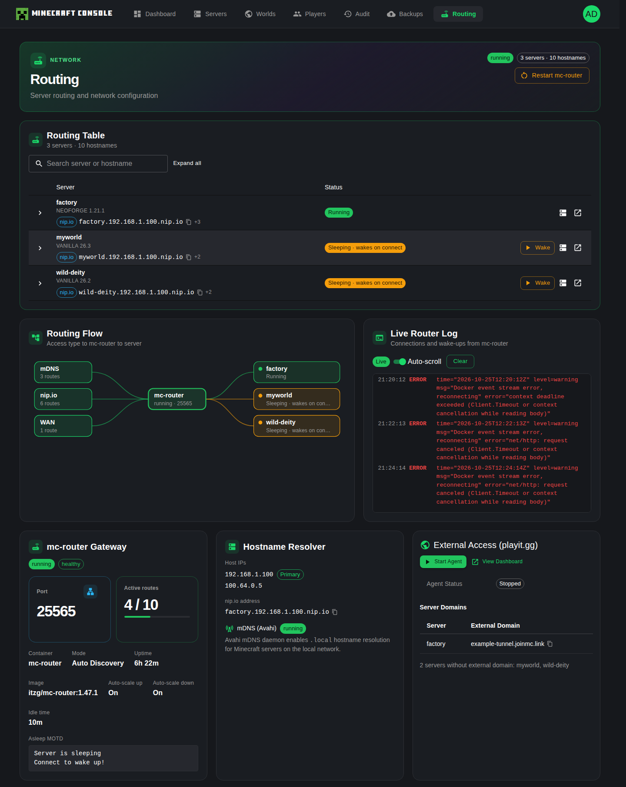

### MC-Router 상태

왼쪽의 넓은 패널에 라이브 라우팅 테이블과 함께 **MC-Router Status**가 표시됩니다:

- 라우터 상태와 헬스 칩 (예: `running`, `healthy`)
- **Routing Table**에서 서버마다 펼칠 수 있는 항목이 다음을 보여줍니다:
    - 상태 점, 서버 이름, 서버 유형과 Minecraft 버전
    - 구성된 라우트 수
    - 모든 호스트명 매핑 (예: `botagent.local`, `botagent.192.168.xx.xx.nip.io`)

### 플랫폼 정보

**Platform Information** 카드에 mc-router 설정에 대한 정보가 표시됩니다:

| 필드 | 설명 |
|------|------|
| **Router Name** | mc-router 컨테이너 이름 |
| **Port** | 수신 포트 (기본값: 25565) |
| **Mode** | 라우팅 모드 (예: `Auto Discovery`) |
| **Uptime** | 라우터 실행 시간 |

### 네트워크 설정

**Network Settings** 카드에 다음이 표시됩니다:

- **Listening Port** -- mc-router가 수신하는 포트
- **Routing Mode** -- 호스트명 해석 방법 (예: `Auto Discovery`)
- **Total Routes** -- 라우팅 항목 수
- **Active Routes** -- 서버가 실행 중인 라우트 수, "x / y" 형식

### mDNS (Avahi) 상태

**mDNS (Avahi)** 카드는 Avahi mDNS 데몬의 활성 상태를 보여줍니다. 이를 통해 로컬 네트워크의 Minecraft 클라이언트가 `.local` 호스트명을 사용하여 서버에 연결할 수 있습니다.

### 외부 접근 (playit.gg)

**External Access (playit.gg)** 카드에서 포트 포워딩 없이 인터넷에서 서버에 접근할 수 있도록 하는 playit.gg 터널 구성을 관리합니다:

- playit 에이전트를 관리하는 **Start Agent** / **Stop Agent** 버튼과 playit.gg 터널 페이지로 연결되는 **View Dashboard** 링크
- **Agent Status** -- Running 또는 Stopped, 에이전트 가동 시간
- 외부 도메인이 구성된 서버를 보여주는 **Server Domains** 테이블 (예: `possible-tracks.gl.joinmc.link`), 각 도메인에 복사 버튼 포함
- 외부 도메인이 없는 서버 목록

playit.gg가 설정되지 않았다면 카드에 "Not configured"가 표시되며 `PLAYIT_SECRET_KEY` 설정을 안내합니다.

---

## 내비게이션

상단 내비게이션 바는 모든 페이지에서 일관되게 표시되며 다음을 포함합니다:

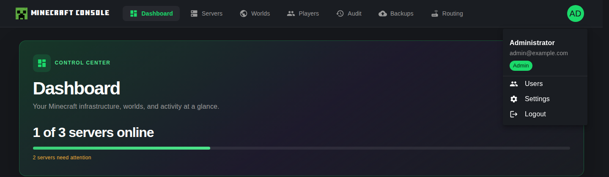

| 항목 | 설명 |
|------|------|
| **Minecraft Console** 로고 | 클릭하면 대시보드로 돌아감 |
| **Dashboard** | 인프라 개요 |
| **Servers** | 서버 관리 |
| **Worlds** | 월드 관리 |
| **Players** | 플레이어 관리 |
| **Audit** | 활동 감사 로그 |
| **Backups** | 백업 관리 |
| **Routing** | 네트워크 라우팅 구성 |
| **사용자 아바타** (우측 상단) | 사용자 메뉴를 엽니다 |

현재 활성화된 페이지가 내비게이션 바에서 강조 표시됩니다.

사용자 메뉴에는 이름과 이메일(관리자는 **Admin** 칩 포함)이 표시되며 다음 항목을 제공합니다:

| 메뉴 항목 | 설명 |
|-----------|------|
| **Users** | [사용자 관리](#사용자-관리-관리자) -- 관리자 전용 |
| **Settings** | [계정 설정](#계정-설정) |
| **Logout** | 세션을 종료하고 로그인 페이지로 이동 |

콘솔은 항상 다크 테마로 표시되며 테마 전환 기능은 없습니다.

---

## 계정 설정

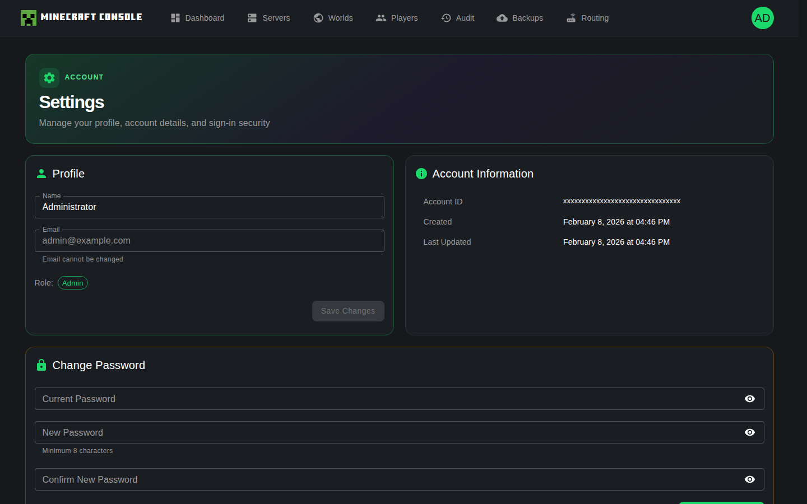

사용자 메뉴에서 **Settings**를 열면 자신의 계정을 관리할 수 있습니다. 페이지는 세 개의 카드로 구성됩니다:

- **Profile** -- **Name**을 수정하고 **Save Changes**를 클릭합니다. **Email**은 읽기 전용("Email cannot be changed")이며, 참고용으로 **Role**(Admin 또는 User)이 표시됩니다
- **Account Information** -- 계정의 **Account ID**, **Created** 시각, **Last Updated** 시각
- **Change Password** -- **Current Password**, **New Password**(8자 이상이며 현재 비밀번호와 달라야 함), **Confirm New Password**를 입력하고 **Change Password**를 클릭합니다. 다른 기기의 로그인 세션은 로그아웃되지 않습니다

---

## 플랫폼 설정 (관리자)

관리자에게는 **Settings** 페이지의 계정 카드 위에 **Platform Settings** 섹션이 추가로 표시됩니다. 이 섹션은 플랫폼 `.env` 파일을 편집합니다. 일반 사용자는 자신의 계정 카드만 볼 수 있으며 플랫폼 설정을 읽거나 변경할 수 없습니다. API가 UI와 별개로 이를 강제합니다.

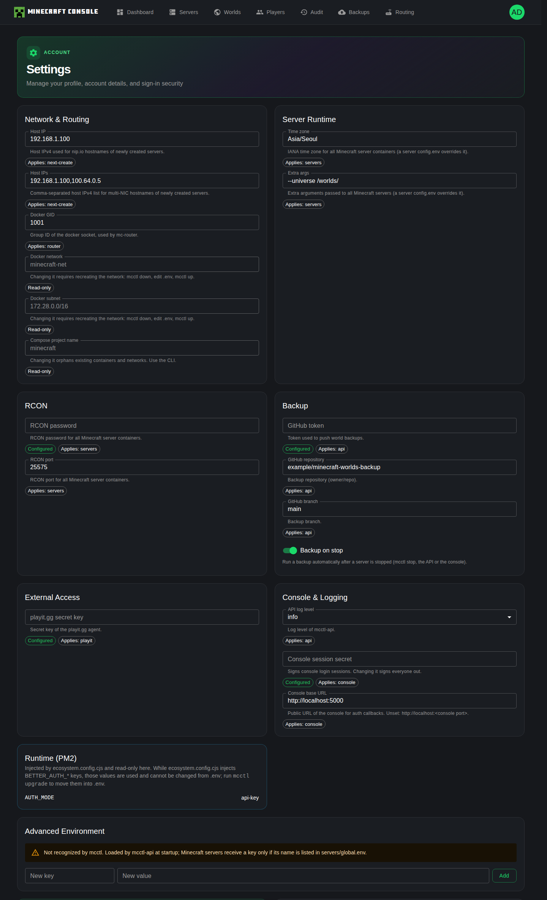

- **Bento 카드** -- 설정은 Network & Routing, Server Runtime, RCON, Backup, External Access (playit.gg), Console & Logging 카드로 그룹화됩니다. 각 필드는 타입별 입력(텍스트, 스위치, 선택, 숫자, IP 목록)과 필드 단위 검증을 제공합니다
- **시크릿은 쓰기 전용** -- 시크릿 필드(`RCON_PASSWORD`, `BACKUP_GITHUB_TOKEN`, `PLAYIT_SECRET_KEY`)는 **Configured** 또는 **Not configured**만 표시합니다. 입력란은 미리 채워지지 않으며, 값을 입력하면 변경된 필드로 표시됩니다
- **Runtime (PM2)** -- `ecosystem.config.cjs`의 `AUTH_MODE`와, 이전 버전 ecosystem 파일이 아직 주입하는 경우 `BETTER_AUTH_BASE_URL` / `BETTER_AUTH_SECRET`(configured 여부만)을 읽기 전용 카드로 보여줍니다. ecosystem에 정의돼 있는 동안은 `.env`보다 우선하며 여기서 바꿀 수 없습니다. `mcctl upgrade`를 실행하면 `.env`로 옮겨집니다
- **Advanced Environment** -- 알 수 없는 키를 key/value 행으로 추가, 편집, 삭제합니다. 이 키는 이름이 `servers/global.env`에 있을 때만 서버에 전달됩니다
- **Legacy / Unused** -- Legacy 키를 경고 스타일로 표시합니다("Not read by any current code."). 직접 삭제하지 않는 한 아무것도 제거되지 않습니다
- **읽기 전용 네트워크 식별자** -- `MINECRAFT_NETWORK`, `MINECRAFT_SUBNET`, `COMPOSE_PROJECT_NAME`은 CLI 안내와 함께 표시만 됩니다

서버별 값은 각 서버의 **Options** 탭에 그대로 있습니다. 서버의 `config.env`는 해당 서버에 한해 플랫폼 값을 덮어쓰며, UI는 서버 런타임 키에 이를 안내합니다. 전체 분류는 [환경 변수](../configuration/environment.md#설정-분류)를 참고하세요.

### 변경 사항 저장 및 적용

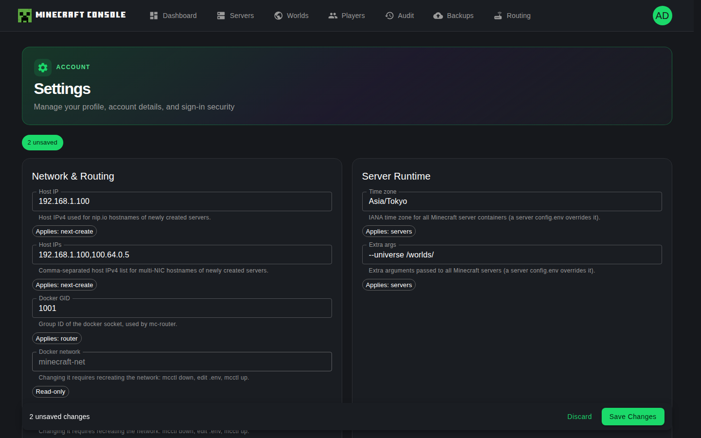

필드를 변경하면 **Discard**와 **Save Changes**가 있는 하단 고정 바가 나타나고, 카드 위의 칩이 저장하지 않은 필드 수를 보여줍니다. **저장은 `.env`만 기록하며 아무것도 재시작하지 않습니다.** 저장 후 **Restart required** 대화상자가 범위별로 재시작이 필요한 대상을 안내합니다:

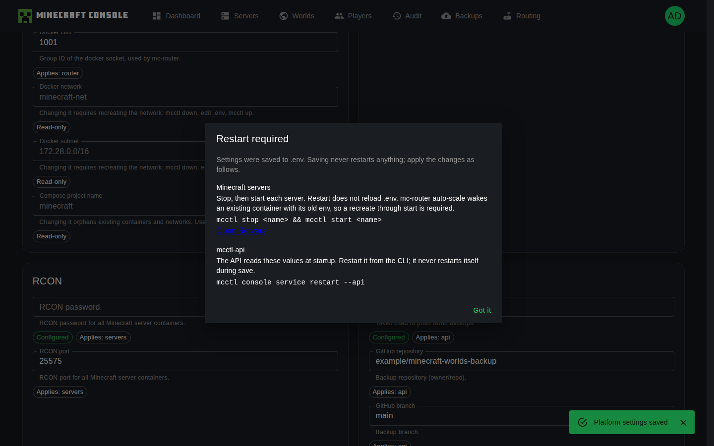

| 범위 | 해야 할 일 |
|------|------------|
| Servers | 각 서버를 **stop 후 start** (Servers 페이지 또는 `mcctl stop <name> && mcctl start <name>`). **Restart는 `.env`를 다시 읽지 않습니다.** mc-router auto-scale은 기존 컨테이너를 이전 환경 그대로 깨우므로, start를 통한 재생성이 필요합니다 |
| Router | `mcctl router start` (`restart`가 아님) |
| playit | Routing 페이지에서 playit 에이전트를 stop 후 start하거나 `mcctl playit stop && mcctl playit start` |
| API | `mcctl console service restart --api`. mcctl-api가 사용하는 설정은 재시작 전까지 "restart pending" 칩이 표시됩니다 |
| Next create | 이 변경 이후 생성하는 서버에 적용됩니다. 기존 서버의 호스트명은 바뀌지 않습니다 |

페이지를 불러온 뒤 파일이 변경된 경우(예: CLI로 수정) 저장 시 **409 충돌**이 반환되고 대화상자가 새로고침을 안내합니다. 편집 내용은 자동으로 덮어써지지 않습니다.

### 동일한 CLI 명령

| 카드 | CLI |
|------|-----|
| Network & Routing | `mcctl init --reconfigure` |
| Backup | `mcctl backup init` |
| External Access (playit.gg) | `mcctl playit setup` |
| Runtime (PM2) | `mcctl console init` |

---

## 사용자 관리 (관리자)

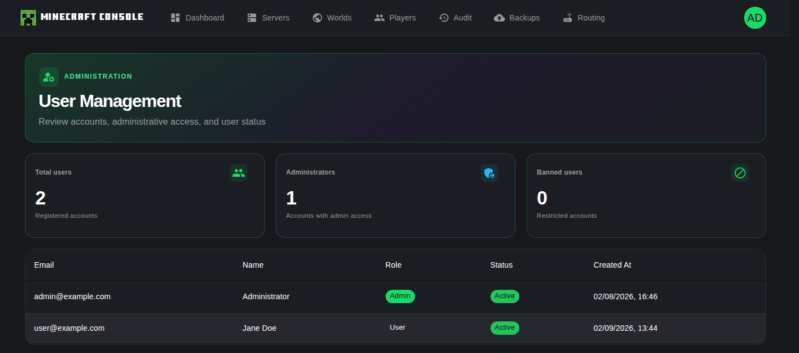

관리자에게는 사용자 메뉴에 **Users** 항목이 표시되며, 이를 누르면 **User Management** 페이지(`/admin/users`)가 열립니다. 관리자가 아닌 사용자가 이 페이지를 열면 대시보드로 리디렉션됩니다.

- 세 개의 카드가 **Total users**, **Administrators**, **Banned users**를 요약합니다
- 사용자 디렉토리에 각 계정의 **Email**, **Name**, **Role**(Admin 또는 User), **Status**(Active 또는 Banned), **Created At**이 표시됩니다
- 행을 클릭하면 같은 필드와 **User ID**가 있는 **User Details**가 열립니다

이 페이지는 읽기 전용입니다. 사용자 추가, 역할 변경, 비밀번호 재설정은 CLI를 사용하세요([CLI 명령어](cli-commands.ko.md) 참조):

```bash
mcctl console user add user@example.com --role user --password "SecurePass123"
mcctl console user update user@example.com --role admin
mcctl console user reset-password user@example.com
```

---

## 모범 사례

### 보안

1. **강력한 비밀번호 사용** -- `mcctl console init` 과정에서 비밀번호 요구사항을 따르세요
2. **접근 제한** -- Access 탭을 사용하여 각 사용자에게 최소한의 권한만 부여하세요
3. **HTTPS 사용** -- 프로덕션 배포에서는 SSL이 포함된 리버스 프록시를 구성하세요
4. **감사 로그 검토** -- 예상치 못한 활동이 있는지 정기적으로 감사 로그를 확인하세요

### 서버 관리

1. **대시보드 모니터링** -- 서버 상태, 플레이어 수, 최근 활동을 정기적으로 확인하세요
2. **정상적인 종료** -- 컨테이너를 강제 종료하지 말고 항상 Stop 버튼을 사용하세요
3. **변경 전 백업** -- 월드 데이터를 수정하기 전에 백업을 푸시하고, 서버 구성을 변경하기 전에 구성 스냅샷을 생성하세요
4. **자동 백업 활용** -- 안심을 위해 자동 백업 스케줄을 구성하세요

### 성능

1. **동시 작업 지양** -- 여러 서버를 동시에 시작/중지하지 마세요
2. **리소스 사용량 모니터링** -- 서버 상세 페이지의 리소스 통계 카드로 CPU와 메모리를 추적하세요
3. **미사용 월드 정리** -- 더 이상 필요하지 않은 월드를 삭제하여 디스크 공간을 확보하세요

---

## 사용 통계

production 모드에서 웹 콘솔은 어떤 화면이 사용되는지 파악하기 위해 익명 사용 데이터를 Google Analytics 4(GA4)로 보냅니다. 개발 모드(`pnpm dev`)에서는 아무것도 보내지 않습니다.

**보내는 항목:**

- 설치마다 하나씩 만드는 익명 `installId`(무작위 UUID). GA `user_id`로 보냅니다. 계정이나 호스트명과는 관련이 없습니다.
- 정규화한 페이지 경로. 예: `/dashboard`, `/servers/:name`, `/servers/:name/console`
- mcctl 콘솔 버전(`mcctl_version`)

**보내지 않는 항목:**

- 콘솔의 호스트명·IP 주소 (페이지 URL을 `http://mcctl-console.invalid/...`로 바꿔서 보냅니다)
- 서버 이름, 월드 이름, 쿼리스트링
- 계정, 이메일

!!! note
    브라우저가 Google에 요청을 보내므로 Google은 접속 IP 주소를 받습니다. Google 문서에 따르면 GA4는 IP 주소를 기록하거나 저장하지 않습니다.

### installId

`installId`는 `<root>/.mcctl.json`의 `installId`에 저장됩니다. 한 번 만들어지면 바뀌지 않습니다.

- 신규 설치: `mcctl init`에서 생성
- 업그레이드: `mcctl upgrade`가 없을 때만 추가 (기존 값은 유지)
- `mcctl update`로 패키지만 바꾼 경우: 콘솔의 첫 요청 때 생성하여 저장

통계가 켜져 있으면 `mcctl console init`과 `mcctl update`가 다음 안내를 출력합니다.

```
Console usage analytics is on (anonymous install ID and page paths, sent to Google Analytics). To turn it off, set "telemetry": false in <root>/.mcctl.json.
```

### 끄는 방법

=== "방법 1: .mcctl.json"

    `<root>/.mcctl.json`의 기존 필드는 그대로 두고 `"telemetry": false`를 추가합니다. 다음 페이지 로드부터 적용되며 재시작은 필요 없습니다.

    ```json
    {
      "telemetry": false
    }
    ```

=== "방법 2: DO_NOT_TRACK"

    PM2 `ecosystem.config.cjs`의 mcctl-console `env`에 `DO_NOT_TRACK=1`을 추가한 뒤 콘솔을 재시작합니다.

    ```bash
    mcctl console service restart
    ```

---

## 문제 해결

### 콘솔에 접근할 수 없음

1. **서비스 상태 확인:**
   ```bash
   mcctl console service status
   ```

2. **포트 확인:**
   ```bash
   netstat -tlnp | grep 5000
   ```

3. **로그 확인:**
   ```bash
   pm2 logs mcctl-console --lines 100
   ```

### 로그인 실패

1. **자격 증명 확인:** **Email** 컬럼에 표시된 이메일로 로그인하세요:
   ```bash
   mcctl console user list
   ```

2. **비밀번호 재설정:** 로그인 페이지에는 셀프 서비스 재설정 기능이 없으므로, 계정의 이메일로 CLI를 사용하세요:
   ```bash
   mcctl console user reset-password <email>
   ```

### 서버 상태가 업데이트되지 않음

1. **API 상태 확인:**
   ```bash
   curl http://localhost:5001/health
   ```

2. **Docker 소켓 확인:**
   Docker가 실행 중이고 mcctl-api 프로세스가 Docker 소켓에 접근할 수 있는지 확인하세요.

3. **네트워크 확인:**
   mcctl-console이 5001 포트로 mcctl-api에 연결할 수 있는지 확인하세요.

### 명령이 작동하지 않음

1. **서버가 실행 중이어야 함** -- RCON 명령은 서버가 `running` 상태일 때만 작동합니다
2. **RCON이 활성화되어야 함** -- 서버 구성에서 RCON이 활성화되어 있는지 확인하세요
3. **API 로그 확인:**
   ```bash
   pm2 logs mcctl-api --lines 100
   ```

---

## 모바일 접근

웹 콘솔은 다양한 화면 크기에 적응하는 반응형 Material UI 레이아웃을 사용합니다:

- **폰** -- 접을 수 있는 내비게이션이 있는 간소화된 카드 레이아웃
- **태블릿** -- 터치에 최적화된 컨트롤이 있는 전체 대시보드
- **데스크톱** -- 나란히 배치된 패널의 전체 기능 세트

!!! tip "모바일 팁"
    - 콘솔에서 더 나은 명령 입력을 위해 가로 모드를 사용하세요
    - 작은 화면에서는 내비게이션이 햄버거 메뉴로 접힙니다
    - 대부분의 다이얼로그는 모바일에서 더 쉬운 상호작용을 위해 전체 화면으로 표시됩니다
