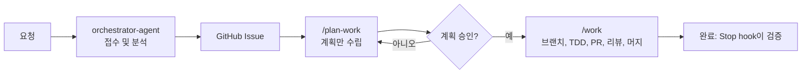

# 에이전트 협업

이 문서는 `.claude/`의 Claude Code 서브에이전트와 슬래시 커맨드가 이 저장소에서 어떻게 함께 동작하는지 설명합니다. 누가 무엇을 담당하는지, 작업을 어떻게 계획하는지, `/work`가 작업을 어떻게 라우팅하는지, 완료를 어떻게 강제하는지를 다룹니다.

!!! note "기준 문서"
    여기에 설명된 동작은 `.claude/agents/`, `.claude/commands/`, `.claude/hooks/`의 파일과 저장소 루트의 `CLAUDE.md`, `DEVELOPMENT.md`에서 정의합니다. 이 문서와 해당 파일의 내용이 다르면 해당 파일이 우선합니다.

## 개요와 원칙

- **이슈 기반.** 모든 변경은 GitHub Issue에서 시작합니다. 이슈 1개 = 브랜치 1개 = PR 1개입니다. [Git 워크플로우](git-workflow.md)를 참조하세요.
- **계획 후 실행.** `/plan-work`는 계획만 만들고 코드를 수정하지 않습니다. 실행은 `/work`가 합니다.
- **전문 에이전트가 모듈을 담당.** 각 에이전트는 정해진 경로를 담당하며, 메인 세션이 담당 에이전트에게 작업을 라우팅합니다.
- **메시지 버스 없음.** 에이전트는 런타임 프로토콜로 메시지를 주고받지 않습니다. 작업 전달은 `Agent` tool 호출(프롬프트 입력, 에이전트의 최종 보고 출력)로 이루어지며, 팀 구성 시에는 `SendMessage`를 사용합니다.
- **진행 상황은 Git과 GitHub에 기록.** 로컬 진행 기록은 `task.md`(gitignore 대상)에, 완료 항목은 이슈 체크박스에 남깁니다.

## 에이전트

모든 에이전트 정의는 `.claude/agents/`에 있습니다. 에이전트에는 `tools:` 제한이 없으며 모든 도구를 상속합니다. 모델은 별칭(`opus`, `sonnet`)으로만 지정하므로 새 모델이 나와도 파일을 수정할 필요가 없습니다.

| 에이전트 | 담당 | 모델 | 레이블 |
|----------|------|------|--------|
| `orchestrator-agent` | 요청의 진입점. 분석, 계획, 위임, 조율을 수행하며 코드를 작성하지 않습니다. | opus | `agent:orchestrator` |
| `core-agent` | `platform/services/shared/`, `platform/services/mod-source-*/` (도메인 엔티티, 값 객체, 유스케이스, 포트/어댑터) | opus | `agent:core` |
| `cli-agent` | `platform/services/cli/` | sonnet | `agent:cli` |
| `backend-agent` | `platform/services/mcctl-api/` (Fastify, OpenAPI) | sonnet | `agent:backend` |
| `frontend-agent` | `platform/services/mcctl-console/` (Next.js, React, MUI 5.x, Better Auth) | sonnet | `agent:frontend` |
| `devops-agent` | Docker 관련 파일과 나머지 `platform/`, `e2e/`, `.github/workflows/`, `.claude/hooks/` | sonnet | `agent:devops` |
| `technical-writer` | `docs/`, `README*`, `CHANGELOG.md` (영어/한국어) | sonnet | `agent:docs` |
| `release-manager` | 버전 올리기, `v*` 태그, GitHub Release, 릴리즈 후 검증 | sonnet | `agent:release` |

`/plan-work`와 `/build-kb` 커맨드도 `opus`로 실행되며, `/work`, `/write-docs`, `/sync-docs`, `/update-docs`는 `sonnet`으로 실행됩니다.

에이전트별 참고 사항입니다.

- `mcctl-console`은 Docker가 아니라 PM2로 네이티브 실행됩니다.
- `release-manager`는 Docker 이미지가 아니라 npm 패키지를 다룹니다. `v*` 태그를 push하면 `.github/workflows/release.yml`이 5개 패키지(`shared`, `mod-source-modrinth`, `mcctl-api`, `mcctl-console`, `mcctl`)를 발행하고 GitHub Release를 만듭니다.
- 레이블 열의 `agent:*` 값은 각 에이전트 정의의 Identity 표에 선언된 레이블입니다.

!!! warning "Architect 에이전트는 이 저장소에 포함되어 있지 않습니다"
    `orchestrator-agent.md`와 `/plan-work`는 `system-architect`, `backend-architect`, `frontend-architect`, `devops-architect`, `quality-engineer`를 언급합니다. 이들은 **선택 사항인 사용자 레벨 에이전트**이며 `.claude/agents/`에 포함되어 있지 않습니다. 워크플로우는 이들에 의존하지 않습니다. 없으면 메인 세션이나 담당 에이전트가 설계 단계를 처리합니다.

## 워크플로우



1. **접수.** `CLAUDE.md`의 저장소 규칙에 따라 요청은 `orchestrator-agent`가 접수하고, 분석하여 전문 에이전트에게 분석을 위임합니다. 이 단계에서는 코드를 수정하지 않습니다.
2. **이슈.** 분석 결과를 GitHub Issue로 만듭니다(요약, 근본 원인 또는 요구사항, 계획, 수정 대상 파일, 브랜치 전략, 완료 조건).
3. **계획.** `/plan-work`가 작업 분해, 의존성, 병렬 그룹, 에이전트 배정, 실행 구성안(Teams 또는 순차 서브에이전트)을 만듭니다. 코드 수정이나 브랜치 생성은 하지 않습니다.
4. **승인.** 계획을 검토합니다.
5. **실행.** `/work`가 작업을 완료까지 진행합니다. `/work`를 호출하는 것이 브랜치 생성, 커밋, PR 생성, 리뷰, 머지에 대한 승인입니다.

### `/plan-work`

```bash
/plan-work                           # 대화 컨텍스트 기반 계획
/plan-work --issue <N>               # 단일 이슈
/plan-work --milestone <N>           # 마일스톤의 열린 이슈 전체
/plan-work --issues <N1,N2,...>      # 복수 이슈
```

### "계획 먼저"의 적용 방식

- 요청이 `orchestrator-agent`를 통해 접수되면 `/plan-work`로 계획을 먼저 세우고 그다음 `/work`를 실행합니다.
- `/work` 안에서는 메인 세션이 티어(아래 참조)로 라우팅합니다. `/plan-work`를 직접 실행하는 것은 T4일 때뿐입니다. 더 낮은 티어는 이슈의 `Files to Modify`를 기준으로 바로 구현합니다.

## `/work` 모드와 라우팅

```bash
/work                         # 컨텍스트 모드: 대화에서 이슈를 만들고 실행
/work --issue <N>             # 단일 이슈
/work --milestone <N>         # 마일스톤의 모든 이슈를 의존성 순서로 처리
```

| 옵션 | 설명 |
|------|------|
| `--dry-run` | 계획(이슈, 순서, 브랜치)만 출력하고 중단합니다. 상태 파일 생성과 변경이 없습니다. |
| `--contributor` | Fork 모드. 머지하지 않습니다. 아래 "기여자 모드" 절을 참조하세요. |
| `--skip-review` | 코드 리뷰를 건너뜁니다(긴급 수정 전용). `REVIEW=skipped`로 기록됩니다. |
| `--parallel` | 마일스톤 모드 전용. 독립적인 이슈를 동시에 실행하며, 각 Agent는 `isolation: "worktree"`를 사용합니다. 브랜치는 하나씩 병합하고 병합할 때마다 테스트를 다시 실행합니다. |

단일 이슈에 대해 `/work`는 다음을 수행합니다.

1. 이슈를 읽고 상태 파일을 기록합니다.
2. 최신 `develop`에서 `feature/<N>-<description>`(또는 `bugfix/...`) 브랜치를 만듭니다.
3. 작업을 라우팅(아래 참조)하고 TDD로 구현하며, 체크포인트마다 `<type>: <description> (#<N>)` 형식으로 커밋합니다.
4. 항목이 완료될 때마다 이슈 체크박스를 체크합니다.
5. 외부 동작이 새로 생기거나 바뀌면 E2E 테스트를 추가합니다(REST API는 `e2e/`의 Playwright, CLI는 `platform/services/cli/tests/e2e/`의 Vitest).
6. PR을 만들고 `/code-review:code-review`를 실행해 모든 지적을 수정한 뒤 `REVIEW=done`으로 기록합니다.
7. merge commit으로 머지하고 `develop`으로 돌아옵니다.

마일스톤 모드에서는 각 이슈가 같은 단계를 거칩니다. 막힌 이슈는 `task.md`에 기록하고, 의존 이슈가 머지된 뒤 다시 처리합니다.

### 모듈 라우팅

메인 세션이 오케스트레이터 역할을 합니다. 가장 구체적인 경로가 우선합니다.

| `Files to Modify`의 경로 | 담당 |
|--------------------------|------|
| `platform/services/shared/**`, `platform/services/mod-source-*/**` | core-agent |
| `platform/services/cli/**` | cli-agent |
| `platform/services/mcctl-api/**` | backend-agent |
| `platform/services/mcctl-console/**` | frontend-agent |
| 나머지 `platform/**`, `e2e/**`, `.github/workflows/**`, `.claude/hooks/**` | devops-agent |
| `docs/**`, `README*`, `CHANGELOG.md` | technical-writer |
| `.claude/commands/**`, `.claude/agents/**`, `CLAUDE.md`, `DEVELOPMENT.md` (문서 내용만 변경) | 메인 세션이 직접 처리 |

문서 파일이 로직 파일과 함께 바뀌면 로직 담당 에이전트가 둘 다 처리합니다.

### 라우팅 티어

| 티어 | 조건 | 처리 방식 |
|------|------|-----------|
| T0 직접 | 1개 모듈, 2개 파일 이하, 새 public 인터페이스 없음, 근본 원인 확정. 또는 오타/주석/지침 문서만 변경 | 메인 세션. PR 본문에 직접 처리했다는 한 줄을 남깁니다. |
| T1 단일 | 1개 모듈, 3~8개 파일, 근본 원인 확정 | 담당 에이전트 1개, 기본 모델 |
| T2 강화 | shared 도메인 변경, 근본 원인 미확정, `security` 레이블, 데이터 손실 위험, 9개 이상 파일 | 담당 에이전트(원인이 미확정이면 분석 먼저), `model: opus`, `effort: high` |
| T3 다중 모듈 | 2개 모듈 | 모듈별로 위임하며 core를 먼저, 독립적인 부분은 병렬(worktree) |
| T4 설계 | 3개 이상 모듈 또는 아키텍처 변경 | `/plan-work`와 (있다면) architect, 이후 T3 |

`model`과 `effort`는 티어가 에이전트 기본값과 다른 값을 지정할 때만 위임에 설정합니다.

!!! info "모든 작업이 에이전트에게 가는 것은 아닙니다"
    T0 작업과 문서만 바뀌는 파일은 메인 세션이 처리합니다. 작은 코드 리뷰 지적도 직접 수정하고, 큰 지적은 같은 에이전트에게 다시 맡깁니다. 규칙은 "다른 에이전트의 파일을 건드리지 않는다"가 아니라 "표에 따라 라우팅하고, 실행 중인 에이전트가 맡은 파일은 수정하지 않는다"입니다.

## 위임 계약

위임 프롬프트에는 다음이 포함되어야 합니다.

- 이슈 번호와 본문
- 이미 체크아웃된 브랜치
- 에이전트가 담당하는 파일
- TDD, 커밋 형식, Tidy First(구조 변경과 동작 변경은 별도 커밋)
- "체크포인트마다 커밋"

에이전트가 **하면 안 되는 일**은 브랜치 전환, PR 생성 또는 머지, 이슈 본문 수정, `work-state` 파일 수정, `/work` 호출입니다.

에이전트가 반환하는 것은 커밋 SHA, 테스트 결과, 완료 항목 목록입니다.

위임된 에이전트는 백그라운드에서 실행됩니다. 에이전트가 실행 중일 때 Stop hook이 메인 세션을 막으면, 에이전트의 완료 알림을 기다리고 그 파일을 직접 수정하지 마세요.

## 병렬 작업

| 방식 | 사용 시점 | 비고 |
|------|-----------|------|
| 단일 에이전트 | 이슈의 담당자가 하나일 때 | feature 브랜치에서 직접 작업합니다. **worktree를 쓰지 않습니다.** |
| `Agent` tool + `isolation: "worktree"` | 병렬 위임(T3, 또는 마일스톤 모드의 `--parallel`) | 각 에이전트가 자신의 worktree를 갖습니다. PR 전에 브랜치를 feature 브랜치로 병합합니다. |
| Claude Code Teams | 큰 규모의 병렬 계획 | `CLAUDE_CODE_EXPERIMENTAL_AGENT_TEAMS=1`이 필요합니다. `TeamCreate`, `TaskCreate`/`TaskUpdate`(의존성), `SendMessage`를 제공합니다. |

Teams 도구가 보이지 않으면 `Agent` tool과 worktree만으로 병렬 처리합니다.

worktree는 모든 에이전트가 아니라 병렬 위임에만 사용합니다. 별개로, 동시에 실행되는 `/work` **세션**은 하나의 체크아웃에 있는 브랜치와 작업 트리를 공유하므로 별도의 `git worktree` 폴더에서 실행하세요.

## 완료 강제

`/work`는 frontmatter에 Stop hook `.claude/hooks/work-done-check.sh`를 선언합니다. `/work`가 시작되면(`--dry-run` 제외) `.claude/work-state.<session_id>`를 기록합니다. 이 파일은 gitignore 대상이며, 세션마다 하나씩 만들어져 동시 세션이 서로를 막지 않습니다.

```bash
# 이슈 모드
printf 'MODE=issue\nISSUE=%s\nREVIEW=pending\n' <N> > .claude/work-state.${CLAUDE_SESSION_ID}
# 마일스톤 모드
printf 'MODE=milestone\nMILESTONE=%s\n' <N> > .claude/work-state.${CLAUDE_SESSION_ID}
```

Claude가 멈추려 할 때마다 hook이 실제 GitHub와 git 상태를 확인하고, 조건이 충족되지 않으면 멈춤을 막고 남은 항목을 알려 줍니다.

| 모드 | 완료 조건 |
|------|-----------|
| 이슈 | 이슈 본문에 체크되지 않은 `- [ ]`가 없고, 이슈의 PR이 머지되었고, `REVIEW`가 `done` 또는 `skipped`이며, 커밋되지 않은 변경이 없음 |
| 이슈, `ROLE=contributor` | 닫히지 않은 이슈 PR이 존재하고, `REVIEW`가 `done` 또는 `skipped`이며, 커밋되지 않은 변경이 없음 |
| 마일스톤 | 마일스톤에 열린 이슈가 없고, 커밋되지 않은 변경이 없음 |

안전장치는 다음과 같습니다.

- hook은 멈춤을 **30**번 막으면 포기합니다(`WORK_MAX_LOOPS`로 한도를 바꿀 수 있습니다).
- `gh` 조회가 실패하면 검증을 건너뜁니다.
- 해결할 수 없는 블로커를 만나면 세션이 이를 보고하고, 상태 파일을 삭제한 뒤 멈춥니다.
- 상태 파일이 없으면 hook은 아무 동작도 하지 않습니다.

## 기여자 모드

원본 저장소에 쓰기 권한이 없는 사람을 위한 모드입니다. `--contributor`를 지정하거나, `gh repo view --json viewerPermission`이 `WRITE`, `MAINTAIN`, `ADMIN`이 아닌 값을 반환하면 자동으로 켜집니다. 상태 파일에 `ROLE=contributor`가 기록되고 흐름이 다음과 같이 달라집니다.

- 먼저 fork의 `develop`을 동기화한 뒤 브랜치를 만듭니다.
- 이슈를 수정할 수 있을 때만 체크박스를 체크하고, 아니면 완료 항목을 PR 본문에 나열합니다.
- fork에 push하고 원본 저장소의 `develop`을 대상으로 PR을 엽니다.
- 머지하지 않습니다. PR이 열리고 리뷰가 `done`이 되면 작업이 끝납니다.

기여자용 절차는 저장소 루트의 `DEVELOPMENT.md`(7.6절)를 참조하세요.

## 핸드오프 규약

일부 에이전트 프롬프트는 마크다운 제목을 핸드오프 규약으로 사용합니다. 이는 프롬프트 규약일 뿐 프로토콜이 아니며, 이를 파싱하는 코드는 없습니다.

| 규약 | 사용하는 에이전트 | 의미 |
|------|-------------------|------|
| `DEPENDENCY_NEEDED` | core, cli | 다른 에이전트의 산출물이 필요해 막힘 |
| `DEPENDENCY_READY` | backend, orchestrator | 공유 산출물(타입, API 스펙)을 사용할 수 있음 |
| `WORK_COMPLETE` | core, cli, frontend | 에이전트의 작업이 끝남 |
| `BLOCKER_DETECTED` | orchestrator | 블로커와 선택한 해결 방안 |
| `PROGRESS_REPORT` | orchestrator | 전체 및 에이전트별 진행 상황 |
| `STATUS_REQUEST` | orchestrator | 응답 없는 에이전트에게 상태 요청 |

완료 보고 예시입니다.

```markdown
## WORK_COMPLETE
Task: Mod domain entities (#42)
Commits: a1b2c3d, e4f5a6b
Tests: shared package, all passing
Ready for: cli-agent, backend-agent
```

## 커맨드

| 커맨드 | 용도 |
|--------|------|
| `/plan-work` | 시작 전 계획 수립(`--issue`, `--milestone`, `--issues`). 계획만 수립합니다. |
| `/work` | 이슈나 마일스톤을 완료까지 진행: 브랜치, TDD, PR, 코드 리뷰, 머지. |
| `/write-docs` | 이중 언어(영어/한국어) 기술 문서를 작성합니다. |
| `/sync-docs` | `CLAUDE.md`, `README.md` 등의 문서를 코드와 동기화합니다. |
| `/update-docs` | 공식 문서를 기준으로 `docs/itzg-reference/`를 갱신합니다. |
| `/build-kb` | 소스를 깊이 분석해 LLM 지식 베이스를 만듭니다. |

커맨드 정의는 `.claude/commands/`에 있습니다. 기여자용 설명은 `DEVELOPMENT.md`(7절)에 있습니다. 개발 규칙 전반은 [개발 가이드](index.md)를 참조하세요.

## 에이전트 프롬프트 파일

| 파일 | 에이전트 |
|------|----------|
| `.claude/agents/orchestrator-agent.md` | Orchestrator |
| `.claude/agents/core-agent.md` | Core |
| `.claude/agents/cli-agent.md` | CLI |
| `.claude/agents/backend-agent.md` | Backend |
| `.claude/agents/frontend-agent.md` | Frontend |
| `.claude/agents/devops-agent.md` | DevOps |
| `.claude/agents/technical-writer.md` | Technical Writer |
| `.claude/agents/release-manager.md` | Release Manager |

특정 영역을 한 에이전트에게 직접 맡기려면 대화에서 이름을 지정하세요. 예: "cli-agent를 사용해 `mcctl backup`에 `--dry-run` 옵션을 추가해 주세요 (이슈 #42)".
