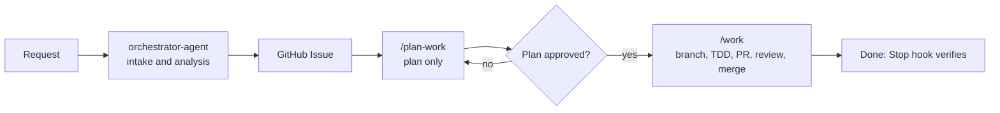

# Agent Collaboration

This page describes how the Claude Code subagents and slash commands in `.claude/` work together on this repository: who owns what, how work is planned, how `/work` routes it, and how completion is enforced.

!!! note "Source of truth"
    The behavior described here is defined by the files in `.claude/agents/`, `.claude/commands/`, and `.claude/hooks/`, plus `CLAUDE.md` and `DEVELOPMENT.md` in the repository root. If this page and those files disagree, the files win.

## Overview and Principles

- **Issue-driven.** Every change starts from a GitHub Issue. One issue = one branch = one PR. See [Git Workflow](git-workflow.md).
- **Plan first, then execute.** `/plan-work` produces a plan and does not change code. `/work` executes.
- **Specialists own modules.** Each agent owns a set of paths. The main session routes work to the owner.
- **No message bus.** Agents do not exchange messages through a runtime protocol. Work is handed over through the `Agent` tool call (the prompt in, the agent's final report out) or, in a team, through `SendMessage`.
- **Progress lives in Git and GitHub.** Local progress is written to `task.md` (gitignored). Issue checkboxes track completed items.

## Agents

All agent definitions are in `.claude/agents/`. Agents have no `tools:` restriction; they inherit all tools. Model names are aliases (`opus`, `sonnet`) so files do not need editing when a new model ships.

| Agent | Owns | Model | Label |
|-------|------|-------|-------|
| `orchestrator-agent` | Entry point for requests. Analyzes, plans, delegates, coordinates. Does not write code. | opus | `agent:orchestrator` |
| `core-agent` | `platform/services/shared/`, `platform/services/mod-source-*/` (domain entities, value objects, use cases, ports/adapters) | opus | `agent:core` |
| `cli-agent` | `platform/services/cli/` | sonnet | `agent:cli` |
| `backend-agent` | `platform/services/mcctl-api/` (Fastify, OpenAPI) | sonnet | `agent:backend` |
| `frontend-agent` | `platform/services/mcctl-console/` (Next.js, React, MUI 5.x, Better Auth) | sonnet | `agent:frontend` |
| `devops-agent` | Docker files and the rest of `platform/`, `e2e/`, `.github/workflows/`, `.claude/hooks/` | sonnet | `agent:devops` |
| `technical-writer` | `docs/`, `README*`, `CHANGELOG.md` (English and Korean) | sonnet | `agent:docs` |
| `release-manager` | Version bumps, `v*` tags, GitHub releases, post-release verification | sonnet | `agent:release` |

The commands `/plan-work` and `/build-kb` also run on `opus`; `/work`, `/write-docs`, `/sync-docs`, and `/update-docs` run on `sonnet`.

Notes on specific agents:

- `mcctl-console` runs natively under PM2, not in Docker.
- `release-manager` handles npm packages, not Docker images. Pushing a `v*` tag triggers `.github/workflows/release.yml`, which publishes five packages (`shared`, `mod-source-modrinth`, `mcctl-api`, `mcctl-console`, `mcctl`) and creates the GitHub Release.
- The `agent:*` values in the Label column are the label each agent definition declares in its Identity table.

!!! warning "Architect agents are not part of this repository"
    `orchestrator-agent.md` and `/plan-work` mention `system-architect`, `backend-architect`, `frontend-architect`, `devops-architect`, and `quality-engineer`. These are **optional user-level agents** and are not shipped in `.claude/agents/`. The workflow does not depend on them: without them, the main session or the owner agent does the design step.

## Workflow



1. **Intake.** By the repository rules in `CLAUDE.md`, a request is received by `orchestrator-agent`, which analyzes it and delegates analysis to specialists. No code is modified in this phase.
2. **Issue.** The analysis becomes a GitHub Issue (summary, root cause or requirements, plan, files to modify, branch strategy, acceptance criteria).
3. **Plan.** `/plan-work` produces a plan: work breakdown, dependencies, parallel groups, agent assignment, and an execution proposal (Teams or sequential sub-agents). It never edits code or creates branches.
4. **Approval.** You review the plan.
5. **Execute.** `/work` carries the work through to completion. Invoking `/work` is the approval to branch, commit, open the PR, run the review, and merge.

### `/plan-work`

```bash
/plan-work                           # Plan from the conversation
/plan-work --issue <N>               # One issue
/plan-work --milestone <N>           # Every open issue in a milestone
/plan-work --issues <N1,N2,...>      # Several issues
```

### How "plan first" applies

- When a request comes in through `orchestrator-agent`, planning with `/plan-work` comes first, then `/work`.
- Inside `/work`, the main session routes by tier (below). It runs `/plan-work` itself only at tier T4. Smaller tiers use the issue's `Files to Modify` and go straight to implementation.

## `/work` Modes and Routing

```bash
/work                         # Context mode: create an issue from the conversation, then execute
/work --issue <N>             # Single issue
/work --milestone <N>         # All issues in a milestone, in dependency order
```

| Option | Description |
|--------|-------------|
| `--dry-run` | Print the plan (issues, order, branches) and stop. No state file, no changes. |
| `--contributor` | Fork mode: no merge. See the Contributor Mode section below. |
| `--skip-review` | Skip the code review (emergency fixes only). Records `REVIEW=skipped`. |
| `--parallel` | Milestone mode only. Run independent issues concurrently, each Agent with `isolation: "worktree"`. Branches are merged one at a time, with tests re-run after each. |

For a single issue, `/work`:

1. Loads the issue and writes the state file.
2. Creates `feature/<N>-<description>` (or `bugfix/...`) from an updated `develop`.
3. Routes the work (below) and implements it with TDD, committing as `<type>: <description> (#<N>)` at each checkpoint.
4. Ticks the issue checkboxes as items complete.
5. Adds E2E tests for new or changed external behavior (REST API: Playwright in `e2e/`; CLI: Vitest in `platform/services/cli/tests/e2e/`).
6. Opens the PR, runs `/code-review:code-review`, fixes every finding, and sets `REVIEW=done`.
7. Merges with a merge commit and returns to `develop`.

In milestone mode, each issue goes through the same steps. A blocked issue is noted in `task.md` and revisited after its dependency is merged.

### Module routing

The main session acts as the orchestrator. The most specific path wins.

| Paths in `Files to Modify` | Owner |
|----------------------------|-------|
| `platform/services/shared/**`, `platform/services/mod-source-*/**` | core-agent |
| `platform/services/cli/**` | cli-agent |
| `platform/services/mcctl-api/**` | backend-agent |
| `platform/services/mcctl-console/**` | frontend-agent |
| rest of `platform/**`, `e2e/**`, `.github/workflows/**`, `.claude/hooks/**` | devops-agent |
| `docs/**`, `README*`, `CHANGELOG.md` | technical-writer |
| `.claude/commands/**`, `.claude/agents/**`, `CLAUDE.md`, `DEVELOPMENT.md`, prose only | handled directly by the main session |

If prose files change together with logic files, the logic owner handles both.

### Routing tiers

| Tier | Condition | Handling |
|------|-----------|----------|
| T0 direct | One module, 2 files or fewer, no new public interface, confirmed root cause; or typo/comment/instruction prose only | Main session. The PR body gets one line noting the direct handling. |
| T1 single | One module, 3-8 files, confirmed root cause | One owner agent, default model |
| T2 hardened | Shared domain change, unconfirmed root cause, `security` label, data-loss risk, or 9+ files | Owner agent (analysis first if the cause is unconfirmed), `model: opus`, `effort: high` |
| T3 multi-module | Two modules | Delegate per module, core first, independent parts in parallel (worktrees) |
| T4 design | Three or more modules, or architecture change | `/plan-work` plus an architect if available, then T3 |

`model` and `effort` are set on the delegation only when the tier gives a value that differs from the agent's default.

!!! info "Not every task goes to an agent"
    Tier T0 work and prose-only files are handled by the main session. Small code-review findings are also fixed directly; large ones go back to the same agent. The rule is not "never touch another agent's files" but "route by the table, and do not edit files a running agent owns".

## Delegation Contract

A delegation prompt must contain:

- the issue number and body
- the branch that is already checked out
- the files the agent owns
- TDD, the commit format, and Tidy First (structural and behavioral changes in separate commits)
- "commit at every checkpoint"

The agent must **not**: switch branches, create PRs or merge, edit the issue body, touch the `work-state` file, or invoke `/work`.

The agent returns: commit SHAs, test results, and the list of completed items.

Delegated agents run in the background. If the Stop hook blocks the main session while one is running, wait for its completion notification and do not edit its files.

## Parallel Work

| Mechanism | When | Notes |
|-----------|------|-------|
| Single agent | One owner for the issue | Works directly on the feature branch. **No worktree.** |
| `Agent` tool + `isolation: "worktree"` | Parallel delegation (T3, or `--parallel` in milestone mode) | Each agent gets its own worktree. Merge the branches into the feature branch before the PR. |
| Claude Code Teams | Larger parallel plans | Needs `CLAUDE_CODE_EXPERIMENTAL_AGENT_TEAMS=1`. Provides `TeamCreate`, `TaskCreate`/`TaskUpdate` (dependencies), and `SendMessage`. |

If the Teams tools are not available, parallelize with the `Agent` tool and worktrees only.

Worktrees are for parallel delegation, not for every agent. Separately, concurrent `/work` **sessions** share one checkout's branch and working tree, so run them in separate `git worktree` folders.

## Completion Enforcement

`/work` declares a Stop hook in its frontmatter: `.claude/hooks/work-done-check.sh`. When `/work` starts (not for `--dry-run`), it writes `.claude/work-state.<session_id>` (gitignored; one file per session so concurrent sessions do not block each other):

```bash
# Issue mode
printf 'MODE=issue\nISSUE=%s\nREVIEW=pending\n' <N> > .claude/work-state.${CLAUDE_SESSION_ID}
# Milestone mode
printf 'MODE=milestone\nMILESTONE=%s\n' <N> > .claude/work-state.${CLAUDE_SESSION_ID}
```

Each time Claude tries to stop, the hook checks the real GitHub and git state and, if conditions are unmet, blocks the stop and lists what remains.

| Mode | Work is complete when |
|------|-----------------------|
| Issue | No unchecked `- [ ]` in the issue body, a PR for the issue is merged, `REVIEW` is `done` or `skipped`, no uncommitted changes |
| Issue, `ROLE=contributor` | A non-closed PR for the issue exists, `REVIEW` is `done` or `skipped`, no uncommitted changes |
| Milestone | The milestone has no open issues, no uncommitted changes |

Safety valves:

- The hook gives up after **30** blocked stops (`WORK_MAX_LOOPS` overrides the limit).
- If `gh` fails, verification is skipped.
- On an unresolvable blocker, the session reports it, deletes its state file, and stops.
- No state file means the hook does nothing.

## Contributor Mode

For people without write access to the original repository. It turns on with `--contributor`, or automatically when `gh repo view --json viewerPermission` reports something other than `WRITE`, `MAINTAIN`, or `ADMIN`. The state file gets `ROLE=contributor`, and the flow changes as follows:

- Sync the fork's `develop` first, then branch.
- Tick issue checkboxes only if you can edit the issue; otherwise list completed items in the PR body.
- Push to the fork and open the PR against the original repository's `develop`.
- Do not merge. The job is done when the PR is open and the review is `done`.

See `DEVELOPMENT.md` (section 7.6) in the repository root for the contributor-facing steps.

## Handoff Conventions

Some agent prompts use markdown headings as handoff conventions. They are prompt conventions, not a protocol: nothing parses them.

| Convention | Used by | Meaning |
|------------|---------|---------|
| `DEPENDENCY_NEEDED` | core, cli | The agent is blocked on another agent's output |
| `DEPENDENCY_READY` | backend, orchestrator | A shared artifact (type, API spec) is available |
| `WORK_COMPLETE` | core, cli, frontend | The agent's task is finished |
| `BLOCKER_DETECTED` | orchestrator | A blocker and the chosen resolution |
| `PROGRESS_REPORT` | orchestrator | Overall and per-agent status |
| `STATUS_REQUEST` | orchestrator | Ask an unresponsive agent for status |

Example of a completion report:

```markdown
## WORK_COMPLETE
Task: Mod domain entities (#42)
Commits: a1b2c3d, e4f5a6b
Tests: shared package, all passing
Ready for: cli-agent, backend-agent
```

## Commands

| Command | Purpose |
|---------|---------|
| `/plan-work` | Plan before starting (`--issue`, `--milestone`, `--issues`). Plans only. |
| `/work` | Run an issue or milestone through to completion: branch, TDD, PR, code review, merge. |
| `/write-docs` | Write bilingual (English/Korean) technical documentation. |
| `/sync-docs` | Sync `CLAUDE.md`, `README.md`, and other docs with the code. |
| `/update-docs` | Refresh `docs/itzg-reference/` from the official documentation. |
| `/build-kb` | Analyze the source in depth and build an LLM knowledge base. |

Command definitions are in `.claude/commands/`. The contributor-facing description is in `DEVELOPMENT.md` (section 7). For the surrounding development rules, see the [Development Guide](index.md).

## Agent Prompt Files

| File | Agent |
|------|-------|
| `.claude/agents/orchestrator-agent.md` | Orchestrator |
| `.claude/agents/core-agent.md` | Core |
| `.claude/agents/cli-agent.md` | CLI |
| `.claude/agents/backend-agent.md` | Backend |
| `.claude/agents/frontend-agent.md` | Frontend |
| `.claude/agents/devops-agent.md` | DevOps |
| `.claude/agents/technical-writer.md` | Technical Writer |
| `.claude/agents/release-manager.md` | Release Manager |

To hand a specific area to one agent directly, name it in the conversation, for example: "Use cli-agent to add a `--dry-run` option to `mcctl backup` (issue #42)".
