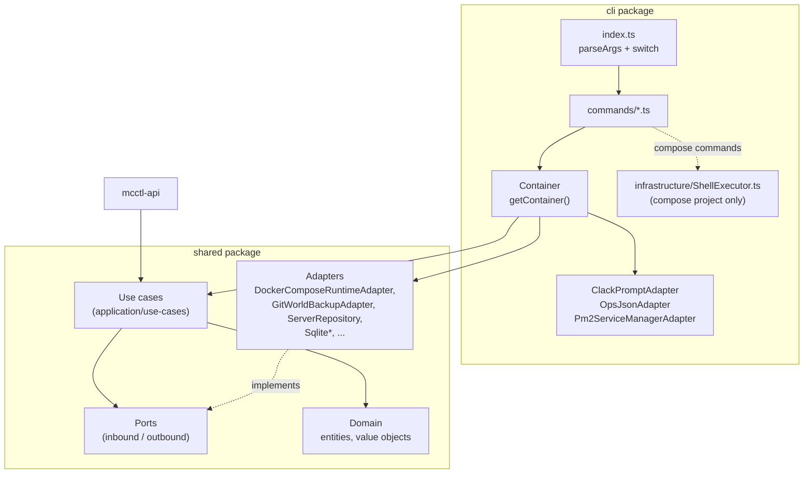

# CLI 아키텍처

이 문서는 `@minecraft-docker/mcctl` CLI의 구성과 확장 방법을 설명합니다. CLI는 **Hexagonal Architecture**(Ports & Adapters)와 **Clean Architecture** 계층 구조를 따르지만, 도메인 모델, 포트, 유스케이스, 대부분의 어댑터는 CLI 패키지가 아니라 shared 패키지에 있습니다.

## 패키지 구성

관련된 패키지는 세 가지입니다.

| 패키지 | 경로 | 내용 |
|--------|------|------|
| `@minecraft-docker/mcctl` | `platform/services/cli/` | 진입점, 커맨드 핸들러, DI 컨테이너, CLI 전용 어댑터 |
| `@minecraft-docker/shared` | `platform/services/shared/` | 도메인, 포트, 유스케이스, 대부분의 어댑터. CLI와 `mcctl-api`가 함께 사용합니다 |
| `@minecraft-docker/mod-source-modrinth` | `platform/services/mod-source-modrinth/` | `IModSourcePort`의 Modrinth 구현체 |

### CLI (`platform/services/cli/src/`)

| 경로 | 역할 |
|------|------|
| `index.ts` | 진입점. 자체 `parseArgs()`와 하나의 큰 `switch (command)`를 가집니다 |
| `commands/` | 커맨드 핸들러(`create.ts`, `world.ts`, `mod.ts` 등). 하위 디렉터리 `config-snapshot/`, `console/`에 그룹 커맨드가 있습니다 |
| `lib/` | 헬퍼: `shell.ts`(`ShellExecutor` re-export), `rcon.ts`, `console-db.ts`, `pm2-utils.ts`, `prompts/` |
| `infrastructure/adapters/` | CLI 전용 어댑터: `ClackPromptAdapter`, `OpsJsonAdapter`, `Pm2ServiceManagerAdapter` |
| `infrastructure/ShellExecutor.ts` | compose 프로젝트 조작(pull, up/down, 전체 start/stop, router)과 `config.env` 접근만 맡습니다. 런타임 포트가 아닙니다(ADR-0001, 15행) |
| `infrastructure/di/container.ts` | 의존성 주입 컨테이너 |
| `domain/index.ts`, `application/index.ts` | `@minecraft-docker/shared`를 re-export할 뿐입니다 |

### Shared (`platform/services/shared/src/`)

| 경로 | 역할 |
|------|------|
| `domain/value-objects/`, `domain/entities/`, `domain/mod/` | 도메인 모델 |
| `application/ports/inbound/` | 유스케이스 인터페이스(`ICreateServerUseCase`, `IConfigSnapshotUseCase` 등) |
| `application/ports/outbound/` | 인프라 인터페이스(`IContainerRuntimePort`, `IServerConsolePort`, `IWorldBackupPort`, `IWorldAssignmentPort`, `IServerSpecRepository`, `IServerRepository`, `IPromptPort`, `IDocProvider`, `IModSourcePort` 등) |
| `application/use-cases/` | 유스케이스 구현 |
| `infrastructure/adapters/` | `DockerComposeRuntimeAdapter`, `GitWorldBackupAdapter`, `ConfigEnvWorldAssignmentAdapter`, `AvahiHostnameRegistrarAdapter`, `ServerRepository`, `WorldRepository`, `DocsAdapter`, `ApiPromptAdapter`, `Sqlite*Repository`, `RconCliAdapter` 등 |
| `infrastructure/config/`, `infrastructure/factories/` | `Pm2EcosystemConfig`, `ModSourceFactory` |
| `docker/`, `prerequisite/`, `types/`, `utils/` | Docker 헬퍼, 사전 요구사항 점검, 공용 타입과 유틸리티 |

## 아키텍처 다이어그램



## 두 종류의 커맨드

코드를 읽거나 추가할 때 두 가지 방식이 공존한다는 점을 알아두어야 합니다.

- **유스케이스 커맨드**는 비즈니스 로직을 가집니다. 핸들러가 컨테이너를 얻고, `shared`의 유스케이스를 호출한 뒤 결과를 출력합니다. 예: `create`, `delete`, `config-snapshot`, `backup-schedule`, `world`, `mod`.
- **Thin 커맨드**는 단순 전달용입니다. 런타임 포트를 부르거나(`start`, `stop`, `logs`), `IServerConsolePort.getEndpoint`로 TCP RCON 세션을 열거나(`rcon`, `console <server>`), `ShellExecutor`로 docker compose를 실행하거나(`up`, `down`, `--all`, `router`; compose 프로젝트만), `docker exec <container> rcon-cli`로 RCON을 실행합니다(`lib/rcon.ts`, `exec`). `console init/service/user/api/remove` 하위 명령은 별개이며 아래에서 설명합니다.

새로운 비즈니스 로직은 `commands/` 아래 파일이 아니라 shared 유스케이스에 두어야 합니다. 커맨드 파일은 옵션 파싱, 유스케이스 호출, 출력만 담당합니다.

## 도메인 계층

`platform/services/shared/src/domain/`에 있습니다.

**Value Object**(불변, 정적 `create()`에서 검증):

| 클래스 | 규칙 |
|--------|------|
| `ServerName` | 2~32자, 소문자, 영문자로 시작, 하이픈 허용(연속 불가). `value`를 제공합니다. 컨테이너·호스트 이름은 `containerNameOf` / `serverHostnameOf`로 얻습니다 |
| `ServerType` | `ServerTypeEnum`을 감쌉니다: PAPER, VANILLA, FORGE, NEOFORGE, FABRIC, SPIGOT, BUKKIT, PURPUR, QUILT, LEAF, FOLIA, PUFFERFISH, MODRINTH, AUTO_CURSEFORGE |
| `McVersion` | Minecraft 버전 |
| `Memory` | `4G`, `2048M` 같은 JVM 메모리 |
| `WorldOptions`, `ModpackOptions` | 월드, 모드팩 설정 |

그 외 cron 표현식, 스냅샷 diff, 역할, 플레이어 데이터 등의 value object는 `domain/value-objects/`를 참고하세요.

**Entity**에는 `Server`, `World`, `ConfigSnapshot`, `BackupSchedule`, `Player`, `PlayerSession`, `User`, `AuditLog`가 있습니다. `domain/entities/`를 참고하세요.

## 포트와 유스케이스

**Inbound 포트**(`application/ports/inbound/`)는 유스케이스 인터페이스입니다. 오래된 대화형 유스케이스는 진입점이 두 개입니다.

| 인터페이스 | 메서드 |
|-----------|--------|
| `ICreateServerUseCase` | `execute()`(프롬프트) / `executeWithConfig(config)` |
| `IDeleteServerUseCase` | `execute()`(프롬프트) / `executeWithName(name, { force, yes, deleteWorld })` |

새로운 유스케이스(설정 스냅샷, 백업 스케줄, 플레이어 관리 등)는 대화형 모드 없이 CRUD 형태의 메서드를 사용합니다.

```typescript
// shared/src/application/ports/inbound/IConfigSnapshotUseCase.ts
export interface IConfigSnapshotUseCase {
  create(serverName: string, description?: string, scheduleId?: string): Promise<ConfigSnapshot>;
  list(serverName?: string, limit?: number, offset?: number): Promise<ConfigSnapshot[]>;
  findById(id: string): Promise<ConfigSnapshot | null>;
  diff(snapshotId1: string, snapshotId2: string): Promise<SnapshotDiff>;
  restore(snapshotId: string, force?: boolean): Promise<void>;
  count(serverName?: string): Promise<number>;
  delete(id: string): Promise<void>;
}
```

**Outbound 포트**(`application/ports/outbound/`)에는 `IPromptPort`, `IContainerRuntimePort`, `IServerConsolePort`, `IWorldBackupPort`, `IWorldAssignmentPort`, `IServerSpecRepository`, `IServerRepository`, `IWorldRepository`, `IDocProvider`, `IAuditLogPort`, `IRconPort`, `IModSourcePort`, `IServiceManagerPort`와 스냅샷/백업 저장소가 있습니다. `IPromptPort`와 `IDocProvider`는 outbound 포트입니다.

## 어댑터

| 포트 | 어댑터 | 패키지 |
|------|--------|--------|
| `IPromptPort` | `ClackPromptAdapter`(@clack/prompts) | cli |
| `IPromptPort` | `ApiPromptAdapter`(비대화형, `mcctl-api`에서 사용) | shared |
| `IContainerRuntimePort` | `DockerComposeRuntimeAdapter` | shared |
| `IServerConsolePort` | `DockerServerConsoleAdapter`(RCON) | shared |
| `IWorldBackupPort` | `GitWorldBackupAdapter` | shared |
| `IWorldAssignmentPort` | `ConfigEnvWorldAssignmentAdapter` | shared |
| `IServerRepository` | `ServerRepository`(파일 시스템, `Paths` 사용) | shared |
| `IWorldRepository` | `WorldRepository` | shared |
| `IDocProvider` | `DocsAdapter` | shared |
| `IAuditLogPort`, 백업/스냅샷 저장소 | `Sqlite*Repository`(better-sqlite3) | shared |
| `IServiceManagerPort` | `Pm2ServiceManagerAdapter` | cli |
| `IModSourcePort` | `ModrinthAdapter` | mod-source-modrinth |

## 의존성 주입

`cli/src/infrastructure/di/container.ts`의 `class Container`는 지연 생성되는 싱글턴을 타입이 지정된 getter로 제공합니다. 문자열 키 기반 `resolve()`는 없습니다.

```typescript
const container = getContainer(options.root);   // ContainerOptions | rootDir string
const useCase = container.configSnapshotUseCase; // created on first access
```

사용 가능한 getter: `promptPort`, `runtimePort`, `containerRuntime`, `serverConsolePort`, `worldBackupPort`, `worldAssignmentPort`, `serverSpecRepository`, `serverRepository`, `worldRepository`, `docProvider`, `auditLogPort`, `modSourcePort`, `createServerUseCase`, `deleteServerUseCase`, `worldManagementUseCase`, `backupUseCase`, `backupScheduleUseCase`, `configSnapshotUseCase`, `configSnapshotScheduleUseCase`.

관련 헬퍼:

- `getContainer(options?)`는 프로세스 전역 `Container`를 반환합니다.
- `Container.create(options?)`는 새 인스턴스를 만듭니다.
- `Container.createWithAdapters(...)`는 사용자 지정 어댑터를 주입합니다(테스트용).
- `resetContainer()`는 전역 인스턴스를 초기화합니다(테스트용).

## 새 커맨드 추가하기

커맨드는 `cli/src/index.ts`에 직접 등록합니다. 이 용도로 commander를 사용하지 않습니다(commander는 `console user`와 `console api`에서만 사용합니다).

1. `cli/src/commands/<name>.ts`를 작성하고, 종료 코드를 반환하는 `<name>Command(options): Promise<number>`를 export합니다.
2. `cli/src/commands/index.ts`에서 re-export합니다.
3. `cli/src/index.ts`에서 import합니다.
4. `switch (command)` 블록에 `case '<name>':`을 추가합니다.
5. 하위 커맨드가 있으면 `parseArgs()`에서 `result.subCommand`를 설정하는 목록에 커맨드 이름을 추가합니다. 값이 없는 플래그는 `booleanOnlyFlags`에 추가합니다.
6. `printUsage()`에 도움말을 추가합니다.

비즈니스 로직이 필요하면 먼저 shared에 추가합니다.

1. `application/ports/inbound/`에 포트 인터페이스를 추가합니다(새 I/O가 필요하면 outbound 포트나 어댑터도 추가).
2. `application/use-cases/`에 구현합니다.
3. 둘 다 `shared/src/index.ts`에서 export합니다.
4. `cli/src/infrastructure/di/container.ts`에 getter를 추가합니다.

### 실제 예시: `config-snapshot`

| 구성 요소 | 파일 |
|-----------|------|
| 유스케이스 | `shared/src/application/use-cases/ConfigSnapshotUseCase.ts` |
| 핸들러 | `cli/src/commands/config-snapshot/{list,create,show,diff,restore,delete}.ts`, `schedule/` |
| 컨테이너 getter | `container.ts`의 `configSnapshotUseCase` |
| 테스트 | `cli/tests/commands/config-snapshot.test.ts` |

핸들러는 작습니다. 컨테이너를 얻고, 유스케이스를 호출하고, 출력합니다.

```typescript
// cli/src/commands/config-snapshot/list.ts
export async function configSnapshotListCommand(
  options: ConfigSnapshotListOptions
): Promise<number> {
  const container = getContainer(options.root);
  const useCase = container.configSnapshotUseCase;
  const limit = options.limit ?? 20;

  try {
    const snapshots = await useCase.list(options.serverName, limit, options.offset);
    if (options.json) {
      console.log(JSON.stringify(snapshots.map((s) => s.toJSON()), null, 2));
      return 0;
    }
    // ... format and print
    return 0;
  } catch (error) {
    // log error
    return 1;
  }
}
```

`cli/src/index.ts`의 디스패치:

```typescript
case 'config-snapshot': {
  const csAction = subCommand;
  if (csAction === 'schedule') {
    const scheduleAction = positional[0];
    switch (scheduleAction) {
      case 'list':
        exitCode = await configSnapshotScheduleListCommand({
          root: rootDir,
          serverName: flags['server'] as string | undefined,
          json: flags['json'] === true,
        });
        break;
      // add, remove, enable, disable ...
    }
    break;
  }
  // list, create, show, diff, restore, delete ...
}
```

## 프롬프트

`IPromptPort`는 범용 프롬프트(`text`, `confirm`, `password`), 도메인 프롬프트(`promptServerName`, `promptServerType`, `promptMcVersion`, `promptMemory`, `promptWorldOptions`, `promptServerSelection` 등), 출력 헬퍼(`intro`, `outro`, `success`, `error`, `warn`, `info`, `note`), `spinner()`, 취소 처리 헬퍼를 제공합니다.

```typescript
const name = await this.prompt.promptServerName();   // returns a ServerName
if (this.prompt.isCancel(value)) {
  this.prompt.handleCancel();                         // never returns
}
const spin = this.prompt.spinner();
```

프롬프트를 추가하는 방법:

- 유스케이스에서 사용하는 도메인 프롬프트: `IPromptPort`에 `promptXxx()` 메서드를 추가하고, `ClackPromptAdapter`와 `ApiPromptAdapter` **둘 다** 구현하며, `MockPromptAdapter`에도 추가합니다.
- 커맨드에서 직접 사용하는 독립 프롬프트(서버 선택, 플레이어 선택 등): `cli/src/lib/prompts/`에 파일을 추가하고 해당 `index.ts`에서 export합니다.

## Mod 소스

`IModSourcePort`는 `sourceName`, `displayName`, `search()`, `getProject()`, `getVersions()`, `isAvailable()`, `getEnvKey()`, `formatForEnv()`와 선택적 메서드 `getProjects?()`, `getModpackClientOnlyMods?()`를 가집니다.

핵심 모델 필드(`shared/src/domain/mod/`):

- `ModProject`: `slug`, `title`, `description`, `downloads`, `iconUrl`, `projectType`, `serverSide`, `clientSide`, `categories`, `author`, `license`, `sourceId`, `sourceName`.
- `ModVersion`: 버전 식별 정보와 함께 `versionType`, `downloads`, `datePublished`, 선택적 `changelog`.

`ModSourceFactory`(`shared/src/infrastructure/factories/ModSourceFactory.ts`)는 정적 레지스트리입니다: `register`(중복 시 예외), `get`(미등록 시 예외), `getOrNull`, `isSupported`, `getSupportedSources`, `getAllAdapters`, `getDefaultSource`, `clear`.

`ModrinthAdapter`는 `ModrinthApiClient`와 `ModrinthMapper`를 기본값이 있는 생성자 인자로 받으며, import 시 인스턴스를 자동 등록합니다(`modrinthAdapter`로도 export). CLI 커맨드 `cli/src/commands/mod.ts`는 `ModSourceFactory.getOrNull(source)`로 소스를 찾고, 컨테이너는 `modSourcePort`용으로 `new ModrinthAdapter()`를 직접 생성합니다.

소스를 추가하려면 `IModSourcePort`를 구현하는 패키지를 만들고, 그 `index.ts`에서 `ModSourceFactory.register()`를 호출한 뒤, 활성화할 위치에서 해당 패키지를 import합니다.

## CLI와 다른 패키지의 관계

- CLI는 `mcctl-api`를 HTTP로 호출하지 **않습니다**. 둘 다 같은 shared 유스케이스를 사용합니다.
- `mcctl console ...`은 `Pm2ServiceManagerAdapter`와 `shared/src/infrastructure/config/Pm2EcosystemConfig.ts`를 통해 `mcctl-api`, `mcctl-console`을 PM2 프로세스로 관리합니다.
- `mcctl console user`는 콘솔 SQLite 데이터베이스에 직접 기록합니다(`cli/src/lib/console-db.ts`).
- SQLite 저장소(better-sqlite3), 플랫폼 루트 기준: `data/audit.db`, `backups/meta/backup-schedules.db`, `backups/meta/config-snapshots.db`.
- bash 스크립트는 없습니다. 모든 명령이 TypeScript이며(#715), `mcctl`은 docker, git, avahi를 포트와 어댑터로 실행합니다.
- 일부 하위 시스템은 `mcctl-api`에서만 사용합니다: BlueMap 렌더링, 월드 분석, 플레이어 세션, RCON 어댑터(`RconCliAdapter`).

## 테스트

CLI는 **vitest**를 사용합니다. `platform/services/cli/tests/` 구조:

| 디렉터리 | 용도 |
|----------|------|
| `unit/` | 도메인, lib, 인프라, 커맨드 단위 테스트 |
| `integration/` | Mock과 연결한 유스케이스 |
| `commands/` | 컨테이너를 mock한 커맨드 핸들러 |
| `e2e/` | `cli-*.test.ts`가 `tests/e2e/helpers.ts`(`runCli`)로 `node dist/index.js`를 실행 |
| `mocks/` | `MockPromptAdapter`, `MockServerRepository`, `MockWorldRepository`, `MockWorldAssignmentPort`, `createMockContainerRuntime` |

shared 패키지 테스트는 `platform/services/shared/tests/*.test.ts`에 평면 구조로 있습니다.

```bash
pnpm --filter @minecraft-docker/mcctl test              # all
pnpm --filter @minecraft-docker/mcctl test:unit
pnpm --filter @minecraft-docker/mcctl test:integration
pnpm --filter @minecraft-docker/mcctl test:e2e          # needs a build (dist/)
```

오래된 테스트는 `node:assert`를, 새 테스트는 vitest의 `expect`와 `vi.mock()`을 사용합니다. 새 테스트에는 `expect`를 사용하세요.

유스케이스 통합 테스트(Mock과 가짜 포트로 유스케이스를 직접 생성합니다. `cli/tests/integration/BackupUseCase-port.test.ts` 참고):

```typescript
const prompt = new MockPromptAdapter({ /* scripted answers */ });
const port: IWorldBackupPort = fakeBackupPort();   // 호출을 기록하는 가짜
const useCase = new BackupUseCase(prompt, port);
```

컨테이너를 mock한 커맨드 테스트(`cli/tests/commands/config-snapshot.test.ts` 참고):

```typescript
vi.mock('../../src/infrastructure/di/container.js');
vi.mocked(getContainer).mockReturnValue({
  configSnapshotUseCase: mockUseCase,
} as never);
```

실제 `Container`가 필요하면 `Container.createWithAdapters(prompt, serverRepo, worldRepo)`로 Mock 기반 컨테이너를 만들 수 있습니다. 테스트 사이에는 `resetContainer()`로 전역 컨테이너를 초기화하세요.

## 참고

- [개발 가이드 인덱스](index.md)
- [에이전트 협업](agent-collaboration.md)
- [Git 워크플로우](git-workflow.md)
- [CLI 명령어 레퍼런스](../cli/commands.md)
