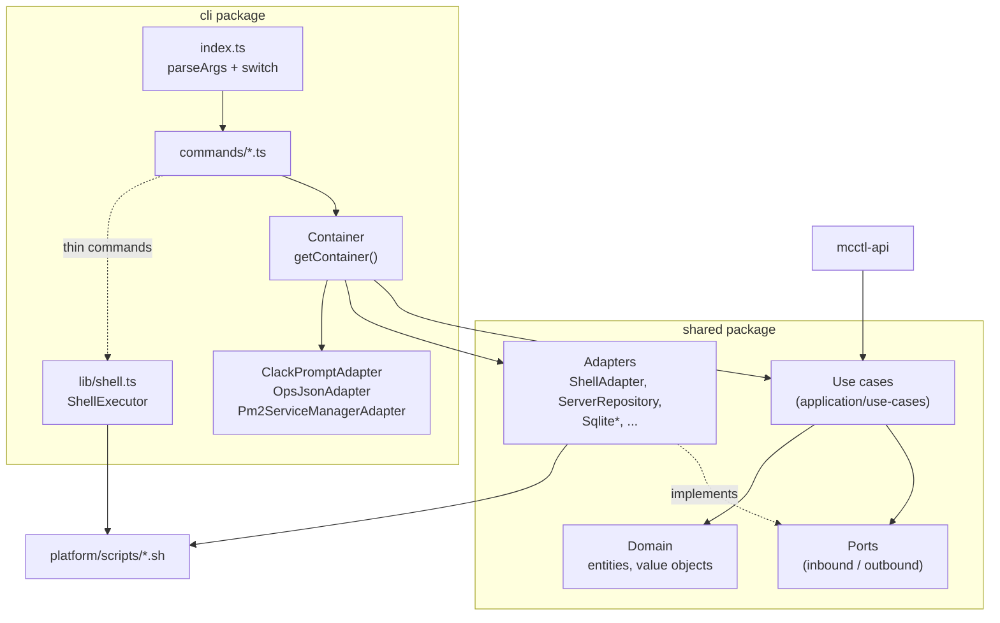

# CLI Architecture

This document describes how the `@minecraft-docker/mcctl` CLI is organized and how to extend it. The CLI follows **Hexagonal Architecture** (Ports & Adapters) with **Clean Architecture** layering, but the domain model, ports, use cases and most adapters live in the shared package, not in the CLI package.

## Package Layout

Three packages matter here:

| Package | Path | Contents |
|---------|------|----------|
| `@minecraft-docker/mcctl` | `platform/services/cli/` | Entry point, command handlers, DI container, CLI-only adapters |
| `@minecraft-docker/shared` | `platform/services/shared/` | Domain, ports, use cases, most adapters. Used by the CLI **and** `mcctl-api` |
| `@minecraft-docker/mod-source-modrinth` | `platform/services/mod-source-modrinth/` | Modrinth implementation of `IModSourcePort` |

### CLI (`platform/services/cli/src/`)

| Path | Role |
|------|------|
| `index.ts` | Entry point. Own `parseArgs()` and one large `switch (command)` |
| `commands/` | Command handlers (`create.ts`, `world.ts`, `mod.ts`, ...). Subdirectories `config-snapshot/` and `console/` hold grouped commands |
| `lib/` | Helpers: `shell.ts` (`ShellExecutor`), `rcon.ts`, `console-db.ts`, `pm2-utils.ts`, `prompts/` |
| `infrastructure/adapters/` | CLI-only adapters: `ClackPromptAdapter`, `OpsJsonAdapter`, `Pm2ServiceManagerAdapter` |
| `infrastructure/di/container.ts` | Dependency injection container |
| `domain/index.ts`, `application/index.ts` | Only re-export `@minecraft-docker/shared` |

### Shared (`platform/services/shared/src/`)

| Path | Role |
|------|------|
| `domain/value-objects/`, `domain/entities/`, `domain/mod/` | Domain model |
| `application/ports/inbound/` | Use case interfaces (`ICreateServerUseCase`, `IConfigSnapshotUseCase`, ...) |
| `application/ports/outbound/` | Infrastructure interfaces (`IShellPort`, `IServerRepository`, `IPromptPort`, `IDocProvider`, `IModSourcePort`, ...) |
| `application/use-cases/` | Use case implementations |
| `infrastructure/adapters/` | `ShellAdapter`, `ServerRepository`, `WorldRepository`, `DocsAdapter`, `ApiPromptAdapter`, `Sqlite*Repository`, `RconCliAdapter`, ... |
| `infrastructure/config/`, `infrastructure/factories/` | `Pm2EcosystemConfig`, `ModSourceFactory` |
| `docker/`, `prerequisite/`, `types/`, `utils/` | Docker helpers, prerequisite checks, shared types and utilities |

## Architecture Diagram



## Two Kinds of Commands

Be aware of both styles when reading or adding code:

- **Use case commands** contain business logic. The handler gets the container, calls a use case from `shared`, and formats the result. Examples: `create`, `delete`, `config-snapshot`, `backup-schedule`, `world`, `mod`.
- **Thin commands** are pass-throughs. They call bash scripts (`mcctl.sh` and friends) through `ShellExecutor`, or run RCON through `docker exec <container> rcon-cli` (`lib/rcon.ts`). Examples: `start`, `stop`, `logs`, `console <server>` (RCON console), `router`, `exec`. The `console init/service/user/api/remove` subcommands are separate; see below.

New business logic belongs in a shared use case, not in a file under `commands/`. A command file should parse options, call the use case and print output.

## Domain Layer

Lives in `platform/services/shared/src/domain/`.

**Value objects** (immutable, validated in a static `create()`):

| Class | Rule |
|-------|------|
| `ServerName` | 2-32 characters, lowercase, must start with a letter, hyphens allowed but not consecutive. Exposes `containerName` (`mc-<name>`) and `hostname` |
| `ServerType` | Wraps `ServerTypeEnum`: PAPER, VANILLA, FORGE, NEOFORGE, FABRIC, SPIGOT, BUKKIT, PURPUR, QUILT, LEAF, FOLIA, PUFFERFISH, MODRINTH, AUTO_CURSEFORGE |
| `McVersion` | Minecraft version |
| `Memory` | JVM memory such as `4G` or `2048M` |
| `WorldOptions`, `ModpackOptions` | World and modpack setup |

Other value objects cover cron expressions, snapshot diffs, roles, player data and so on. See `domain/value-objects/`.

**Entities** include `Server`, `World`, `ConfigSnapshot`, `BackupSchedule`, `Player`, `PlayerSession`, `User` and `AuditLog`. See `domain/entities/`.

## Ports and Use Cases

**Inbound ports** (`application/ports/inbound/`) are use case interfaces. Older, interactive use cases expose two entry points:

| Interface | Methods |
|-----------|---------|
| `ICreateServerUseCase` | `execute()` (prompts) / `executeWithConfig(config)` |
| `IDeleteServerUseCase` | `execute()` (prompts) / `executeWithName(name)` |
| `IServerStatusUseCase` | `execute()` / `executeForServer(name)` |

Newer use cases (config snapshots, backup schedules, player management, ...) have plain CRUD-style methods and no interactive mode:

```typescript
// shared/src/application/ports/inbound/IConfigSnapshotUseCase.ts
export interface IConfigSnapshotUseCase {
  create(serverName: string, description?: string, scheduleId?: string): Promise<ConfigSnapshot>;
  list(serverName?: string, limit?: number, offset?: number): Promise<ConfigSnapshot[]>;
  findById(id: string): Promise<ConfigSnapshot | null>;
  diff(snapshotId1: string, snapshotId2: string): Promise<SnapshotDiff>;
  restore(snapshotId: string, force?: boolean): Promise<void>;
  count(serverName?: string): Promise<number>;
  delete(id: string): Promise<void>;
}
```

**Outbound ports** (`application/ports/outbound/`) include `IPromptPort`, `IShellPort`, `IServerRepository`, `IWorldRepository`, `IDocProvider`, `IAuditLogPort`, `IRconPort`, `IModSourcePort`, `IServiceManagerPort` and the snapshot/backup repositories. Note that `IPromptPort` and `IDocProvider` are outbound ports.

## Adapters

| Port | Adapter | Package |
|------|---------|---------|
| `IPromptPort` | `ClackPromptAdapter` (@clack/prompts) | cli |
| `IPromptPort` | `ApiPromptAdapter` (non-interactive, used by `mcctl-api`) | shared |
| `IShellPort` | `ShellAdapter` | shared |
| `IServerRepository` | `ServerRepository` (filesystem, via `Paths`) | shared |
| `IWorldRepository` | `WorldRepository` | shared |
| `IDocProvider` | `DocsAdapter` | shared |
| `IAuditLogPort`, backup/snapshot repositories | `Sqlite*Repository` (better-sqlite3) | shared |
| `IServiceManagerPort` | `Pm2ServiceManagerAdapter` | cli |
| `IModSourcePort` | `ModrinthAdapter` | mod-source-modrinth |

## Dependency Injection

`cli/src/infrastructure/di/container.ts` defines `class Container` with lazily created singletons exposed as typed getters. There is no string-keyed `resolve()`.

```typescript
const container = getContainer(options.root);   // ContainerOptions | rootDir string
const useCase = container.configSnapshotUseCase; // created on first access
```

Available getters include `promptPort`, `shellPort`, `serverRepository`, `worldRepository`, `docProvider`, `auditLogPort`, `modSourcePort`, `createServerUseCase`, `deleteServerUseCase`, `worldManagementUseCase`, `backupUseCase`, `playerLookupUseCase`, `backupScheduleUseCase`, `configSnapshotUseCase` and `configSnapshotScheduleUseCase`.

Related helpers:

- `getContainer(options?)` returns a process-wide `Container`.
- `Container.create(options?)` builds a fresh one.
- `Container.createWithAdapters(...)` injects custom adapters (tests).
- `resetContainer()` drops the global instance (tests).

## Adding a New Command

Commands are registered by hand in `cli/src/index.ts`. The CLI does not use commander for this (commander is only used by `console user` and `console api`).

1. Write `cli/src/commands/<name>.ts` exporting `<name>Command(options): Promise<number>` that returns an exit code.
2. Re-export it from `cli/src/commands/index.ts`.
3. Import it in `cli/src/index.ts`.
4. Add a `case '<name>':` to the `switch (command)` block.
5. If it has subcommands, add the command name to the list in `parseArgs()` that sets `result.subCommand`. Add any value-less flags to `booleanOnlyFlags`.
6. Add help text to `printUsage()`.

If the command needs business logic, first add it in shared:

1. Add the port interface under `application/ports/inbound/` (and outbound ports or adapters if new I/O is needed).
2. Implement it in `application/use-cases/`.
3. Export both from `shared/src/index.ts`.
4. Add a getter in `cli/src/infrastructure/di/container.ts`.

### Worked Example: `config-snapshot`

| Piece | File |
|-------|------|
| Use case | `shared/src/application/use-cases/ConfigSnapshotUseCase.ts` |
| Handlers | `cli/src/commands/config-snapshot/{list,create,show,diff,restore,delete}.ts` and `schedule/` |
| Container getter | `configSnapshotUseCase` in `container.ts` |
| Test | `cli/tests/commands/config-snapshot.test.ts` |

A handler is small: build the container, call the use case, print.

```typescript
// cli/src/commands/config-snapshot/list.ts
export async function configSnapshotListCommand(
  options: ConfigSnapshotListOptions
): Promise<number> {
  const container = getContainer(options.root);
  const useCase = container.configSnapshotUseCase;
  const limit = options.limit ?? 20;

  try {
    const snapshots = await useCase.list(options.serverName, limit, options.offset);
    if (options.json) {
      console.log(JSON.stringify(snapshots.map((s) => s.toJSON()), null, 2));
      return 0;
    }
    // ... format and print
    return 0;
  } catch (error) {
    // log error
    return 1;
  }
}
```

Dispatch in `cli/src/index.ts`:

```typescript
case 'config-snapshot': {
  const csAction = subCommand;
  if (csAction === 'schedule') {
    const scheduleAction = positional[0];
    switch (scheduleAction) {
      case 'list':
        exitCode = await configSnapshotScheduleListCommand({
          root: rootDir,
          serverName: flags['server'] as string | undefined,
          json: flags['json'] === true,
        });
        break;
      // add, remove, enable, disable ...
    }
    break;
  }
  // list, create, show, diff, restore, delete ...
}
```

## Prompts

`IPromptPort` provides generic prompts (`text`, `confirm`, `password`), domain prompts (`promptServerName`, `promptServerType`, `promptMcVersion`, `promptMemory`, `promptWorldOptions`, `promptServerSelection`, ...), output helpers (`intro`, `outro`, `success`, `error`, `warn`, `info`, `note`), `spinner()` and cancellation helpers.

```typescript
const name = await this.prompt.promptServerName();   // returns a ServerName
if (this.prompt.isCancel(value)) {
  this.prompt.handleCancel();                         // never returns
}
const spin = this.prompt.spinner();
```

To add a prompt:

- Domain prompt used by a use case: add a `promptXxx()` method to `IPromptPort`, implement it in `ClackPromptAdapter` **and** `ApiPromptAdapter`, and add it to `MockPromptAdapter`.
- Standalone prompt used directly by a command (server select, player select, ...): add a file under `cli/src/lib/prompts/` and export it from its `index.ts`.

## Mod Sources

`IModSourcePort` has `sourceName`, `displayName`, `search()`, `getProject()`, `getVersions()`, `isAvailable()`, `getEnvKey()`, `formatForEnv()`, plus two optional methods: `getProjects?()` and `getModpackClientOnlyMods?()`.

Essential model fields (`shared/src/domain/mod/`):

- `ModProject`: `slug`, `title`, `description`, `downloads`, `iconUrl`, `projectType`, `serverSide`, `clientSide`, `categories`, `author`, `license`, `sourceId`, `sourceName`.
- `ModVersion`: version identity plus `versionType`, `downloads`, `datePublished`, optional `changelog`.

`ModSourceFactory` (`shared/src/infrastructure/factories/ModSourceFactory.ts`) is a static registry: `register` (throws on duplicate), `get` (throws if unknown), `getOrNull`, `isSupported`, `getSupportedSources`, `getAllAdapters`, `getDefaultSource`, `clear`.

`ModrinthAdapter` takes `ModrinthApiClient` and `ModrinthMapper` through its constructor, with defaults, and registers an instance on import (also exported as `modrinthAdapter`). The CLI command `cli/src/commands/mod.ts` resolves sources with `ModSourceFactory.getOrNull(source)`, while the container creates `new ModrinthAdapter()` for `modSourcePort`.

To add a source: create a package that implements `IModSourcePort`, call `ModSourceFactory.register()` from its `index.ts`, and import the package where it should be active.

## How the CLI Relates to the Other Packages

- The CLI does **not** call `mcctl-api` over HTTP. Both consume the same shared use cases.
- `mcctl console ...` manages `mcctl-api` and `mcctl-console` as PM2 processes through `Pm2ServiceManagerAdapter` and `shared/src/infrastructure/config/Pm2EcosystemConfig.ts`.
- `mcctl console user` writes the console SQLite database directly (`cli/src/lib/console-db.ts`).
- SQLite stores (better-sqlite3), relative to the platform root: `data/audit.db`, `backups/meta/backup-schedules.db`, `backups/meta/config-snapshots.db`.
- Bash scripts live in `platform/scripts/` and are copied into the CLI package at publish time by the `sync-scripts` npm script (run from `prepublishOnly`).
- Some subsystems are only used by `mcctl-api`: BlueMap rendering, world analysis, player sessions and the RCON adapter (`RconCliAdapter`).

## Testing

The CLI uses **vitest**. Layout under `platform/services/cli/tests/`:

| Directory | Purpose |
|-----------|---------|
| `unit/` | Domain, lib, infrastructure and command unit tests |
| `integration/` | Use cases wired with mocks |
| `commands/` | Command handlers with a mocked container |
| `e2e/` | `cli-*.test.ts` spawn `node dist/index.js` via `tests/e2e/helpers.ts` (`runCli`) |
| `mocks/` | `MockPromptAdapter`, `MockShellAdapter`, `MockServerRepository`, `MockWorldRepository` |

Shared package tests are flat files in `platform/services/shared/tests/*.test.ts`.

```bash
pnpm --filter @minecraft-docker/mcctl test              # all
pnpm --filter @minecraft-docker/mcctl test:unit
pnpm --filter @minecraft-docker/mcctl test:integration
pnpm --filter @minecraft-docker/mcctl test:e2e          # needs a build (dist/)
```

Older tests use `node:assert`; newer ones use vitest `expect` and `vi.mock()`. Use `expect` in new tests.

Use case integration test (construct the use case directly with mocks; `MockShellAdapter.wasCommandCalled()` matches the exact command string):

```typescript
const prompt = new MockPromptAdapter({ /* scripted answers */ });
const shell = new MockShellAdapter();
const repo = new MockServerRepository();
const useCase = new CreateServerUseCase(prompt, shell, repo);
```

Command test with a mocked container (see `cli/tests/commands/config-snapshot.test.ts`):

```typescript
vi.mock('../../src/infrastructure/di/container.js');
vi.mocked(getContainer).mockReturnValue({
  configSnapshotUseCase: mockUseCase,
} as never);
```

`Container.createWithAdapters(prompt, shell, serverRepo, worldRepo)` builds a container from mocks when you need a real `Container`. Reset any global container between tests with `resetContainer()`.

## See Also

- [Development Index](index.md)
- [Agent Collaboration](agent-collaboration.md)
- [Git Workflow](git-workflow.md)
- [CLI Commands Reference](../cli/commands.md)
